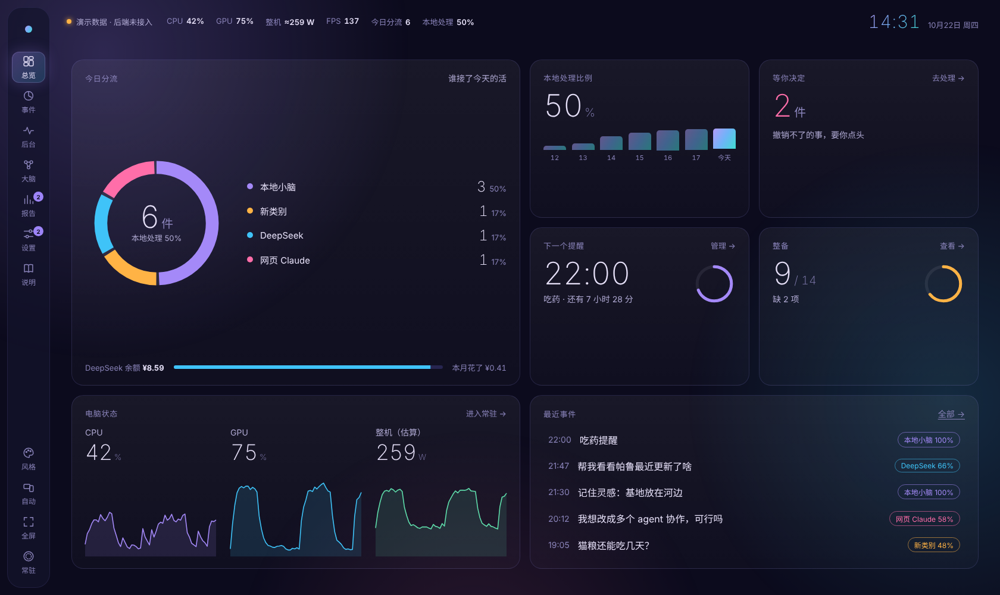
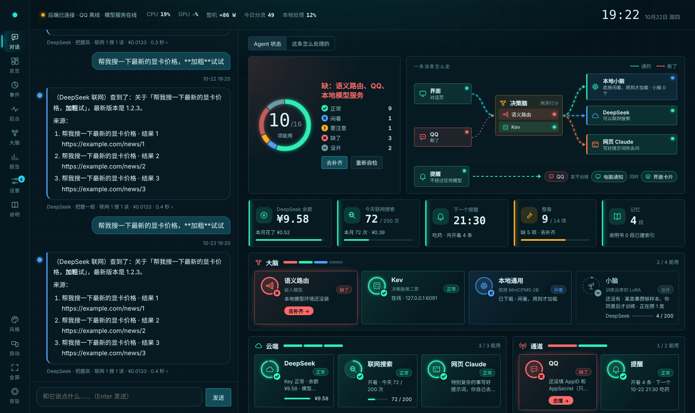
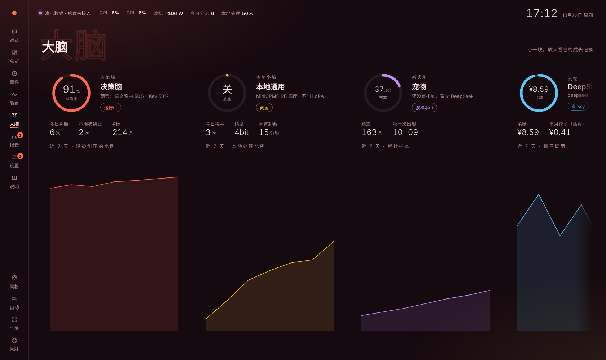

# Experiment Agent One · 自己的 Agent

一个跑在自己 Windows 电脑上的私人 AI 管家。

一个小模型当"决策脑"，每来一件事，先判断该交给谁做：
- 交给**本地小模型**；
- 交给 **DeepSeek**；
- 特别复杂的事，写好提示词，让你自己去问**更强的模型**（网页 Claude、ChatGPT 等，名字能改；不想用就关掉，交给 DeepSeek）。

决策脑判完，你还能"换它重做"：指定交给本地 / DeepSeek / 更强的模型，再处理一遍。

交给 DeepSeek 的事，它可以自己**联网搜索**、读网页（DeepSeek 自研搜索引擎），回答带来源。

除此之外，它还能：
- 用 **QQ** 收发消息、准时提醒；
- 记东西，每天自己整理一次；
- 把每一步怎么判、怎么做都留下证据，界面上能点开看。

> 这是一个个人项目，作者自己每天在用，边用边改。界面和文档都是中文。目前只支持 **Windows 10/11 + NVIDIA 显卡**。

## 它是怎么想的

- **能在本地做的就在本地做。**
  - 涉及隐私的事绝不出本机。判断过两道关：一道是写死的关键词名单，另一道是决策脑；任何一道认为是隐私，就只在本地处理。
  - 游戏、画图要显存时，本地模型自动从显存里让出来，空了再装回去。
- **决策脑两票打分：**
  - 语义路由：跟以前判对的例子比，像不像。
  - [Kev](https://github.com/jaredpalmer/kev)：一个按说明做选择题的小决策模型。
  - 判错了在界面上纠正一下，纠正立刻变成新判例。
- **慢成长：**
  - 某一类事攒够了样本，就先问你要不要为它训练一个专门的"小脑"（LoRA）。
  - 你同意了才练，不偷偷占显卡。
- **提醒不依赖任何模型。** 吃药、起床这类提醒由程序直接发，模型没装好、显卡被占满也照样准时。
  - 送达分三层：先发 QQ；QQ 发不出去就弹电脑通知；同时在界面上挂一张卡片，直到你确认。
- **安全线写死在代码里：**
  - 先斩后奏、事后可以一键撤销的：新建小脑、改记忆、改提醒。
  - 必须先问你的：删文件、加新权限、花钱、把隐私内容发出本机。
  - 每个动作都记进带哈希链的日志，事后改不了。
- **Claude 的内容只当参考，不进任何训练数据。** Anthropic 的用户条款不允许用 Claude 的输出训练模型，这条也写死在代码里。
- **所有东西都在一个文件夹里。** 模型、环境、缓存都下到 Agent 文件夹，不往 C 盘用户目录写。删掉文件夹就干净了。

## 它能做什么

**和它说话**
- 在界面「对话」页或者 QQ 里发，两边走同一条路，QQ 上的对话也出现在对话页。
- 每条回复下面一行小字：交给谁、把握高不高、联网查了几次、花了多少钱。点开就是「这条怎么处理的」：分数、为什么这么判、每一步、查过的网页。
- 判错了当场纠正（以后照这个判），或者「换它重做」：指定交给本地 / DeepSeek / 更强的模型再做一遍。涉及隐私的事要换到云端，得再确认一次才发出本机。

**几句话不经过模型，程序直接办**

| 你说 | 它怎么做 |
| --- | --- |
| "每天晚上十点提醒我吃药"、"半小时后提醒我收衣服" | 直接建提醒 |
| 提醒来了回"吃了"、"晚点"、"20 分钟后" | 打卡，或者顺延 |
| "记住……" | 写进记忆收件箱，每日差事再整理进长期记忆，能撤销 |
| "帕鲁最近更新了什么"、"显卡现在多少钱" | 交 DeepSeek 联网搜、读几个网页再答，末尾带来源 |
| "免打扰在哪设置"、"你能做什么" | 先查自己的说明书，告诉你在界面哪里点 |

**三条路**
- **本地小模型**：MiniCPM5-2B 当底座，以后每类事一个 LoRA 小脑。只用显卡，不偷用 CPU。
- **DeepSeek**：一般难题和长对话；带 DeepSeek 自研的搜索引擎，要不要搜它自己定，隐私的事不搜，每天有上限。余额从官方查，花费本机估算。
- **更强的模型**：特别难的事（架构、长期规划、深度研究），写好提示词让你自己带去问网页 Claude、ChatGPT、Kimi……带回来的总结在「大脑」页导入，只当参考资料。这条路可以改名，也可以不要。

**提醒和 QQ**
- QQ 官方机器人，只回复绑定的那个 QQ。
- 提醒送达分三层：先发 QQ；发不出去就弹电脑通知；同时在界面挂一张卡片，直到你确认。没确认过 30 分钟再提醒。
- 免打扰：只发提醒，别的主动消息先攒着，关掉后一起发。

**记忆、每日差事和成长**
- 记忆是一个文件夹里的 Markdown 文件，git 记下每次改动，能放进 Obsidian 库。
- 每日差事不按钟点：电脑开着、你一阵子没找它时跑一次，整理记忆、给新类别分组起名、造训练样本、写周报草稿。
- 某类事攒够样本，先在 QQ 和界面上问你要不要训练，你说"开始"才练。

**显存让路**
- 游戏、画图要显存时，本地模型自动从显存里让出来：先卸底座和 Kev，还不够再卸嵌入模型；认出你在玩游戏也先让。
- 显存空出来几分钟后自动装回去。让路期间不涉及隐私的事交 DeepSeek，涉及隐私的排队，显卡空了再处理、通过 QQ 回你。
- 给别的程序留多少显存、空出来多久再装回去，都能在设置里改。

**硬件监控和游戏内显示**
- CPU、显卡的占用、频率、温度、功耗，显存、内存、硬盘温度（有几块列几块，带盘符），整机功耗（估算）。占用和频率和任务管理器同一套算法，录屏时视频编码占满也会标出来。
- 游戏帧数和 1% 低帧：听 Windows 的 ETW 事件（PresentMon 的办法），不注入游戏，支持 DirectX 10/11/12。
- 游戏内显示：像游戏加加那样在游戏画面上浮一个小框，鼠标点得穿、不抢焦点。显示哪几项、竖排还是横排、放哪个角或顶部居中、哪块屏幕都能选；快捷键藏起来。把别的程序认成游戏了，点「这不是游戏」。
- CPU 温度、功耗要装一次 [PawnIO](https://pawnio.eu) 驱动（任务管理器里也没有这两项）；硬件监控助手在设置里一键打开，第一次弹一次管理员确认，以后跟着 Agent 一起起。

**装好、跑稳**
- **整备**：14 项"能不能在这台电脑上跑起来"的检查，每次启动自动查，好了的直接打勾。
- **一键补齐**：Git、本地模型环境、底座和嵌入模型、模型服务、Kev 权重、硬件监控助手，按顺序装好（约 11GB）。测速选最快的源、分段下载、断点续传；某步失败让 DeepSeek 看日志，从固定的几种修法里选一个。
- **后台**：正在跑的任务和进度，每个部分好不好，「进展报告」把每一步写成人话。
- 没有黑窗口；关掉窗口后提醒和 QQ 照常；可以开机自启。

## 界面

| 页面 | 看什么、做什么 |
| --- | --- |
| 对话 | 一打开就是它。左边窄栏只放你和它的一来一回；右边是 Agent 状态仪表盘：健康环、"一条消息怎么走"的链路图（通的线在流动，断了是红虚线）、余额和今日联网这些大数字，每个部分一张带图标的卡片，缺了直接给按钮 |
| 总览 | 今天分流了多少、Agent 状态、等你决定的事、下一个提醒、电脑状态、最近事件 |
| 事件 | 每件事的完整记录：四个去向各几分、为什么这么判、每一步，能纠正 |
| 后台 | 任务进度、各部分状态、进展报告和原始日志 |
| 大脑 | 本地小脑、新类别、DeepSeek、更强的模型四块，各自的成长记录；导入更强的模型带回的总结 |
| 报告 | 这周的分流、本地比例、被纠正几次、花了多少钱；先斩后奏的改动（能撤销）；等你决定的事 |
| 设置 | 14 个分区：整备、提醒、本地模型、云端、QQ 通道、记忆与文件、分流旋钮、成长与训练、安全线、硬件监控、游戏内显示、外观、自动化、数据 |
| 说明 | `docs/` 里的文档。每个功能一张能点开收起的树状图，QQ、模型服务这些节点按实时状态亮灯；能切到文字版 |
| 常驻屏 | 闲下来自动进入（或者点侧栏「常驻」）：大时钟、下一个提醒、硬件读数，玩游戏时有帧数 |

"一眼看"的页（对话页的 Agent 状态、总览、常驻屏）一屏放下，不用滚轮翻；横屏、竖屏都能用，两块屏幕缩放不一样也没问题。无边框窗口，支持 Windows 的贴靠和半屏。

三套风格不只是配色不同，滚动方式和手感也不一样：

| 风格 | 手感 |
| --- | --- |
| 星云 | 漂浮：滚轮带惯性，视差，卡片从模糊里浮上来，跟着鼠标微微倾斜 |
| 深海 | 精确：标题吸顶，滚动进度线，停下时对齐到卡片，悬停出现瞄准框 |
| 绛焰 | 杂志：卡片排成横条左右翻，揭幕式出场，标题后面有一行巨大的背景字，数字会跳动，按钮会被鼠标吸过去 |

## 现在做到哪

上面写的都已经能用。**还没做：**
- 小脑训练本身（样本在攒，"先问你"这一步已经做好）
- 自动生成技能
- 标准 MCP 工具层
- 语音

逐条的对照见 [架构 · 总览](docs/AI文档/架构/00-总览.md) 最后一节，每一版改了什么见 [更新记录](docs/更新记录.md)。

## 安装

1. 装 **Python 3.12**，安装第一页勾选 *Add python.exe to PATH*。NVIDIA 驱动装好就行。
2. 下载这个仓库：Code → Download ZIP。解压到一个路径里没有空格的地方，比如 `D:\Agent`。
3. 双击 **`启动.bat`**。第一次会装依赖，大约 1 分钟，装完自动打开界面。
4. 在 设置 › 云端 填 **DeepSeek Key**。
5. 在 设置 › 整备 点 **「一键补齐」**。一共下载约 11GB，可以关掉界面，它在后台接着装。
6. （可选）在 设置 › QQ 通道 填 QQ 机器人的 AppID 和 AppSecret（在 QQ 开放平台申请），然后在 整备 里绑定你的 QQ。
7. （可选）要看 CPU 温度和游戏帧数：设置 › 硬件监控 打开助手；CPU 温度、功耗还要装一次 PawnIO 驱动，装完重启电脑。
8. （可选）双击 `开机自启.bat`，以后登录 Windows 自动启动。

以后每次启动会自动查一遍哪些已经装好，不用再点一键补齐。更新到新版本：新压缩包解压到原来的文件夹，选「替换」。

详细步骤见 [操作手册](docs/操作手册.md)。

## 文档

| 文档 | 讲什么 |
| --- | --- |
| [操作手册](docs/操作手册.md) | 怎么装、每天怎么用、出问题看哪里 |
| [架构 · 总览](docs/AI文档/架构/00-总览.md) | 整体怎么搭的、一条消息怎么走、代码地图 |
| [docs/AI文档/架构/](docs/AI文档/架构/) | 每个功能各一篇，开头一张结构图（GitHub 上直接显示），后面是文字说明 |
| [当前结构](docs/AI文档/当前结构.md) | 后端每次启动按代码自动重写：模块、接口、设置项、端口 |
| [更新记录](docs/更新记录.md) | 每一版改了什么 |
| [开发说明](dev/README.md) | 怎么跑测试、怎么接着开发 |

## 借鉴和致谢

这个项目是站在很多开源项目的肩膀上拼起来的：

- **[Kev](https://github.com/jaredpalmer/kev)**（Jared Palmer，Apache-2.0）：决策脑的第二票。源码原样放在 `kev/`，许可证一起保留。
- **[Hermes Agent](https://github.com/NousResearch/hermes-agent)**（Nous Research）：技能库、越用越会的思路。
- **[PresentMon](https://github.com/GameTechDev/PresentMon)**（Intel）：用 ETW 事件读游戏帧数的办法。
- **[LibreHardwareMonitor](https://github.com/LibreHardwareMonitor/LibreHardwareMonitor)**：CPU、硬盘的温度和功耗传感器。
- **[CC Switch](https://github.com/farion1231/cc-switch)**："获取模型列表 → 下拉选择"的设计。
- **模型**：[MiniCPM](https://github.com/OpenBMB/MiniCPM)（OpenBMB）当底座，[Qwen3-Embedding](https://github.com/QwenLM/Qwen3-Embedding)（通义千问）做嵌入。模型文件由一键补齐从魔搭下载，不在仓库里，各自遵守原许可。
- **库**：
  - 后端：FastAPI、Uvicorn、HTTPX、websockets、psutil、NumPy、nvidia-ml-py、pywebview、pythonnet、pywintrace
  - 本地模型：PyTorch、Transformers、PEFT、Accelerate、bitsandbytes
- 代码和文档大部分是作者和 **Claude**（Anthropic）一起写的。

## 许可

[MIT](LICENSE)。`kev/` 目录是 Apache-2.0，保留原作者的许可证。

有想法、建议、发现了问题，欢迎提 Issue。
