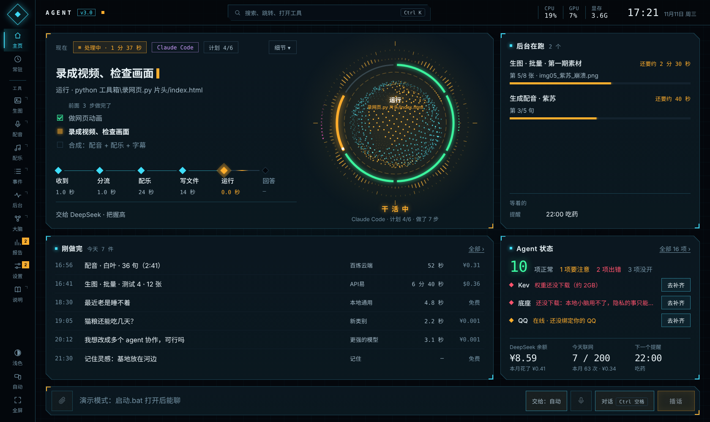
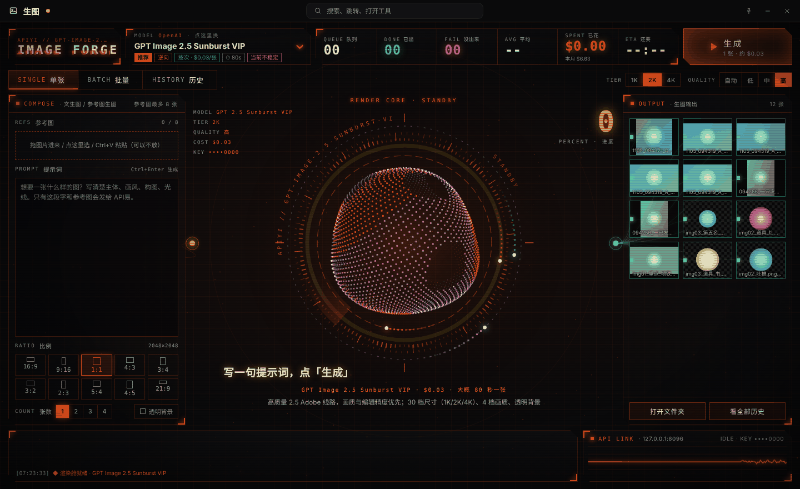

# Experiment Agent One · 自己的 Agent

一个跑在自己 Windows 电脑上的私人 AI 管家。

一个小模型当"决策脑"，每来一件事，先判断该交给谁做：
- 交给**本地小模型**；
- 交给 **DeepSeek**；
- 特别复杂的事，写好提示词，让你自己去问**更强的模型**（网页 Claude、ChatGPT 等，名字能改；不想用就关掉，交给 DeepSeek）。

决策脑判完，你还能"换它重做"：指定交给本地 / DeepSeek / 更强的模型，再处理一遍。

交给 DeepSeek 的事，它可以自己**联网搜索**、读网页（DeepSeek 自研搜索引擎），回答带来源。

除此之外，它还能：
- 用 **QQ** 收发消息、准时提醒；
- 记东西，每天自己整理一次；
- 把每一步怎么判、怎么做都留下证据，界面上能点开看。

> 这是一个个人项目，作者自己每天在用，边用边改。界面和文档都是中文。目前只支持 **Windows 10/11 + NVIDIA 显卡**。

## 它是怎么想的

- **能在本地做的就在本地做。**
  - 涉及隐私的事绝不出本机。判断过两道关：一道是写死的关键词名单，另一道是决策脑；任何一道认为是隐私，就只在本地处理。
  - 游戏、画图要显存时，本地模型自动从显存里让出来，空了再装回去。
- **决策脑两票打分：**
  - 语义路由：跟以前判对的例子比，像不像。
  - [Kev](https://github.com/jaredpalmer/kev)：一个按说明做选择题的小决策模型。
  - 判错了在界面上纠正一下，纠正立刻变成新判例。
- **慢成长：**
  - 某一类事攒够了样本，就先问你要不要为它训练一个专门的"小脑"（LoRA）。
  - 你同意了才练，不偷偷占显卡。
- **提醒不依赖任何模型。** 吃药、起床这类提醒由程序直接发，模型没装好、显卡被占满也照样准时。
  - 送达分三层：先发 QQ；QQ 发不出去就弹电脑通知；同时在界面上挂一张卡片，直到你确认。
- **安全线写死在代码里：**
  - 先斩后奏、事后可以一键撤销的：新建小脑、改记忆、改提醒。
  - 必须先问你的：删文件、加新权限、花钱、把隐私内容发出本机。
  - 每个动作都记进带哈希链的日志，事后改不了。
- **Claude 的内容只当参考，不进任何训练数据。** Anthropic 的用户条款不允许用 Claude 的输出训练模型，这条也写死在代码里。
- **所有东西都在一个文件夹里。** 模型、环境、缓存都下到 Agent 文件夹，不往 C 盘用户目录写。删掉文件夹就干净了。

## 它能做什么

**和它说话**
- 在主页最下面的对话（Ctrl 空格展开）或者 QQ 里发，两边走同一条路，QQ 上的对话也出现在这里。处理到哪一步，主页「现在」那块大字写着（正在联网搜索……），下面一条进度，每步几秒。
- 每条回复下面一行小字：交给谁、把握高不高、联网查了几次、花了多少钱。点开就是「细节」：分数、为什么这么判、每一步、查过的网页。
- 判错了当场纠正（以后照这个判），或者「换它重做」：指定交给本地 / DeepSeek / 更强的模型再做一遍。涉及隐私的事要换到云端，得再确认一次才发出本机。

**几句话不经过模型，程序直接办**

| 你说 | 它怎么做 |
| --- | --- |
| "每天晚上十点提醒我吃药"、"半小时后提醒我收衣服" | 直接建提醒 |
| 提醒来了回"吃了"、"晚点"、"20 分钟后" | 打卡，或者顺延 |
| "记住……" | 写进记忆收件箱，每日差事再整理进长期记忆，能撤销 |
| "帕鲁最近更新了什么"、"显卡现在多少钱" | 交 DeepSeek 联网搜、读几个网页再答，末尾带来源 |
| "免打扰在哪设置"、"你能做什么" | 先查自己的说明书，告诉你在界面哪里点 |

**三条路**
- **本地小模型**：MiniCPM5-2B 当底座，以后每类事一个 LoRA 小脑。只用显卡，不偷用 CPU。
- **DeepSeek**：一般难题和长对话；带 DeepSeek 自研的搜索引擎，要不要搜它自己定，隐私的事不搜，每天有上限。余额从官方查，花费本机估算。
- **更强的模型**：特别难的事（架构、长期规划、深度研究），写好提示词让你自己带去问网页 Claude、ChatGPT、Kimi……带回来的总结在「大脑」页导入，只当参考资料。这条路可以改名，也可以不要。

**提醒和 QQ**
- QQ 官方机器人，只回复绑定的那个 QQ。
- 提醒送达分三层：先发 QQ；发不出去就弹电脑通知；同时在界面挂一张卡片，直到你确认。没确认过 30 分钟再提醒。
- 免打扰：只发提醒，别的主动消息先攒着，关掉后一起发。

**记忆、每日差事和成长**
- 记忆是一个文件夹里的 Markdown 文件，git 记下每次改动，能放进 Obsidian 库。
- 每日差事不按钟点：电脑开着、你一阵子没找它时跑一次，整理记忆、给新类别分组起名、造训练样本、写周报草稿。
- 某类事攒够样本，先在 QQ 和界面上问你要不要训练，你说"开始"才练。

**显存让路**
- 游戏、画图要显存时，本地模型自动从显存里让出来：先卸底座和 Kev，还不够再卸嵌入模型；认出你在玩游戏也先让。
- 显存空出来几分钟后自动装回去。让路期间不涉及隐私的事交 DeepSeek，涉及隐私的排队，显卡空了再处理、通过 QQ 回你。
- 给别的程序留多少显存、空出来多久再装回去，都能在设置里改。

**硬件监控和游戏内显示**
- CPU、显卡的占用、频率、温度、功耗，显存、内存、硬盘温度（有几块列几块，带盘符），整机功耗（估算）。占用和频率和任务管理器同一套算法，录屏时视频编码占满也会标出来。
- 游戏帧数和 1% 低帧：听 Windows 的 ETW 事件（PresentMon 的办法），不注入游戏，支持 DirectX 10/11/12。
- 游戏内显示：像游戏加加那样在游戏画面上浮一个小框，鼠标点得穿、不抢焦点。显示哪几项、竖排还是横排、放哪个角或顶部居中、哪块屏幕都能选；快捷键藏起来。把别的程序认成游戏了，点「这不是游戏」。
- CPU 温度、功耗要装一次 [PawnIO](https://pawnio.eu) 驱动（任务管理器里也没有这两项）；硬件监控助手在设置里一键打开，第一次弹一次管理员确认，以后跟着 Agent 一起起。

**配音（给视频念旁白）**
- 用阿里通义的 [Qwen3-TTS](https://github.com/QwenLM/Qwen3-TTS) 1.7B（Apache 2.0，可以商用），在本机生成、不联网。设置 › 本地模型 点「安装配音」，后台装好环境、从魔搭下模型。
- 贴文案 → 选预设音色（9 个，5 个中文，一句话控制语气）或写一段描述造一个音色 → 生成 → 当场试听 → 保存。
- 一段文案默认一次念完（语气前后连贯），自动停顿、拼成一个 WAV，同时出每句的时间轴（按音频里的停顿对齐，JSON 和 SRT），做视频时字幕和画面按它对齐。
- 描述音色的「描述 + 随机种子」能存成「我的音色」一键再用。用到才启动，闲置、玩游戏时关掉，显存全还回去。不接克隆，不克隆任何真人的声音。
- 也能换成**百炼云端**的千问 Qwen-Audio-3.1-TTS-Plus（声音更好，按字计费，不用显卡）：设置 › 云端 填百炼 Key（DPAPI 加密），4 个中文音色都能试听，生成前显示预估花费，输出的文件和本地一样。只把配音页的文案和语气发过去。
- 云端还能**自己造音色**：写一段描述做声音设计，或者拿自己的 / AI 生成的录音做声音复刻（不复刻别人的声音）；语速、音调、音量、读音词典（多音字）都能调。生成好的配音画成波形，点哪听哪。
- 时间轴（字幕）用本地的 [Qwen3-ForcedAligner](https://github.com/QwenLM/Qwen3-ASR) 0.6B 拿音频和原文对出每个字的时间，云端、本地都用；对不了的标红，装好以后点「重新对齐」，不用重新生成。

**看图、读文件（v1.8.17）**
- 对话里能发图片（回形针、Ctrl+V 粘贴、拖进来），交给 DeepSeek 看。
- 设置里加「能读的文件夹」（比如 Obsidian 笔记仓库，只读）：贴路径它就读，问「我笔记里 XX 怎么写的」它自己搜、自己读；每个文件夹能设成只给本地小脑看。Agent 自己的设置、密钥永远不读。

**自己的工作文件夹（v2.1）**
- Agent 文件夹里的「工作区」（能换到别的盘）：它在里面写、改、删、挪文件、运行程序（python、ffmpeg，工作区专用的 Python 环境）都不用问你，比如让 DeepSeek 写网页、写脚本、自己试着做视频。
- 改、删之前旧的先进「工作区备份」（能找回来），备份半年清一次、清之前出清单。工作区外面照旧只读；删文件的命令、系统命令、写了外面路径的命令会被拦下（不是真沙箱，设置里能关掉「能运行程序」）。

**能把一件事做到底（v3.0）**
- 先列计划、做一步勾一步，主页上看得到；正在做的时候能「停下」，想改方向直接说（插话），停了说「继续」接着做。一件事最多 120 步，花的钱有上限。
- 它在工作区里的本事：看图、看视频里的画面（做完视频自己检查）、看音视频信息、下载、自己配音、自己出配乐、自己生图（要花钱，默认关）。每样在 设置 › Agent 能力 里开关。
- 工具箱：网页动画一帧一帧录成视频、画面 + 配音 + 配乐 + 字幕合成、差分图跟着配音张嘴。技能：一类事的成套做法写成一份 Markdown，它用到时自己翻，你也能自己写。
- Claude Code 引擎（默认关）：打开后，工作区里的活交给你本机的 Claude Code 动手，过程照样显示在主页上，能停、能继续。
- 文件进出：对话里拖文件、拖整个文件夹；PDF、Excel 能读；做好的文件在回答下面出卡片；QQ 上发的图片和文件也收，做好的图片发回 QQ。

**和它说话（v3.0）**
- 点主页中间的核心开始说，说完停一下自动发，回答念出来。听写是本地的 Qwen3-ASR；出声用 Breeze TTS 2（只限自己用、非商用；代码跟着 Agent 一起发，权重在整备里一键下），没装好时用本地配音的预设音色顶着。

**配乐（v3.0）**
- 本地 ACE-Step 1.5 出纯音乐，不花钱。手动出，Agent 做视频时也自己用。v3.1 起在整备里一键装（官方 Windows 便携包），不用去 GitHub 下、不用填文件夹。

**批量配音、批量配乐（v3.1）**
- 跟生图的批量一样：一份清单，一段（一首）一个文件。配音清单每段能写自己的音色（双人对话按人分段），走和单段一样的时间轴对齐；配乐清单写名字、时长、描述。按清单里的名字存进 `配音输出` / `配乐输出` 的「日期_清单名」文件夹，能打包、放进工作区。

**生图（给视频出素材图）**
- 「生图」页是一个「渲染舱」：中间会转的点阵球核心，出图时粒子拼成画面、图回来了飞进右边格子。默认 API易（中转站）的 GPT Image 2.5 Sunburst VIP（按次 $0.03/张），右上角换模型（按厂商分好的列表，能用 Key 拉最新的；Nano Banana、Seedream、Flux 也能调）。
- 单张：文生图，或者放参考图照着出；批量：把视频窗口出的生图清单（Markdown）拖进来，按每条的比例、透明背景、提示词一张张出完，按清单里的文件名存进「生图输出」，能打包成 zip（放在那一批的文件夹里）；历史：出过的每一张，能再来一张、当参考图。设置 › 云端 填 API易 Key（DPAPI 加密），只发提示词和参考图。

**装好、跑稳**
- **整备**：14 项"能不能在这台电脑上跑起来"的检查，每次启动自动查，好了的直接打勾。
- **一键补齐**：Git、本地模型环境、底座和嵌入模型、模型服务、Kev 权重、硬件监控助手，按顺序装好（约 11GB）。下面第二张卡「配音、语音、配乐」：本地配音、听写、Breeze TTS 2、ACE-Step 1.5，一键装好，也能只装一项（v3.1）。测速选最快的源、分段下载、断点续传；某步失败让 DeepSeek 看日志，从固定的几种修法里选一个。
- **后台**：正在跑的任务和进度，每个部分好不好，「进展报告」把每一步写成人话。
- 没有黑窗口；关掉窗口后提醒和 QQ 照常；可以开机自启。

## 界面

v3.0 起是「指挥舱」的样子（深色、浅色两套）：切角面板、青色的线，干活时变琥珀色；主页中间一颗会动的核心，外面一圈是它的计划。最下面一条指令条一直在，直接打字、说话。主窗口只放主页和常驻屏，其余的工具都是左边的按钮，点了弹一个独立窗口（能置顶，各自记大小和位置）；Ctrl K 打开命令面板。

| 页面 | 看什么、做什么 |
| --- | --- |
| 主页 | 一打开就是它：中间的核心、最下面的指令条，和四块：**现在**在干什么（大字 + 计划清单 + 收到 → 分流 → 联网搜索 → 回答的进度，每步几秒，「细节」里看怎么分的）、**后台在跑**（生图、配音、安装的进度条）、**刚做完**、**Agent 状态**（几项正常，出问题的才列，卡住的能重启）；最下面一条是对话 |
| 事件 | 每件事的完整记录：四个去向各几分、为什么这么判、每一步，能纠正 |
| 后台 | 任务进度、各部分状态、进展报告和原始日志 |
| 大脑 | 本地小脑、新类别、DeepSeek、更强的模型四块，各自的成长记录；导入更强的模型带回的总结 |
| 报告 | 这周的分流、本地比例、被纠正几次、花了多少钱；先斩后奏的改动（能撤销）；等你决定的事 |
| 配音 | 贴文案、选音色、生成、试听、保存；时间轴一句一行，点哪句跳到哪句；「批量」一份清单一段一个文件 |
| 配乐 | 写一句描述、选多长，出一首纯音乐；历史里能听、能放进工作区；「批量」一份清单一首一个文件 |
| 生图 | 「渲染舱」：单张、批量（按生图清单出，每条能挂参考图）、差分（一张定稿图出闭嘴、张嘴、眨眼……）、历史 |
| 设置 | 17 个分区：整备、提醒、本地模型、云端、QQ 通道、Agent 能力、语音、配乐、记忆与文件、分流旋钮、成长与训练、安全线、硬件监控、游戏内显示、外观、自动化、数据 |
| 说明 | `docs/` 里的文档。每个功能一张能点开收起的树状图，QQ、模型服务这些节点按实时状态亮灯；能切到文字版 |
| 常驻屏 | 闲下来自动进入（或者点侧栏「常驻」）：大时钟、下一个提醒、硬件读数，玩游戏时有帧数；后台在装东西、下模型、生成配音、生图，或者正在处理一句话时，多几条进度条 |

"一眼看"的页（主页、常驻屏）一屏放下，不用滚轮翻；横屏、竖屏都能用，两块屏幕缩放不一样也没问题。无边框窗口，支持 Windows 的贴靠和半屏。

## 现在做到哪

上面写的都已经能用。**还没做：**
- 小脑训练本身（样本在攒，"先问你"这一步已经做好）
- 自动生成技能（技能现在是手写的 Markdown）
- 标准 MCP 工具层
- 手机端

逐条的对照见 [架构 · 总览](docs/AI文档/架构/00-总览.md) 最后一节，每一版改了什么见 [更新记录](docs/更新记录.md)。

## 安装

1. 装 **Python 3.12**，安装第一页勾选 *Add python.exe to PATH*。NVIDIA 驱动装好就行。
2. 下载这个仓库：Code → Download ZIP。解压到一个路径里没有空格的地方，比如 `D:\Agent`。
3. 双击 **`启动.bat`**。第一次会装依赖，大约 1 分钟，装完自动打开界面。
4. 在 设置 › 云端 填 **DeepSeek Key**。
5. 在 设置 › 整备 点 **「一键补齐」**。一共下载约 11GB，可以关掉界面，它在后台接着装。
6. （可选）在 设置 › QQ 通道 填 QQ 机器人的 AppID 和 AppSecret（在 QQ 开放平台申请），然后在 整备 里绑定你的 QQ。
7. （可选）要看 CPU 温度和游戏帧数：设置 › 硬件监控 打开助手；CPU 温度、功耗还要装一次 PawnIO 驱动，装完重启电脑。
8. （可选）在 设置 › 自动化 打开「开机自启」，以后登录 Windows 自动启动。
9. （可选）要配音：设置 › 本地模型 点「安装配音」（配音环境 + 两个配音模型 + 时间轴对齐模型，约 16GB，后台装），然后点侧栏「配音」。

以后每次启动会自动查一遍哪些已经装好，不用再点一键补齐。更新到新版本：新压缩包解压到原来的文件夹，选「替换」。

详细步骤见 [操作手册](docs/操作手册.md)。

## 文档

| 文档 | 讲什么 |
| --- | --- |
| [操作手册](docs/操作手册.md) | 怎么装、每天怎么用、出问题看哪里 |
| [架构 · 总览](docs/AI文档/架构/00-总览.md) | 整体怎么搭的、一条消息怎么走、代码地图 |
| [docs/AI文档/架构/](docs/AI文档/架构/) | 每个功能各一篇，开头一张结构图（GitHub 上直接显示），后面是文字说明 |
| [当前结构](docs/AI文档/当前结构.md) | 后端每次启动按代码自动重写：模块、接口、设置项、端口 |
| [更新记录](docs/更新记录.md) | 每一版改了什么 |
| [开发说明](dev/README.md) | 怎么跑测试、怎么接着开发 |

## 借鉴和致谢

这个项目是站在很多开源项目的肩膀上拼起来的：

- **[Kev](https://github.com/jaredpalmer/kev)**（Jared Palmer，Apache-2.0）：决策脑的第二票。源码原样放在 `kev/`，许可证一起保留。
- **[Hermes Agent](https://github.com/NousResearch/hermes-agent)**（Nous Research）：技能库、越用越会的思路。
- **[PresentMon](https://github.com/GameTechDev/PresentMon)**（Intel）：用 ETW 事件读游戏帧数的办法。
- **[LibreHardwareMonitor](https://github.com/LibreHardwareMonitor/LibreHardwareMonitor)**：CPU、硬盘的温度和功耗传感器。
- **[CC Switch](https://github.com/farion1231/cc-switch)**："获取模型列表 → 下拉选择"的设计。
- **模型**：[MiniCPM](https://github.com/OpenBMB/MiniCPM)（OpenBMB）当底座，[Qwen3-Embedding](https://github.com/QwenLM/Qwen3-Embedding)（通义千问）做嵌入，[Qwen3-TTS](https://github.com/QwenLM/Qwen3-TTS)（通义千问，Apache-2.0）配音，[Qwen3-ForcedAligner](https://github.com/QwenLM/Qwen3-ASR)（通义千问，Apache-2.0）对时间轴。模型文件由一键补齐、安装配音从魔搭下载，不在仓库里，各自遵守原许可。
- **库**：
  - 后端：FastAPI、Uvicorn、HTTPX、websockets、psutil、NumPy、nvidia-ml-py、pywebview、pythonnet、pywintrace
  - 本地模型：PyTorch、Transformers、PEFT、Accelerate、bitsandbytes
  - 配音：qwen-tts、qwen-asr（只用对齐器）、torchaudio、librosa、soundfile、ONNX Runtime
- 代码和文档大部分是作者和 **Claude**（Anthropic）一起写的。

## 许可

[MIT](LICENSE)。`kev/` 目录是 Apache-2.0，保留原作者的许可证。

有想法、建议、发现了问题，欢迎提 Issue。
