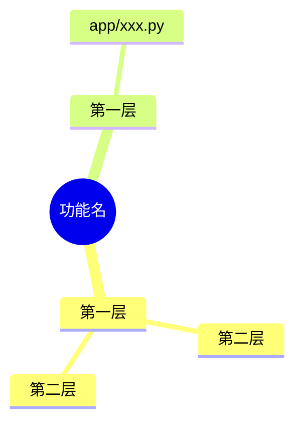

# AI文档 · 给 AI 看的说明

这个文件夹是 Agent 的架构说明文字版，读者是 AI：
- DeepSeek；
- 本地的大脑、小脑；
- 接手开发的 Claude。

人看的话，打开界面侧栏「说明」，那里把同一批文件画成了树状图。

| 文件 | 是什么 |
| --- | --- |
| `架构\00-总览.md` | 整体：哪几个程序、一条消息怎么走、代码地图、后台任务、数据存哪、和最终版比做到哪 |
| `架构\01…13-*.md` | 每个功能一篇：做什么、怎么走、设置、文件、限制 |
| `当前结构.md` | 后端每次启动按代码重写的事实清单：模块、接口、设置项、端口。和手写的说明冲突时，以它为准 |

## 每篇的格式

1. 标题：`# 架构 · 功能名`
2. `> 最后核对：v版本号。`
3. `## 结构图`：一段 mermaid mindmap。界面把它画成树状图，GitHub 也能直接显示。
4. 后面是文字说明：做什么、怎么走、设置、文件、限制。

**改了功能，结构图和文字要一起改。**

## 结构图怎么写

````

````

- **缩进：** 每层多两个空格。
- **节点名要短。** 不要用英文的括号、引号、反引号、`#`，中文标点没问题。
- **`:::` 那一行**单独写在节点下面，和节点同样缩进，给上面那个节点加标记，可以写多个，用空格隔开：
  - `svc-backend`、`svc-model`、`svc-kev`、`svc-qq`、`svc-hw`、`svc-ds`、`svc-nightly`、`svc-queue`：界面上按这个部分的实时状态亮灯。颜色和「后台」页一样。
  - `go-04` 这种：界面上点它旁边的箭头，跳到 04 号那篇的图。
- **文件节点：** 名字是路径的（比如 `app/qq.py`），界面上用等宽字显示。
