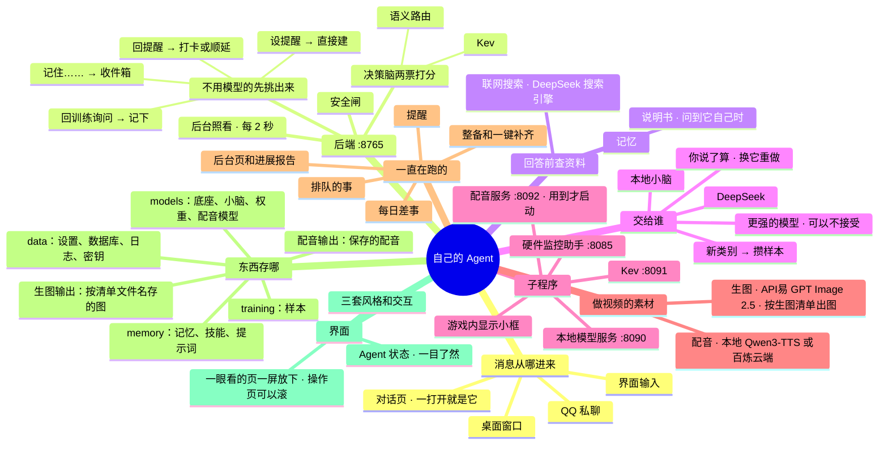

# 架构 · 总览

> 最后核对：v1.8.15（2026-10-30）。最准确的文件、接口清单见 [当前结构（自动生成）](../当前结构.md)。

## 结构图

界面「说明」页会把下面这段画成可以点开、收起的树状图，GitHub 上也能直接看图。



## 一句话

一个跑在你电脑上的后端，管着几个子程序。消息从 QQ 或界面进来，先过两票的决策脑：
- 能本地做的交给本地小脑；
- 一般难题交 DeepSeek；
- 特别复杂的写好提示词，建议你带去问更强的模型（你能用的最强的 AI：网页 Claude、ChatGPT……；也可以选不接受，全交 DeepSeek）。

不管谁想动手，都要先过写死在代码里的安全闸。DeepSeek 的处理记录变成样本，以后训练新的本地小脑。

## 运行起来是哪几个程序

<!-- live:arch -->

```
你（QQ 私聊 / 界面输入）
   │                    │
桌面窗口 ──────── 后端 :8765 ──────── QQ 通道（官方机器人，WebSocket）
(app/window.py)   (app/main.py)
                       │
   ┌───────────┬───────┴─────┬──────────────┐
本地模型服务     Kev          硬件监控助手      DeepSeek     配音服务                 百炼语音合成
:8090           :8091        :8085            （云端）     :8092（用到才启动）       （云端，配音页选了才用）
嵌入+底座+小脑   决策脑第二票   传感器、游戏帧数                Qwen3-TTS                Qwen-Audio-3.1-TTS-Plus
   │
data\（设置、数据库、日志、密钥）  memory\（记忆、技能，git）  training\、models\
```

| 程序 | 谁启动它 | 跑在哪个环境 | 关掉会怎样 |
| --- | --- | --- | --- |
| 后端 `app/main.py` :8765 | `启动.bat`（用 pythonw 跑 `app/launch.py`，没有黑窗口；起不来弹框说原因） | `.venv` | 全部停（窗口几秒内自己关） |
| 桌面窗口 `app/window.py` | 后端启动 1.5 秒后自动拉起 | `.venv`（pythonw，没有黑窗口） | 只是看不到界面，后台照常 |
| 本地模型服务 `app/model_server.py` :8090 | 后端（环境装好后自动拉起，挂了 5 分钟后再试） | `ai-env` | 本地小脑、语义路由、记忆检索用不了；非隐私的活交 DeepSeek，隐私的排队 |
| Kev :8091 | 后端（用到才启动，闲置关掉） | `ai-env` | 决策脑只剩语义路由一票 |
| 硬件监控助手 `app/hw_helper.py` :8085 | 后端（设置 › 硬件监控 打开后跟着 Agent 起；用 Windows 计划任务提权，第一次弹一次管理员确认，`app/hwctl.py`）；也能双击 `硬件监控.bat` | `.venv`（pythonw，没有黑窗口） | CPU 温度、功耗、硬盘温度、游戏帧数读不到；显卡和占用照常 |
| 游戏内显示 `app/osd.py` | 后端（设置 › 游戏内显示 打开时） | `.venv`（pythonw） | 游戏里看不到帧数小框，别的照常 |
| 配音服务 `app/tts_server.py` :8092 | 后端（「配音」页点生成、或者要对时间轴时才启动（云端配音也用它的对齐模型，v1.8.14）；闲置 10 分钟、让路时关掉） | `tts-env`（设置 › 本地模型 点「安装配音」装，`安装配音.bat` 备用；Transformers 版本和 ai-env 不一样，分开） | 只是配音页生成不了，别的照常 |

都只监听本机 127.0.0.1，别的电脑访问不到。后端只结束自己开的子进程（按进程号，或者命令行里带本项目路径），绝不按程序名杀进程。

## 一条消息怎么走

```
收到（QQ / 界面）
 ├─ 是在回提醒？（"吃了""晚点"）        → 打卡 / 顺延，不经过模型
 ├─ 是在回"要不要训练"？                → 记下，不经过模型
 ├─ 是在设提醒？（"每天十点提醒我…"）    → 程序直接建提醒（先斩后奏）
 ├─ 是"记住……"？                       → 写进记忆收件箱（先斩后奏，可撤销）
 └─ 其他 → 决策脑两票打分（语义路由 + Kev）
        ├─ 隐私（关键词或决策脑任何一道说是）→ 只在本地处理；本地不行就排队
        ├─ 本地把握 ≥ 接手线（默认 60%）→ 本地小脑回答（带相关记忆）
        ├─ 「更强的模型」得分 ≥ 50% 且最高 → 写好提示词，建议你带去问（不接受这条路时并进 DeepSeek）
        └─ 否则 → DeepSeek 回答（带联网搜索工具，要不要搜它自己定）；所有小脑都低于新类别线（40%）的记为新类别样本
 问到 agent 自己的 → 先查说明书；判给本地但要查最新信息的 → 改交 DeepSeek 联网
 每一步都写进事件日志（事件页能点开看）；回复发回 QQ / 界面
```

显存让路：别的程序（游戏、画图）占的显存多了，先卸底座和 Kev，还不够再卸嵌入模型；认出在玩游戏也先让。非隐私的活改交 DeepSeek，隐私的活排队；显存空出来 3 分钟后装回嵌入模型、处理排队的事（见 [02](02-本地模型.md)）。

## 代码地图

| 一块 | 文件 | 详细说明 |
| --- | --- | --- |
| 决策脑与分流 | `app/agent.py`、`router.py`、`privacy.py`、`seeds.py`、`exam.py`、`events.py` | [01](01-决策脑与分流.md) |
| 本地模型 | `app/models.py`、`model_server.py` | [02](02-本地模型.md) |
| DeepSeek、联网搜索与更强的模型 | `app/deepseek.py`、`websearch.py`（提示词和总结导入在 `agent.py`、`nightly.py`、`main.py`；开关和名字在 `router.py`） | [03](03-DeepSeek与网页Claude.md) |
| QQ 与提醒 | `app/qq.py`、`reminders.py`、`notify.py` | [04](04-QQ通道与提醒.md) |
| 记忆与文件 | `app/memory.py` | [05](05-记忆与文件.md) |
| 成长与训练 | `app/growth.py`、`nightly.py`（造样本、分组）、`agent.py`（存样本） | [06](06-成长与训练.md) |
| 每日差事 | `app/nightly.py` | [07](07-每日差事.md) |
| 安全线与隐私 | `app/safety.py`、`privacy.py` | [08](08-安全线与隐私.md) |
| 整备与一键补齐 | `app/checks.py`、`setup.py`、`scripts/*.py`、`paths.py` | [09](09-整备与一键补齐.md) |
| 后台监控与进展报告 | `app/monitor.py`、`feed.py` | [10](10-后台监控与进展报告.md) |
| 硬件监控和游戏内显示 | `app/hw.py`、`hw_helper.py`、`hwctl.py`（助手的开和关）、`osd.py` | [11](11-硬件监控与游戏帧数.md) |
| 对话页和 Agent 状态 | `ui/js/chat.js`、`app/agentstate.py` | [12](12-界面主题与交互.md) |
| 界面、主题与交互 | `ui/`（`index.html`、`css/core.css`、`js/*.js`、`themes/*.css`） | [12](12-界面主题与交互.md) |
| 桌面窗口 | `app/window.py`、`winframe.py`、`launch.py`（没有黑窗口的入口）、`ui/js/window.js` | [13](13-桌面窗口.md) |
| 配音 | `app/tts.py`、`tts_cloud.py`（百炼云端，v1.8.11）、`tts_server.py`、`tts_install.py`（设置里的「安装配音」）、`scripts/install_tts.py`、`ui/js/tts.js` | [14](14-配音.md) |
| 生图 | `app/imagegen.py`（API易 GPT Image 2.5，v1.8.15）、`ui/js/img.js` | [15](15-生图.md) |
| 开机自启 | `app/autostart.py`（设置 › 自动化 的开关）、`launch.py --autostart` | [13](13-桌面窗口.md) |
| 设置、数据库、路径 | `app/settings.py`、`db.py`、`paths.py`、`reports.py` | 本页「数据都存在哪」 |
| 说明文档 | `app/docs.py`、`docs/`、`ui/js/docs.js`（树状图也在这里画） | [AI文档 README](../README.md) |
| 测试、打包、交接 | `dev/`（假服务、测试后端、界面测试、`check.sh`、`pack.py`）；不进你的运行流程 | `dev/README.md`（仓库里） |

## 后台一直在跑的任务

| 任务 | 多久一次 | 做什么 |
| --- | --- | --- |
| 后台照看（`main.housekeeping`） | 每 2 秒 | 读硬件、判断让路、拉起模型服务、补算向量、处理排队的事、查余额、问要不要训练、记录各部分上下线、写运行标记 |
| 整备重查（`main.live_checks`） | 头 2 分钟每 10 秒，之后每 30 秒 | 会自己变的几项重查一遍；开机 2 分钟时把还在「启动中」的再查一遍，日志里写一句整备情况 |
| 提醒（`reminders.loop`） | 每几秒 | 到点的发出去；没确认的过 30 分钟再提醒，最多 2 次 |
| 每日差事（`nightly.loop`） | 每 2 分钟看一次 | 电脑开着、你 20 分钟没找它、离上次超过 20 小时就跑；36 小时还没机会就直接跑 |
| QQ（`qq.BOT`） | 一直连着 | WebSocket 收消息、心跳、断线续连 |

## 数据都存在哪

| 位置 | 是什么 |
| --- | --- |
| `data/settings.json` | 设置（界面上改了就写进来） |
| `data/secrets.bin` | DeepSeek Key、QQ AppSecret、百炼 Key、API易 Key，Windows DPAPI 加密，只有你这个 Windows 账号能解开 |
| `data/agent.db` | SQLite：事件、提醒、送达、花费、判例、类别、改动记录、等你决定、kv（余额、模型列表、训练询问等） |
| `data/logs/` | 各部分日志、进展报告、带哈希链的动作日志 |
| `memory/` | 记忆、技能、提示词、从更强的模型带回的总结；git 记录每次改动 |
| `training/` | 慢成长的样本（只有你的消息和纠正、DeepSeek 的处理记录、本地模型的输出） |
| `models/` | 底座、嵌入模型、小脑 LoRA、Kev 权重、配音模型（`models/tts`） |
| `data/tts/` | 最近一次生成的配音（试听用，只留一份）；`try/` 是云端音色的试听 |
| `配音输出/` | 保存的配音：一次一个文件夹（WAV、时间轴 JSON、字幕 SRT、文案），不进仓库 |
| `data/img/board.json` | 生图页当前这份清单（每张的状态、改过的提示词） |
| `生图输出/` | 生图页出的图：一份清单一个文件夹（按清单的文件名、旧版、生图清单.md、生图记录.json），不进仓库 |

## 和「最终版架构」比，现在做到哪

「最终版架构」是 Claude 文档里的目标蓝图。✅ 做好了 · 🟡 做了一部分 · ⬜ 还没做。

| 部分 | 最终版要什么 | 现在（v1.7.0） | 状态 |
| --- | --- | --- | --- |
| 决策脑 | 语义路由 + Kev 两票，按实测准确率加权 | 都有；40 道中文考题实测后自动定权重 | ✅ |
| 本地小脑群 | MiniCPM5-2B 底座 + 多个 LoRA，用到哪个切哪个 | 底座和 LoRA 切换都有；还没有训练出来的小脑 | 🟡 |
| 新类别 | 先交 DeepSeek，同时攒样本 | 有；每日差事给新类别分组起名 | ✅ |
| DeepSeek | 长对话、一般难题；思考模式按需开 | 有；模型从官方查列表选；余额官方查；花费本机估算 | ✅ |
| 网页 Claude（现在叫「更强的模型」，问哪家都行） | DeepSeek 写提示词，你去聊，带回总结 | 有；可以选不接受；总结只当参考资料，不进训练集（固定） | ✅ |
| 显存按需 | 常驻只有嵌入模型；底座、Kev 用到才加载，闲置卸载；让路模式 | 都有；v1.8.4 起按显存让路，分两级 | ✅ |
| 后台差事 | 打标签、分组起名、造样本、考试、整理记忆、周报、整备诊断、找记忆 | 除"给新小脑考试"外都有；改成不按钟点，电脑空着时跑 | 🟡 |
| 工具层 | 每个能力是独立的 MCP 服务，单独授权 | 现在是程序内的工具 + 安全闸分级；还没包成 MCP | 🟡 |
| QQ | 官方机器人，WebSocket，私聊 | 有；只回复绑定的 QQ | ✅ |
| 提醒三层送达 | QQ → 电脑弹窗 → 常驻屏卡片 | 有；加了免打扰（只发提醒，其他消息攒着） | ✅ |
| 联网搜索 | 查资料，只读 | 有：DeepSeek 自研搜索引擎（搜索 + 读网页），DeepSeek 自己决定搜不搜；隐私的不搜；每天有上限 | ✅ |
| 快成长 | 改提示词、技能、记忆，当场生效 | 记忆有（"记住……"→ 收件箱 → 每日差事整理）；自动生成技能还没做 | 🟡 |
| 慢成长 | 攒够样本 → 空闲时训练 → 考试及格上线 | 攒样本、造样本、问你要不要训练都有；训练和考试本身还没接 | 🟡 |
| 安全线 | 能撤销的先斩后奏，撤销不了的先问；分级写死；哈希链日志 | 都有；报告页能撤销 | ✅ |
| 隐私两道关 | 关键词 + 决策脑，任何一道说是就只走本地 | 有（固定，改不了） | ✅ |
| 透明 | 决策日志、阈值旋钮、证据规则、定期报告 | 都有；加了后台页和进展报告 | ✅ |
| REA | 拆解程序学做法（以后） | 没做 | ⬜ |
| 语音 | 以后 | 没做 | ⬜ |

不在最终版里、后来加的：整备与一键补齐、后台监控与进展报告、硬件监控和游戏帧数、游戏内显示、对话页和 Agent 状态、常驻屏、三套风格和交互手感、无边框桌面窗口、说明文档、配音（给视频念旁白，v1.8.6）、生图（按视频窗口的生图清单出图，v1.8.15）。
