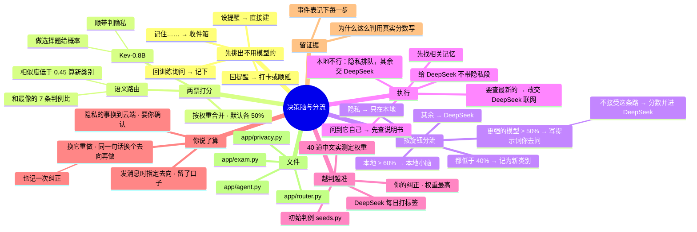

# 架构 · 决策脑与分流

> 最后核对：v1.9.0。

## 结构图

界面「说明」页会把下面这段画成可以点开、收起的树状图，GitHub 上也能直接看图。

## 做什么

每条消息进来，决策脑不回答，只打分：这件事交给谁、有几成把握。去向有四种：
- 本地小脑：可能有好几个，"本地通用"加上每个训练出来的 LoRA 小脑；
- 新类别；
- DeepSeek；
- 更强的模型（第三条路）：特别难的事写好提示词，你带去问你能用的最强的 AI（网页 Claude、ChatGPT、Kimi……）。名字在 设置 › 云端 改；也可以选「不接受」，这条路就关掉。

## 怎么走

1. **不用模型的先挑出来**（`app/agent.py` `handle`）：
   - 在回提醒（"吃了""晚点"）→ 打卡 / 顺延；
   - 在回"要不要训练"→ 记下；
   - 在设提醒 → 程序直接建；
   - "记住……"→ 写进记忆收件箱。
2. **两票打分**（`app/router.py` `decide`）：
   - **语义路由：**
     - 用嵌入模型把消息变成向量，和判例库里最像的 7 条比。
     - 越像哪一类，那一类得分越高。
     - 最像的那条相似度低于 0.45，就把不确定的部分算进"新类别"；0.45 到 0.80 之间按比例分。
   - **Kev-0.8B：**
     - 按说明做选择题，给每个去向一个概率；
     - 顺带回答"涉不涉及隐私"。
   - **合并：** 按权重合并（设置 › 分流旋钮 › 语义路由这一票的权重，默认各 50%）。只有一票能用时就只用那一票；两票都没有（模型还没装好）时退回简单规则。
3. **按旋钮分流：**
   - **隐私：** 关键词或决策脑任何一道说是 → 只在本地。
   - **本地：** 本地最高分 ≥ 接手线（默认 60%）→ 交本地小脑。
   - **更强的模型：** 它的得分 ≥ 建议找更强的模型的线（默认 50%）且高过 DeepSeek → 写提示词，建议你带去问。
     - 设置 › 云端 选了「不接受」（`strongOn=false`）：它那份分数并进 DeepSeek，不会再判给它；DeepSeek 开不开思考模式还按原来那份"难"的程度（`hard`）定。
   - **DeepSeek：** 以上都不是就交 DeepSeek。如果所有本地小脑都低于新类别线（默认 40%），而且"新类别"得分最高，就记为新类别、存成样本。
4. **"为什么这么判"** 直接用真实分数套模板写，不让模型编理由。
5. **执行**：
   - **本地处理：** 先找相关记忆（本地检索，可以带隐私内容），再交给本地模型。
   - **交 DeepSeek：** 也先找记忆，但不带隐私内容；思考模式按设置开（自动档：长消息或者偏难的才开）。
   - **本地用不了时：** 隐私的排队，等本地能用了再通过 QQ 回你；非隐私的改交 DeepSeek。
   - **要查最新信息的：** 判给本地小脑、但话里有"最新、最近更新、新闻、价格、多少钱、汇率、天气、比分、发布了、搜一下……"（`websearch.wants_fresh`），而且不是隐私的，改交 DeepSeek。本地小脑上不了网，DeepSeek 带着联网搜索工具（见 [03](03-DeepSeek与网页Claude.md)）。
   - **问到 agent 自己的：** 话里有"你能、怎么用、在哪设置、免打扰、整备、一键补齐……"（`memory.about_agent`），先从说明书（`docs\操作手册.md` 和 `docs\AI文档\`）里找最相关的 3 段，和记忆一起交给模型（本地、DeepSeek 都一样），模型按说明书回答。事件里记一步「查了说明书」。
   - **查 Obsidian 笔记（v1.9.0）：** 接了库的，回答前用同一个向量找最像的 4 段笔记，交给模型（本地全给，DeepSeek 只给非私人的）。用到了私人笔记、却判给了 DeepSeek：本地能用就改交本地小脑，"为什么"里写明；你指定交给 DeepSeek 的不改，私人的不跟着发（见 [14](14-Obsidian笔记.md)）。
   - **系统提示里带上现在的日期和时间**，问"今天几号""周几"不会答错。
6. **你说了算（换它重做）**：
   - 「这条怎么处理的」里点「交给 X 重做」→ `POST /api/events/{id}/redo {to}`：同一句话按你选的去向再处理一遍（新的一条事件，步骤里写「你指定了去向 · 重做事件 #N」），原来那条记一次纠正，变成判例。
   - 决策脑的分数照样算出来给你看，"为什么"里写"你指定交给 X。决策脑原本判给 Y（Z%）：……"。
   - **隐私的事换到云端**（DeepSeek 或更强的模型）：不确认就回 409；界面上按钮变成"涉及隐私，再点一次确认发出本机"，点了才发。发出去这一次记进安全日志（`privacy.send`），不联网搜、不进训练。
   - 留的口子：`/api/chat` 也能带 `force`（发消息时就指定去向），QQ 上"换本地""换 DeepSeek"以后接。
7. **每一步都写进事件**（`app/events.py`，`events` 表）：收到什么、四个去向各几分、两票各自怎么投、门槛、为什么、每一步、花了多少、用了多久。

## 判例怎么越来越准

判例存在数据库 `examples` 表（带向量），有三个来源：
1. 初始例子：`app/seeds.py` 里的 SEEDS。
2. **你在事件页的纠正**：立刻加进去，权重最高。
3. **每日差事里 DeepSeek 当老师打的标签**：你纠正过的不会被覆盖。

## 实测和定权重

- 大脑 › 决策脑 › 运行中文实测（`app/exam.py`）：40 道题（`seeds.py` 的 EXAM，和 SEEDS 不重复），看两票各判对多少、隐私认出多少。
- 打开了「实测后自动定权重」的话，按两票的准确率分配权重。

## 设置

设置 › 分流旋钮，具体有这几项：
- 本地小脑接手线
- 新类别线
- 建议找更强的模型的线（设置 › 云端 还能选接不接受这条路、改它的名字）
- 两票权重和「实测后自动定权重」
- 额外隐私关键词

## 限制和还没做的

- Kev 的训练数据是英文，中文效果要看实测。
- 本地小脑现在只有"本地通用"（只用底座），还没有训练出来的 LoRA 小脑（见 [06 成长与训练](06-成长与训练.md)）。
