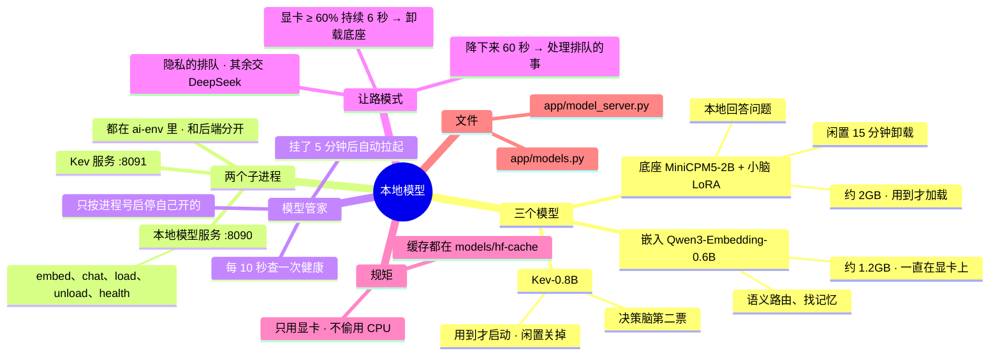

# 架构 · 本地模型

> 最后核对：v1.5.0。

## 结构图

界面「说明」页会把下面这段画成可以点开、收起的树状图，GitHub 上也能直接看图。



## 做什么

在你的显卡上跑三样东西：

| 模型 | 干什么 | 显存 | 什么时候在显卡上 |
| --- | --- | --- | --- |
| 嵌入模型 Qwen3-Embedding-0.6B | 语义路由、找相关记忆 | 约 1.2GB | 一直在（唯一常驻的） |
| 底座 MiniCPM5-2B（默认 4bit）+ 小脑 LoRA | 本地回答问题；每个小脑是一个几 MB 的 LoRA，用到哪个切哪个 | 约 2GB | 用到才加载，闲置 15 分钟卸载 |
| Kev-0.8B（基于 Qwen3.5-0.8B） | 决策脑第二票 | 约 2GB | 用到才启动（或设置里改成一直开），闲置后关掉 |

**只用显卡**：检测不到 CUDA 就拒绝工作，不会偷偷跑在 CPU 上（固定，改不了）。

## 怎么搭的

```
后端（.venv）
 └─ models.Manager（app/models.py）—— 管两个子进程，只按进程号启停自己开的
     ├─ 本地模型服务  ai-env\python app\model_server.py --port 8090
     │     /embed  /chat（可带 lora）  /load  /unload  /health
     └─ Kev 服务      ai-env\python -m kev.serve --run jaredpalmer/kev-0.8b --port 8091 --device cuda
```

- 本地模型用 Python 这一套（PyTorch cu128 + Transformers + PEFT），不用 llama.cpp。因为这一套能全部从国内源装，训练出来的 LoRA 也直接能用。
- 两个子进程都跑在 `ai-env` 里，和后端自己的 `.venv` 分开，装坏了也不影响后端。
- **健康检查：**
  - 后台每 10 秒查一次 `/health`，界面轮询直接用这个结果。
  - Windows 上去连一个没开的端口要等 1~2 秒，所以不在每次轮询时现查。
- **自动拉起：** 本地模型环境装好了、服务却没在跑，后台照看会拉起它；失败了 5 分钟后再试。
- 环境变量都指到 Agent 文件夹里，Kev 和模型服务的下载缓存都在 `models\hf-cache`，不写 C 盘：
  - HF_HOME
  - 下载 Kev 权重走 hf-mirror（可关）

## 让路模式

| 条件 | 会怎样 |
| --- | --- |
| 显卡占用连续 3 次采样（约 6 秒）≥ 让路线（默认 60%），而且不是自己在用显卡 | 进入让路，卸载底座 |
| 让路期间 | 非隐私的活交 DeepSeek，隐私的活排队 |
| 显卡降下来超过 60 秒 | 退出让路，后台照看把排队的事处理掉，结果通过 QQ 发给你 |

## 设置

设置 › 本地模型，具体有这几项：
- 三个模型文件夹（留空用默认位置）
- 底座精度（4bit / 8bit / 原始）
- 闲置多久卸载
- Kev 模式（用到才启动 / 一直开 / 关）
- hf-mirror 开关
- 让路模式和让路线
- 两个端口

## 文件

- `app/models.py`：模型管家（启停、健康检查、让路、闲置关闭、embed / chat / kev 调用）。
- `app/model_server.py`：模型服务本体（在 ai-env 里跑）。
- `models\base\MiniCPM5-2B\`、`models\embed\Qwen3-Embedding-0.6B\`、`models\brains\<小脑名>\`（PEFT 格式）、`models\hf-cache\`。
- 日志：`data\logs\model_server.log`、`data\logs\kev.log`。

## 限制和还没做的

- 底座在你显卡上的实际生成速度还没实测（大脑页会显示每次的 token/秒）。
- 小脑现在由后端代办工具调用，第一版不直接调工具。
