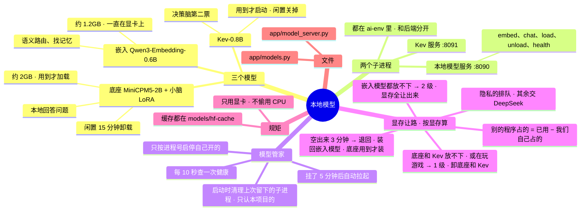

# 架构 · 本地模型

> 最后核对：v1.8.5。

## 结构图

界面「说明」页会把下面这段画成可以点开、收起的树状图，GitHub 上也能直接看图。



## 做什么

在你的显卡上跑三样东西：

| 模型 | 干什么 | 显存 | 什么时候在显卡上 |
| --- | --- | --- | --- |
| 嵌入模型 Qwen3-Embedding-0.6B | 语义路由、找相关记忆 | 约 1.2GB | 一直在（唯一常驻的） |
| 底座 MiniCPM5-2B（默认 4bit）+ 小脑 LoRA | 本地回答问题；每个小脑是一个几 MB 的 LoRA，用到哪个切哪个 | 约 2GB | 用到才加载，闲置 15 分钟卸载 |
| Kev-0.8B（基于 Qwen3.5-0.8B） | 决策脑第二票 | 约 2GB | 用到才启动（或设置里改成一直开），闲置后关掉 |

**只用显卡**：检测不到 CUDA 就拒绝工作，不会偷偷跑在 CPU 上（固定，改不了）。

## 怎么搭的

```
后端（.venv）
 └─ models.Manager（app/models.py）—— 管两个子进程，只按进程号启停自己开的
     ├─ 本地模型服务  ai-env\python app\model_server.py --port 8090
     │     /embed  /chat（可带 lora）  /load  /unload  /health
     └─ Kev 服务      ai-env\python -m kev.serve --run jaredpalmer/kev-0.8b --port 8091 --device cuda
```

- 本地模型用 Python 这一套（PyTorch cu128 + Transformers + PEFT），不用 llama.cpp。因为这一套能全部从国内源装，训练出来的 LoRA 也直接能用。
- 两个子进程都跑在 `ai-env` 里，和后端自己的 `.venv` 分开，装坏了也不影响后端。
- **健康检查：**
  - 后台每 10 秒查一次 `/health`，界面轮询直接用这个结果。
  - Windows 上去连一个没开的端口要等 1~2 秒，所以不在每次轮询时现查。
- **自动拉起：** 本地模型环境装好了、服务却没在跑，后台照看会拉起它；失败了 5 分钟后再试。
- **清理上次留下的子进程（v1.8.5，`M.cleanup_orphans`）：** 后端被直接结束（任务管理器）或者崩溃时，它开的模型服务、Kev、游戏内小框还活着，占着 8090 这些端口，下次新起的模型服务就报「端口已被占用」（10-28 真的发生过）。现在后端启动时先按 `models.orphan_kind` 找出来、连子进程一起按 PID 停掉：命令行里带本项目 `app\model_server.py` 的，或者在本项目文件夹里跑的 `-m kev.serve` / `-m app.osd`。别的程序、别的文件夹里的同名程序一概不碰。硬件监控助手是管理员权限跑的、可以接着用，不动它。
- **加载时的导入锁（v1.8.5）：** 模型服务刚起来时后台线程在加载嵌入模型，这时来一个请求，两个线程同时第一次 `import transformers` 会报 `ImportError: cannot import name 'AutoModel'`（10-24、10-25 各一次）。导入都放进 `IMPORT_LOCK`。
- 环境变量都指到 Agent 文件夹里，Kev 和模型服务的下载缓存都在 `models\hf-cache`，不写 C 盘：
  - HF_HOME
  - 下载 Kev 权重走 hf-mirror（可关）

## 显存让路（v1.8.4 起按显存算）

以前按显卡占用（≥ 60%）判，看不到显存紧不紧，也漏了视频编码；现在按显存。显存一满，Windows 会把多出来的挪到「共享 GPU 内存」（内存），游戏就卡。

- **别的程序占了多少** = 显卡已用的 − 我们自己占的（模型服务和 Kev，连子进程）。我们自己占的在 Windows 上按每个程序的专用显存算（`hw.vram_of`，和任务管理器「详细信息」那一列一样）；读不到时按模型服务报的 PyTorch 显存 + 0.5 GB 运行环境估，Kev 开着按 2 GB 算。
- **能用多少** = 显卡总显存 − 别的程序占的 − 预留（`yieldVram`，默认 2 GB）。
- 各部分大概要：嵌入模型 1.3 GB、底座 2.2 / 3.2 / 5.5 GB（4bit / 8bit / 原始）、Kev 2 GB（`M.need()`）。

| 条件 | 会怎样 |
| --- | --- |
| 底座 + 嵌入 + Kev 放不下，或者认出在玩游戏（前台游戏有帧数） | 1 级：卸底座、停 Kev，用到也不装 |
| 嵌入模型都放不下 | 2 级：嵌入模型也卸掉（模型服务进程还在，只剩它的运行环境约 0.4 GB），语义路由、找记忆先不用 |
| 要让得更多 | 连续 3 次采样（约 6 秒）都这么判才动手；正在用本地模型回答你时，答完再让 |
| 要退回来 | 连续 `yieldCool` 分钟（默认 3）都放得下（多留 0.5 GB 余量，免得来回切）才退；从 2 级退回时把嵌入模型装回去。底座还是用到才装，不提前装 |
| 让路期间 | 非隐私的活交 DeepSeek，隐私的活排队；让路结束后后台照看把排队的事处理掉，结果通过 QQ 发给你 |

每次进出让路都写进进展报告（「显存让路」）。逻辑在 `app/models.py` 的 `yield_want`、`Manager.tick`，用 `dev/test_hw.py` 测。

## 设置

设置 › 本地模型，具体有这几项：
- 三个模型文件夹（留空用默认位置）
- 底座精度（4bit / 8bit / 原始）
- 闲置多久卸载
- Kev 模式（用到才启动 / 一直开 / 关）
- hf-mirror 开关
- 显存让路：开关、给别的程序留多少显存（默认 2 GB）、空出来多久再装回去（默认 3 分钟）
- 两个端口

## 文件

- `app/models.py`：模型管家（启停、健康检查、让路、闲置关闭、embed / chat / kev 调用）。
- `app/model_server.py`：模型服务本体（在 ai-env 里跑）。
- `models\base\MiniCPM5-2B\`、`models\embed\Qwen3-Embedding-0.6B\`、`models\brains\<小脑名>\`（PEFT 格式）、`models\hf-cache\`。
- 日志：`data\logs\model_server.log`、`data\logs\kev.log`。

## 限制和还没做的

- 底座在你显卡上的实际生成速度还没实测（大脑页会显示每次的 token/秒）。
- 小脑现在由后端代办工具调用，第一版不直接调工具。
