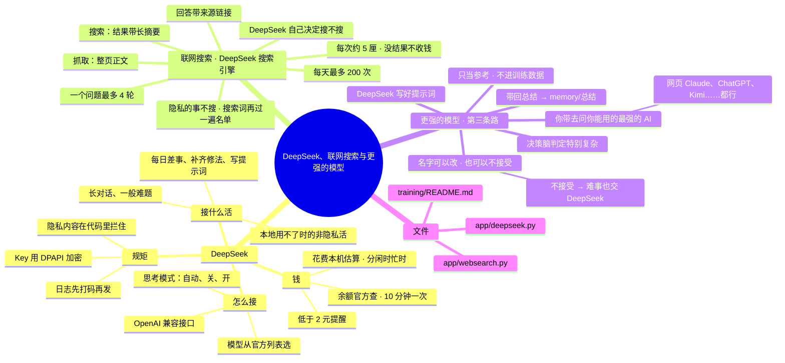

# 架构 · DeepSeek、联网搜索与更强的模型

> 最后核对：v1.8.0。（文件名沿用旧的「网页Claude」，免得更新后留下两份）

## 结构图

界面「说明」页会把下面这段画成可以点开、收起的树状图，GitHub 上也能直接看图。

## DeepSeek：做什么

- 长对话和一般难题，也就是决策脑判给 DeepSeek 的事。
- 本地模型用不了、或者你在玩游戏（让路）时，接非隐私的活。
- 后台的活：
  - 每日差事里打标签、给新类别起名、整理记忆、造样本、起草周报；
  - 一键补齐失败时看日志选修法；
  - 整备里「问 DeepSeek」；
  - 给更强的模型写提示词。

## DeepSeek：怎么接的

`app/deepseek.py`，OpenAI 兼容接口：
- **对话：** `POST {接口地址}/chat/completions`。
  - 每次调用都记一笔账：`costs` 表里存 token 数、用途、对应的事件编号。
  - 花了多少钱按官方价格在本机估算，会区分闲时和忙时（工作日北京时间 9–12 点、14–18 点算忙时）。准确的数以余额为准。
- **思考模式：** 设置里选自动 / 一直关 / 一直开。自动档下，消息长、或者偏难的才开，省钱。
- **余额：** `GET {接口地址}/user/balance`。
  - 平时 10 分钟查一次，调用过后 1 分钟内再查一次。
  - 低于「余额低于多少时提醒你」（默认 2 元）只提醒，不停用。
  - 余额不够时官方返回 402，会告诉你去充值。
- **模型列表：** `GET {接口地址}/models`。
  - 设置 › 云端 ›「获取模型列表」，或者保存 Key 时自动查一次。
  - 查到的存在数据库 kv `ds_models`，模型一栏就变成下拉框；最后一项「手动填写…」能自己填。
  - 现在用的模型不在列表里，会标出来。
- **隐私内容不准发：** 调用时带着隐私标记会直接拒绝，在代码里拦住，不靠提示词。
- **密钥：** Key 用 Windows DPAPI 加密存在 `data\secrets.bin`，导出设置不包含。发给 DeepSeek 看的日志会先把用户名、密钥打码。

## 联网搜索：怎么接的

`app/websearch.py`。用的是 DeepSeek 自研的搜索引擎，2026-10-17 开放，用同一个 Key。

- **两个接口：**
  - 搜索 `POST https://api.deepseek.com/v1/tools/search`：一句话 → 网页结果，每条有标题、链接、短摘要、给模型看的长摘要、相关度、权威度、日期。支持 `site:`、`"精确词"`、`-排除词`、`after:` / `before:` 日期、`lang:` 语言。
  - 抓取 `POST https://api.deepseek.com/v1/tools/fetch`：一个网址 → 整页正文（Markdown）。
- **怎么用上：** 交给 DeepSeek 的事，把这两个接口当成工具（OpenAI 的 tools 格式）一起给它，要不要搜、搜什么、读哪页由它自己定。
  - 系统提示里告诉它今天几号，以及"要最新信息、具体事实、价格、版本、新闻时先搜；常识和闲聊不用搜；搜索词里不放个人信息；回答末尾列来源"。
  - 一个问题最多查「一个问题最多查几轮」（默认 4）轮，一轮里可以同时搜几个词、读几个网页。
  - 模型没写来源的话，程序在回复末尾补上最多 3 条。
- **思考模式带工具：** 官方要求把每一轮的 `reasoning_content` 原样传回去，`deepseek.chat` 返回的 message 里带着它。万一官方返回 400，就改成不思考再试；还不行，就不带工具直接答。
- **钱：** 每 1000 次成功请求 0.75 美元，国内价是 5 元，也就是每次约 5 厘钱。没结果、失败、超时不收钱。
  - 每次都记进 `costs` 表，`model` 记成 `web_search` 或 `web_fetch`，所以余额、本月花费、报告里都算上了。
  - 事件的花费 = DeepSeek 的 token 钱 + 搜索钱。
- **上限：** 「每天最多搜几次」（默认 200，搜索和读网页都算）。到了就不再给工具，凭已有知识回答。
- **隐私（写死）：**
  - 隐私的事不会交给 DeepSeek，所以也不会搜。
  - 发出去的每个搜索词、网址，还要再过一遍隐私关键词名单，命中就不发，并告诉模型别把个人信息放进搜索词。
- **记录：** 事件里多出「联网搜索」（搜了什么、几条、多久）和「读网页」（哪个网站）这几步。
- **训练样本：** 联网查过的回答照样存成样本，但标上 `"web": true`。里面的事实会过时，以后训练时可以只学"怎么答"、不背答案。
- **测试：** 设置 › 云端 › 联网搜索 ›「测试一下」，真搜一次（约 5 厘钱），显示条数、用时、前 3 条。

## 更强的模型（第三条路）：怎么走

以前这条路写死叫"网页 Claude"。仓库是公开的，国内很多人用不了 Claude、或者容易被封号，所以 v1.8 起改成通用的「更强的模型」：
- **用不用：** 设置 › 云端 › 第三条路，二选一：
  - 接受（默认）：特别难的事写好提示词，你带去问；
  - 不接受：这条路关掉，决策脑判给它的分数并进 DeepSeek，难的事也交给 DeepSeek（`router.strong_on`）。
- **叫什么：** 设置 › 云端 › 这条路叫什么（`strongName`，默认"更强的模型"）。比如改成"网页 Claude"，界面、回复、分数条、链路图里都跟着变（`router.strong_name`，界面上 `syncRouteNames`）。
- **自动调接口**（`strongMode=api`）留了位置还没做：以后可以填一个兼容 OpenAI 格式的接口，直接调用。

怎么走：
1. 决策脑判定"非常复杂，需要深入讨论"，比如整体架构、长期规划、深度研究。
2. DeepSeek 按「给更强的模型的提示词开头」写一段提示词：交代背景、目标、约束，结尾要求输出 Markdown 总结。涉及隐私时不经过 DeepSeek，用本地模板。
3. 你带着提示词去问你能用的最强的 AI（网页 Claude、ChatGPT、Kimi……）。agent 不会自动登录或抓取任何网页 AI。
4. 聊完让它出一份 Markdown 总结，在 界面 › 大脑 › 更强的模型 › 导入总结。

导入的总结存在 `memory\总结\`，只在本地建检索索引、当参考资料读。

**更强的模型的内容不进训练数据**（固定，改不了）：
- 带回的总结、聊天记录都只当参考资料，不发给 DeepSeek 加工。
- DeepSeek 回答时参考过这些内容的，那条记录也不存成样本，事件里会写「不进训练集」。
- 原因：Anthropic 的用户条款不允许用 Claude 的服务去开发或训练 AI 模型，OpenAI 等的条款也有类似限制，一律不进最省事。
- 规矩写在 `training\README.md`。

## 设置

设置 › 云端，具体有这几项：
- DeepSeek API Key
- 余额（刷新、去充值）
- 模型（下拉框）
- 余额低于多少时提醒你
- 思考模式
- 联网搜索（开关）
- 每天最多搜几次
- 一个问题最多查几轮
- 接口地址
- 第三条路「更强的模型」：接受 / 不接受
- 这条路叫什么
- 给更强的模型的提示词开头

## 限制和还没做的

- 搜索质量还没有第三方实测，要用一阵子才知道好坏。
- 有些网站不让抓，读不到就换下一个结果。
- 本地小脑不能联网；看着要查最新信息的问题，会改交 DeepSeek（见 [01](01-决策脑与分流.md)）。
