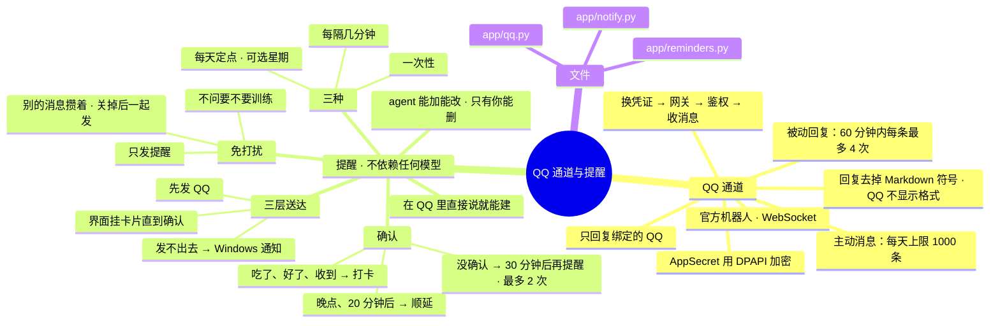

# 架构 · QQ 通道与提醒

> 最后核对：v1.7.0。

## 结构图

界面「说明」页会把下面这段画成可以点开、收起的树状图，GitHub 上也能直接看图。



## QQ 通道：做什么

用 QQ 官方机器人和你私聊：收你的消息交给决策脑，把回复和提醒发回给你。不用非官方接口，没有封号风险。

## QQ 通道：怎么接的

`app/qq.py`，用 WebSocket 接入，不需要公网地址：

```
AppID + AppSecret 换访问凭证 → 取网关地址 → 连 WebSocket → 鉴权（单聊权限）
→ 收消息、心跳、断线自动续连
```

- **回复是纯文字：** QQ 不显示 Markdown，所以发 QQ 的回答在提示里要求不用格式符号，发出去前 `agent.plain` 再把 `**`、`#`、`- ` 列表、代码块、链接写法去掉一遍。界面上照样按 Markdown 显示。
- **只回复你绑定的那个 QQ。** 绑定时，你给机器人发一句话，整备 ›「绑定你的 QQ」会出现「是我」，点了就记下你的 openid。陌生人的消息只记一笔，不回复。
- **被动回复：** 你发消息后 60 分钟内，每条最多回 4 次。
- **主动消息**（比如提醒）：官方允许单聊主动发，每人每天上限 1000 条。但你在 QQ 里可以关掉"允许主动发送"，关了会发不出去，这时改用电脑弹窗和界面卡片（见下面）。
- **沙箱模式：** 测试期间打开，只有你加进去的成员能和它说话。
- **密钥：** AppSecret 用 DPAPI 加密存在 `data\secrets.bin`。

## 提醒：做什么

吃药这类提醒准时送到，直到你确认。**不依赖任何模型**：显卡被游戏占满、模型没装好，提醒照样准时。

## 提醒：怎么走

`app/reminders.py` 和 `app/notify.py`：

- **三种提醒：**
  - 每天定点（可以选星期几）
  - 每隔几分钟
  - 一次性
- **在 QQ 里设：** "每天晚上十点提醒我吃药""半小时后提醒我收衣服""明天八点叫我"，程序直接认出时间和事情建提醒。这一步不经过模型，先斩后奏，写进报告。
- **到点三层送达**：
  1. 先发 QQ。
  2. QQ 发不出去，就弹 Windows 通知（可关）。
  3. 不管 QQ 成没成功，界面上都挂一张卡片（可关），直到你点「好了」或「晚点 30 分钟」。
- **确认：**
  - 6 小时内回"吃了 / 好了 / 收到 / 知道了"就打卡；
  - 回"晚点 / 等会 / 20 分钟后 / 一小时后"就顺延。
- **没确认的：** 过「没确认的话，过多久再提醒」（默认 30 分钟）再提醒一次，最多再提醒「最多再提醒几次」（默认 2 次）。
- **免打扰**（设置 › 提醒，只有一个开关，不设时段）：
  - 开着时只发提醒，吃药这类照常准时。
  - 别的主动消息先攒起来，存在 kv `held_msgs`；关掉免打扰时一起发给你，比如排队的事做完了的结果。
  - 问你要不要训练这种事，免打扰期间干脆不问，关掉后再问。
- **记录：** 每次送达都记在 `deliveries` 表，写明每个渠道成没成功，事件页能看到。

## 设置

- 设置 › QQ 通道：启用、AppID、AppSecret、沙箱、只回复这个用户。
- 设置 › 提醒：免打扰；每条提醒的开关、时间、星期、附带的话、现在试发、删除。agent 自己能新增、修改提醒（先斩后奏），不能删除，删除只能你在这里点。
- 设置 › 自动化：QQ 发不出去时弹电脑通知、界面挂卡片、再提醒间隔和次数。
- 整备：「绑定你的 QQ」「测试主动提醒」。

## 文件

- `app/qq.py`：机器人连接。
- `app/reminders.py`：提醒的解析、定时、确认、顺延。
- `app/notify.py`：三层送达、免打扰攒消息、界面卡片。
- 数据库表：`reminders`、`deliveries`。

## 限制

- QQ 单聊主动消息实测要在你的账号上做一次：整备 › 测试主动提醒。
- 从别的 agent 换过来的话，等这边的提醒测试通过了再关旧的。
