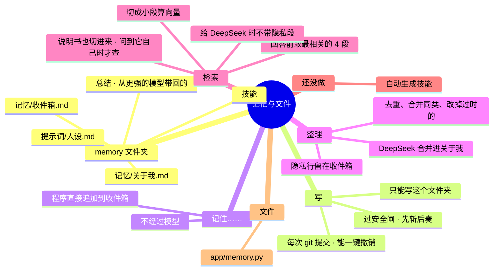

# 架构 · 记忆与文件

> 最后核对：v1.9.0。

## 结构图

界面「说明」页会把下面这段画成可以点开、收起的树状图，GitHub 上也能直接看图。



## 做什么

agent 自己有一个文件夹，放记忆、技能、提示词、从更强的模型带回的总结，全是中文 Markdown，你随时能打开看、改。快成长就是改这个文件夹。

## 文件夹里有什么

默认是 `memory\`。想放进 Obsidian 库：设置 › Obsidian 笔记 ›「把记忆搬进……」（v1.9.0，`obsidian.move_memory`）：整个复制到库里的「Agent 记忆」（`.git` 一起，撤销历史还在），`memDir` 改过去，原来的 `memory\` 改名成 `memory.已搬走-日期` 留着。也可以在 设置 › 记忆与文件 手动填。

搬进库以后，库的笔记索引跳过这个子文件夹（它是记忆，单独索引），见 [14](14-Obsidian笔记.md)。

```
memory\
  记忆\收件箱.md      你说"记住……"的内容先进这里
  记忆\关于我.md      每日差事整理后的长期记忆
  技能\               做事的方法，每个技能一个 .md（什么时候用、怎么做、注意什么）
  提示词\人设.md      它的说话方式（改提示词：先斩后奏，事后写进报告）
  总结\               从更强的模型（网页 Claude、ChatGPT……）带回的总结和聊天记录（只当参考资料读）
```

## 怎么走

- **写：** `memory.write` 有几道关，写入后再提交 git：
  - 只能写这个文件夹，越界直接报错；
  - 要过安全闸，默认先斩后奏；
  - 写入后 `git commit` 一次；
  - 在报告的「先斩后奏的改动」里记一条，能一键撤销（git revert）。
- **"记住……"：** 程序认出来，追加一行到 `记忆\收件箱.md`（带时间），不经过模型。
- **整理：** 每日差事里，DeepSeek 把收件箱的内容合并进 `关于我.md`，会去重、合并同类、把过时的改掉。
  - 涉及隐私的行留在收件箱，不交给 DeepSeek，等以后本地小脑整理。
  - 整理完清空收件箱里已合并的部分。
- **检索：**
  - 文件切成小段，用嵌入模型算向量，存在数据库 `chunks` 表；只算新增的，删掉的段会清掉。
  - 回答前拿消息的向量找最相关的几段（默认 4 段）一起交给模型。
  - 交给 DeepSeek 时不带隐私段。
  - 记忆只在这个文件夹里找。
- **说明书（给 agent 自己读）：**
  - `docs\操作手册.md` 和 `docs\AI文档\` 下的全部文章也切块、算向量，存在同一张 `chunks` 表，`file` 前面加 `@说明/`，和记忆分开找。
  - 说明书是公开的，里面举例提到"吃药""密码"不算隐私。
  - 只在问到 agent 自己时才查（`memory.about_agent`），取最相关的 3 段。嵌入模型没开时，按字面重合找。
  - 每批算 64 段，一次没算完下次接着算。
- **git：**
  - 用 git 记录每次改动（可关）。
  - 用的是一键补齐装的便携版 Git，配置只写在这个文件夹自己的仓库里，不改你系统的 git 设置。

## 设置

设置 › 记忆与文件，具体有这几项：
- agent 自己的文件夹
- 用 git 记录每次改动
- 日志保留天数

## 文件

- `app/memory.py`：读写、git 提交、撤销、切块和检索。
- 数据库：`chunks`（记忆向量）、`changes`（改动记录，撤销用）。

## 限制和还没做的

- 技能现在要手写，agent 还不会自动生成和打磨技能，这是借鉴 Hermes Agent 的那一部分。
- 隐私记忆的整理要等本地小脑训练好。
