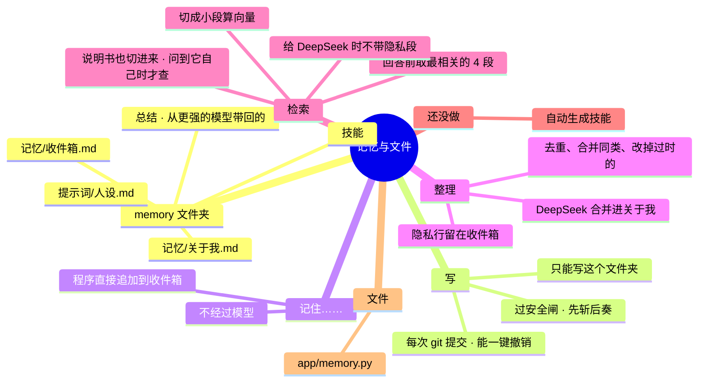

# 架构 · 记忆与文件

> 最后核对：v1.8.17。

## 结构图

界面「说明」页会把下面这段画成可以点开、收起的树状图，GitHub 上也能直接看图。



## 做什么

agent 自己有一个文件夹，放记忆、技能、提示词、从更强的模型带回的总结，全是中文 Markdown，你随时能打开看、改。快成长就是改这个文件夹。

## 文件夹里有什么

默认是 `memory\`，可以在 设置 › 记忆与文件 改到 Obsidian 库里的一个子文件夹。

```
memory\
  记忆\收件箱.md      你说"记住……"的内容先进这里
  记忆\关于我.md      每日差事整理后的长期记忆
  技能\               做事的方法，每个技能一个 .md（什么时候用、怎么做、注意什么）
  提示词\人设.md      它的说话方式（改提示词：先斩后奏，事后写进报告）
  总结\               从更强的模型（网页 Claude、ChatGPT……）带回的总结和聊天记录（只当参考资料读）
```

## 怎么走

- **写：** `memory.write` 有几道关，写入后再提交 git：
  - 只能写这个文件夹，越界直接报错；
  - 要过安全闸，默认先斩后奏；
  - 写入后 `git commit` 一次；
  - 在报告的「先斩后奏的改动」里记一条，能一键撤销（git revert）。
- **"记住……"：** 程序认出来，追加一行到 `记忆\收件箱.md`（带时间），不经过模型。
- **整理：** 每日差事里，DeepSeek 把收件箱的内容合并进 `关于我.md`，会去重、合并同类、把过时的改掉。
  - 涉及隐私的行留在收件箱，不交给 DeepSeek，等以后本地小脑整理。
  - 整理完清空收件箱里已合并的部分。
- **检索：**
  - 文件切成小段，用嵌入模型算向量，存在数据库 `chunks` 表；只算新增的，删掉的段会清掉。
  - 回答前拿消息的向量找最相关的几段（默认 4 段）一起交给模型。
  - 交给 DeepSeek 时不带隐私段。
  - 记忆只在这个文件夹里找。
- **说明书（给 agent 自己读）：**
  - `docs\操作手册.md` 和 `docs\AI文档\` 下的全部文章也切块、算向量，存在同一张 `chunks` 表，`file` 前面加 `@说明/`，和记忆分开找。
  - 说明书是公开的，里面举例提到"吃药""密码"不算隐私。
  - 只在问到 agent 自己时才查（`memory.about_agent`），取最相关的 3 段。嵌入模型没开时，按字面重合找。
  - 每批算 64 段，一次没算完下次接着算。
- **git：**
  - 用 git 记录每次改动（可关）。
  - 用的是一键补齐装的便携版 Git，配置只写在这个文件夹自己的仓库里，不改你系统的 git 设置。

## 能读的文件夹（v1.8.17，`app/files.py`）

agent 只能**写**自己的文件夹；别的文件夹要你在 设置 › 记忆与文件 ›「能读的文件夹」里加了才能**读**（只读：不改、不删、不运行）。

- **加：** 只能你在界面上点（设置里填路径点「允许读」，或者对话里回复下面的「允许读这个文件夹，再问一次」）。这是给 agent 加权限，记进动作日志（`tool.add`）；模型自己加不了。不能加 Agent 自己的 data 文件夹、不能加整个盘。存在设置的 `readDirs`（通用的「改设置」接口改不了它）。
- **每个文件夹一个开关「能发给 DeepSeek」：** 默认开（作者 11-04：笔记仓库这类发给 DeepSeek 没问题）。关掉的只给本地小脑看：DeepSeek 的工具看不到它，你贴了它里面的路径也只交给本地小脑。
- **能读什么：** .md .txt .docx、代码、表格（.csv）、日志这些文字（UTF-8、GBK 都认，一次 2 万字，长的接着读）；图片（给 DeepSeek 看）。程序、压缩包这些不读。
- **怎么防越界：** 路径先 resolve（快捷方式、符号链接走到真的位置），再看在不在允许的文件夹里，`..` 绕不出去；Agent 的 data（设置、密钥、数据库）和看着像密钥的文件（.env、*.key、id_rsa、.kdbx……）不管在哪都不读；.obsidian、.git、.trash 这些不列、不搜。
- **怎么用：**
  - 消息里贴了路径（`E:\笔记仓库\人物.md`，后面紧跟着中文也认得出）：程序直接读出来，跟消息一起交给模型（本地小脑只放前 3000 字）。贴的不在允许里：不读，回一句「允许读这个文件夹」。
  - 问「我笔记里 XX 是怎么写的」：交给 DeepSeek，它带着三个工具 `list_dir`（列目录）、`find_files`（按文件名和内容搜）、`read_file`（读，图片附在下一条消息里），自己翻。本地小脑不会用工具，这类问题不交给它。
  - 每读一个文件，事件里记一步「读文件」，`chat_files` 表记一笔，对话页回复下面写着读了哪些。

## 对话里的图片（v1.8.17）

界面上点回形针、Ctrl+V 粘贴、拖进对话页都行，一次最多 6 张、一张 10MB 以内，认文件头（PNG / JPEG / WEBP / GIF）。存一份在 `data\chat\日期\`（聊天记录里显示缩略图、换它重做时再用），`chat_files` 表记着是哪条事件的。

## 设置

设置 › 记忆与文件，具体有这几项：
- agent 自己的文件夹
- 用 git 记录每次改动
- 日志保留天数
- 能读的文件夹（只读）：路径、能不能发给 DeepSeek、不让读了

## 文件

- `app/memory.py`：读写、git 提交、撤销、切块和检索。
- `app/files.py`：能读的文件夹、列目录 / 搜 / 读、消息里贴的路径、对话里的图片（v1.8.17）。
- 数据库：`chunks`（记忆向量）、`changes`（改动记录，撤销用）、`chat_files`（每条事件带的图片、读过的文件）。

## 限制和还没做的

- 技能现在要手写，agent 还不会自动生成和打磨技能，这是借鉴 Hermes Agent 的那一部分。
- 隐私记忆的整理要等本地小脑训练好。
- 能读的文件夹现在是现翻（按关键词搜），还没像记忆那样建索引（切段算向量）；笔记很多时搜得慢一点。
