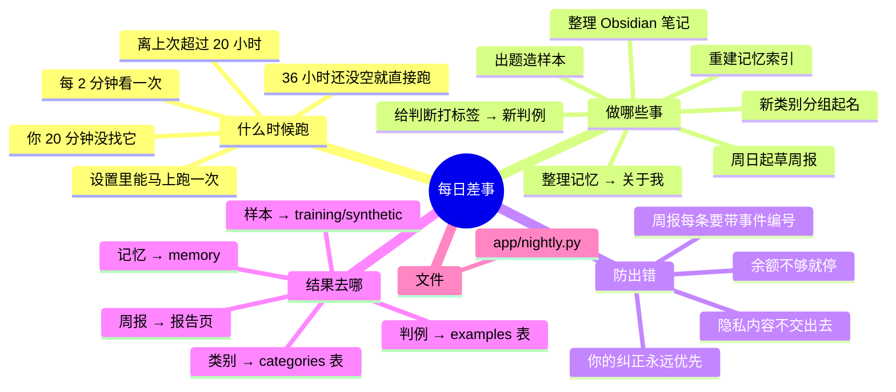

# 架构 · 每日差事

> 最后核对：v1.9.0。以前叫"夜间差事"，从 v1.2 起不按钟点。

## 结构图

界面「说明」页会把下面这段画成可以点开、收起的树状图，GitHub 上也能直接看图。

## 做什么

一些模型比写死的程序做得好的整理活，DeepSeek 当老师和整理员，花钱很少。健康类内容不交出去。

| 差事 | 谁做 | 防出错 |
| --- | --- | --- |
| 给白天的判断打标签：DeepSeek 看消息和回复，说该交给谁，变成语义路由的新判例 | DeepSeek 当老师 | 你的纠正永远优先；隐私的、回应提醒这类不打 |
| 给新类别分组、起名 | 嵌入模型按相似度分组，DeepSeek 起名 | 只读样本，不动文件 |
| 整理记忆：收件箱合并进「关于我」 | DeepSeek | 隐私行留在收件箱；改动进 git，可一键撤销 |
| 出题造样本 | DeepSeek 仿照真实例子写变体 | 真实样本至少占 25%；和真实的重复的去掉 |
| 周日起草周报 | DeepSeek | 每条结论必须带事件编号，程序核对编号真的存在才保留 |
| 整理 Obsidian 笔记（v1.9.0）：今天聊了什么、可能前后矛盾的地方、可以加的链接，写进库里的「Agent 收件箱/每日」 | 程序找链接；像的两段交 DeepSeek（有私人的交本地小脑）看有没有矛盾 | 只列建议，不改你的笔记；每天最多查 12 对；隐私的聊天只写条数（见 [14](14-Obsidian笔记.md)） |
| 重建记忆索引 | 嵌入模型（本地） | 只算新增的段 |

## 什么时候跑

`app/nightly.py` `loop`，每 2 分钟看一次：
- 电脑开着、你 20 分钟没在 QQ 或界面上找它、离上次超过 20 小时，就跑一次；
- 隔了 36 小时还没等到空闲，就不等了直接跑；
- 想马上跑：设置 › 成长与训练 ›「现在跑一次每日差事」。

跑的过程会写进 后台 › 进展报告：开始、每一项做了多少、哪项出错、用了多久。余额不够时，后面的先不做了。

## 设置

设置 › 成长与训练：每日差事、出题造样本、真实样本至少占。

## 文件

- `app/nightly.py`。
- 结果：
  - 判例 → 数据库 `examples` 表；
  - 类别 → `categories`；
  - 记忆 → `memory\`；
  - 样本 → `training\synthetic\`；
  - 周报草稿 → kv `weekly_draft`（报告页「本周要点」）；
  - 上次跑的结果 → kv `nightly_last`（后台页「每日差事」那一行）。

## 还没做的

- 给新小脑考试，要等训练接上。
