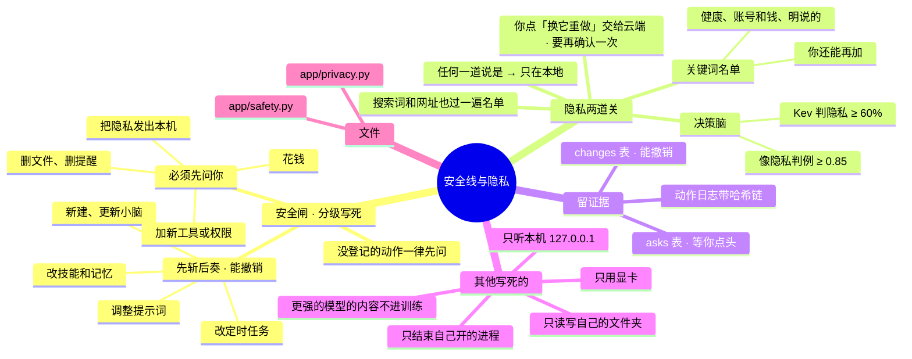

# 架构 · 安全线与隐私

> 最后核对：v1.8.0。

## 结构图

界面「说明」页会把下面这段画成可以点开、收起的树状图，GitHub 上也能直接看图。

## 安全闸：先斩后奏还是先问你

`app/safety.py`。分级写死在代码里，不让模型自己判断，因为写在提示词里的规矩不算护栏。没登记的新动作一律按"先问"处理。

| 先斩后奏，事后写进报告（能撤销） | 必须先问你（撤销不了） |
| --- | --- |
| 新建、更新小脑（删掉适配器文件即恢复） | 删除任何文件、删除提醒 |
| 新增、修改技能和记忆文件（git 可退回） | 给自己加新工具或新权限 |
| 新增、修改定时任务 | 花钱：充值、换更贵的模型、提高额度 |
| 调整自己的提示词 | 把隐私内容发出本机 |

- **先斩后奏的：**
  - 直接做，在 `changes` 表记一条；
  - 报告页「先斩后奏的改动」里能点「撤销」：文件走 git revert，提醒恢复原样。
- **先问的：**
  - 放进 `asks` 表；
  - 总览和报告页「等你决定」里点同意才执行。
- **你可以把左边任何一组改成"先问"**，在设置 › 安全线；右边那些改不了。
- **动作日志：**
  - 每一次动作都写进 `data\logs\actions.jsonl`，每行带上一行的哈希（哈希链），事后改不了；
  - `/api/log/verify` 能检查有没有被动过。

## 隐私：两道关

| 关 | 怎么判 |
| --- | --- |
| 第一道：关键词名单（`app/privacy.py`） | 写死的名单，宁严勿松：健康类（药、医院、病、失眠、情绪……）、账号和钱（密码、验证码、身份证、银行卡、工资、余额……）、明说的（隐私、别告诉、保密……）。设置 › 分流旋钮 › 额外隐私关键词 可以再加 |
| 第二道：决策脑 | 和以前的隐私判例很像（相似度 ≥ 0.85），或者 Kev 判断涉及隐私（≥ 60%） |

任何一道说是隐私，这件事就只在本地处理（固定，改不了）。隐私内容的处理方式：
- 不发给 DeepSeek；
- 不存成训练样本；
- 交给 DeepSeek 找记忆时不带隐私段；
- 不联网搜索；别的事发出去的每个搜索词、网址，也要再过一遍关键词名单，命中就不发；
- 给更强的模型写提示词时不经过 DeepSeek，用本地模板。
- **例外只有一个：你自己要发。** 在「这条怎么处理的」里点「交给 DeepSeek 重做」这类按钮，隐私的事后端先回 409，按钮变成"涉及隐私，再点一次确认发出本机"，你再点一次才发（安全线"把隐私内容发出本机"属于必须先问）。这一次记进动作日志（`privacy.send`），不联网搜、不存样本，事件里写「你确认了发出本机」。

## 其他写死的规矩

- 只用显卡跑模型，不偷偷用 CPU。
- 更强的模型（网页 Claude、ChatGPT……）的内容不进训练数据（见 [03](03-DeepSeek与网页Claude.md)、[06](06-成长与训练.md)）。
- agent 只能读写自己的文件夹（`memory\`）。
- 只结束自己开的进程：按进程号，或者命令行里带本项目路径，绝不按程序名杀进程。
- 一键补齐不删任何文件，旧的改名留着。
- 密钥用 DPAPI 加密，导出设置不包含，发给 DeepSeek 看的日志先打码。
- 所有服务只监听 127.0.0.1；后端只接受本机地址的请求，改东西的请求必须带 `X-Agent: 1` 请求头，防止别的网页偷偷调用。

## 文件

- `app/safety.py`、`app/privacy.py`。
- 数据库：`changes`、`asks`。
- `data\logs\actions.jsonl`。
