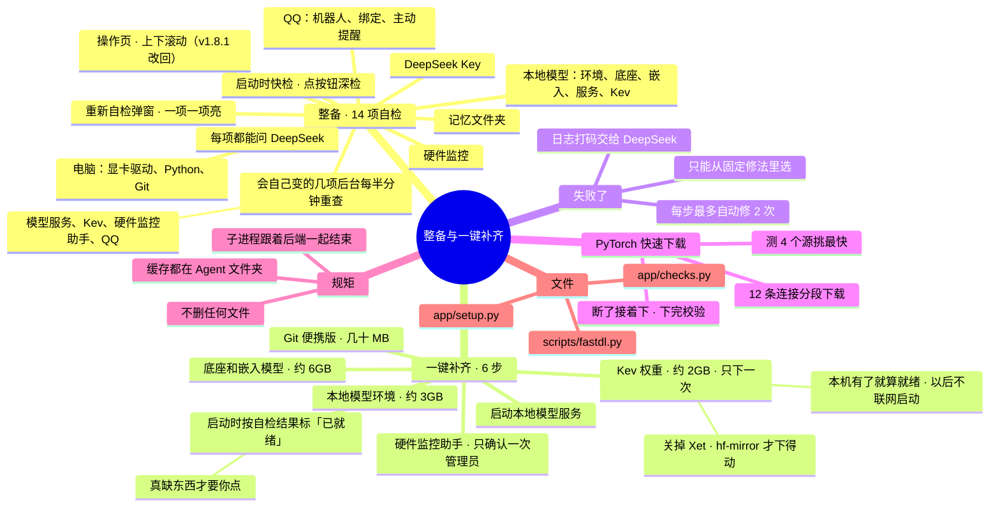

# 架构 · 整备与一键补齐

> 最后核对：v1.8.4。

## 结构图

界面「说明」页会把下面这段画成可以点开、收起的树状图，GitHub 上也能直接看图。



## 整备：做什么

列出"能不能在这台电脑上跑起来"的 14 项，每次启动自检，就绪的自动打勾，缺的告诉你放到哪、怎么弄。`app/checks.py`。

**排法：** 上面几项就绪、进度条和「重新自检」；然后一键补齐那张卡；再往下是要处理的、已就绪的、以后再装的卡片，上下滚动。整备是要动手操作的页，作者用它时手本来就在鼠标上，**可以滚**（v1.8.0 把它塞成一屏，作者不喜欢，v1.8.1 改回 v1.7 的样子）。

**启动后不用再点一键补齐（v1.8.1）：**
- 自检结果写在数据库里（`checks`）。一键补齐的 6 步没在跑时，每一步按自检结果标状态（`setup.refresh_ready`，`/api/setup` 每次都先算一遍）：
  - **已就绪**：已经好了（Git 有、环境装好、模型文件在、模型服务在线、Kev 权重在本机、助手在跑）；
  - **自动启动中**：本地模型服务（环境和模型都在，后端启动时自己拉起）、硬件监控助手（开关开着，每半分钟自己拉一次，不弹确认）；
  - **要补**：真缺东西——要下载，或者要你确认一次管理员。
- 按钮跟着变：都齐了是「都齐了 · 再跑一遍」，缺几项是「补齐缺的 N 项」。
- **会自己变的几项（`checks.LIVE`：本地模型环境、模型服务、Kev、硬件监控助手、QQ）后台重查（`checks.refresh_live`）：** 启动后头两分钟每 10 秒、之后每 30 秒一次，写回自检结果；状态变了就更新时间戳，界面轮询 `/api/state` 看到 `prep.ts` 变了就重新拿 `/api/checks` 和 `/api/setup`。所以助手晚几秒起来，整备上也会自己从"缺失"变成"已就绪"，不用点重新自检。
- **硬件监控那项**：开关开着、助手正在拉起时，检测先等它最多 12 秒；没起来显示"开关开着，正在启动"（待处理），不再显示"缺失"。助手在跑但读不到 CPU 温度，算这一步好了（`running: true`），只提示装 PawnIO。

| 项 | 怎么查 |
| --- | --- |
| 显卡驱动 | 运行 nvidia-smi |
| Python 3.12 | 后端就是用它跑的 |
| Git | `git --version`（一键补齐装的便携版在 `tools\git`） |
| 本地模型环境 | 模型服务在线、能用显卡，就直接算就绪（它就跑在 ai-env 里）。模型服务正在启动时显示「检测中」，起来了后台重查自己变。都不在时才另开 Python 导入显卡版 PyTorch、Transformers、PEFT：放后台跑、不被自检的 20 秒时限打断，没查完显示「检测中」，查完记 10 分钟。（v1.8.4 以前每次都另开 Python，刚开机加载 PyTorch 超过 20 秒，就成了「检测超时」） |
| 底座 MiniCPM5-2B、嵌入模型 | 文件夹里有没有 config.json 和 .safetensors |
| 本地模型服务 | `/health` 通不通、嵌入模型加载没有 |
| 决策脑 Kev | Kev 服务通不通 |
| 硬件监控 | 硬件监控助手通不通 |
| DeepSeek API Key | 用 Key 查一次余额 |
| QQ 官方机器人、绑定你的 QQ、测试主动提醒 | 换凭证、连 WebSocket；有没有收到你的消息；主动发一条 |
| 记忆文件夹 | 在不在、有没有 git |

- **快检**（启动时）：不启动模型、不花钱。
- **自检窗口：** 启动时和点「重新自检」时弹出。14 项同时查（`/api/checks/<项>/run?quick=1`），哪项先查完先亮：转圈变成对勾、叉或横线。启动时查完自己关；重新自检时停在结果上，显示用时，有要处理的就多一个「去处理」，点了跳到第一张要处理的卡片并闪一下。点「后台继续」可以先关窗口，查完弹一句提示。
- **深检**（点按钮）：才启动模型服务、跑实测。
- **问 DeepSeek：** 每项都有这个按钮，DeepSeek 给 3 步以内的修法，不发密钥。

## 一键补齐：怎么走

`app/setup.py`。装到哪、从哪下都是写死的，和手动双击那几个 .bat 做的事一模一样，不让模型随手敲命令。

```
6 步按顺序：Git（便携版）→ 本地模型环境 → 底座和嵌入模型 → 启动本地模型服务 → Kev 的权重 → 硬件监控助手
每一步：先查是不是已经好了（好了就跳过）→ 前面要的没好就先不做 → 运行 → 失败了：
   把日志最后几十行交给 DeepSeek（先打码），它只能从固定修法里选一种：
     原样重试 · 等 3 分钟再试 · 换 Git 镜像 · pip 改走清华镜像 · 模型改从 hf-mirror 下 · 跳过 · 要你手动做
   每步最多自动修 2 次；没填 Key 时按简单规则（像网络问题就重试一次）
```

| 步 | 做什么 | 下载约多少 |
| --- | --- | --- |
| Git（便携版） | 从 npmmirror、华为云、清华镜像下 MinGit，解压到 `tools\git`，不装进系统 | 几十 MB |
| 本地模型环境 | 建 `ai-env`，装显卡版 PyTorch（cu128）、Transformers、PEFT、Kev | 约 3GB |
| 底座和嵌入模型 | 从魔搭下载（不通就改 hf-mirror），断了会接着下 | 约 6GB |
| 启动本地模型服务 | 加载嵌入模型 | 0 |
| Kev 的权重 | 经 hf-mirror 下载 | 约 2GB |
| 硬件监控助手 | 第一次弹一次管理员确认，登记成计划任务，以后跟着 Agent 起、没有黑窗口（`app/hwctl.py`，见 [11](11-硬件监控与游戏帧数.md)）；成功了顺手把 设置 › 硬件监控 的开关打开 | 0 |

- **Kev 每次都像要重新下载（v1.8.1 修）：** 以前整备的 Kev 那项只看"Kev 服务在不在线"——它是用到才启动的，所以每次启动都显示"第一次启动会下载约 2GB 权重"，一键补齐的第 5 步也每次去把 Kev 拉起来、联网查一遍。现在：
  - `M.kev_weights()` 看本机 `models\hf-cache\hub` 里有没有 Kev 的快照；Kev 是 LoRA 的话（快照里有 `adapter_config.json`），底座（`base_model_name_or_path`）的快照也要在；有 `.incomplete` 半截文件不算。
  - 权重在就是「已就绪 · 用到才启动」，一键补齐第 5 步直接算好了，不去启动 Kev。
  - Kev 完整启动过一次就记下（数据库 `kev_ok`），以后启动 Kev 带 `HF_HUB_OFFLINE=1`，不联网、不会再下载；万一不联网起不来（本机文件不全），自动联网再起一次，缺的补上。
  - `dev/test_kev.py` 测这几种情况。
- **Kev 下不动（v1.8 修）：** HuggingFace 新的 Xet 下载方式要直连 `cas-server.xethub.hf.co`，hf-mirror 不支持，返回 401，Kev 的权重一直下不动（DeepSeek 看日志也是这么判的）。现在 `paths.keep_inside()` 统一设 `HF_HUB_DISABLE_XET=1`，所有 HF 下载（Kev 服务、下载脚本）都走老的按文件下载，hf-mirror 和官方都能用。

- **PyTorch 下载（`scripts/fastdl.py`）：**
  - 先同时测阿里云、上交、南大、PyTorch 官方 4 个源，各下 3MB，挑最快的。
  - 用 12 条连接、每段 8MB 分段下载。断了再点一次会接着下，进度记在 `.part.json` 里。
  - 下完逐个文件对校验码，有进度条；下坏了就改名，下次重下。
  - 安装包留在 `tools\wheels`，以后重装不用再下。
- **进度：** 各种下载工具打出来的进度都会认出来，在界面上显示百分比、已下 / 总共、速度、还剩多久、用哪个源；30 秒没动静会标「可能卡住」：
  - fastdl 的 `@@PROGRESS` 行
  - pip 的 `--progress-bar raw`
  - 魔搭和 HF 的 tqdm
- **讲解：** 脚本在一键补齐里运行时，说的话加 `@@SAY` 前缀，进 后台 › 进展报告；单独双击 .bat 时仍是普通输出。
- **子进程管理：**
  - 子进程放进 Windows Job Object，后端被关掉时一起结束，不会留下没人管的下载。
  - 后端启动时还会清理上次留下的孤儿安装进程，按命令行里的本项目路径认。
- **不删任何文件：** 旧的 Git 文件夹改名留着；下载的压缩包在内存里解开。
- **缓存放哪：** 所有下载缓存、临时文件都放进 Agent 文件夹（`paths.keep_inside()`），不往 C 盘用户目录写：
  - pip 缓存 → `tools\cache\pip`
  - 魔搭缓存 → `tools\cache\modelscope`
  - HF → `models\hf-cache`
  - 临时文件 → `tools\tmp`

## 文件

- `app/checks.py`：整备自检。
- `app/setup.py`：一键补齐的步骤、修法白名单、进度解析、进展报告。
- `app/paths.py`：所有路径、缓存放哪。
- `scripts/install_ai.py`、`scripts/download_models.py`、`scripts/fastdl.py`。
- 对应的 .bat：`安装本地模型环境.bat`、`下载模型.bat`、`硬件监控.bat`（手动启动用）。
- 日志：`data\logs\setup_<步>.log`。
