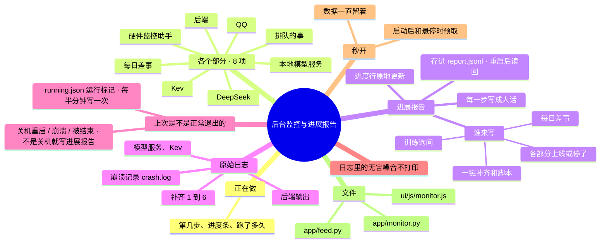

# 架构 · 后台监控与进展报告

> 最后核对：v1.8.5。

## 结构图

界面「说明」页会把下面这段画成可以点开、收起的树状图，GitHub 上也能直接看图。

## 做什么

侧栏「后台」：一眼看到它现在在干什么、各个部分好不好、每一步的进展和原始日志。

## 页面上有什么

| 一块 | 内容 | 数据从哪来 |
| --- | --- | --- |
| 正在做 | 一键补齐跑到第几步、进度条、最新一句进展、已经跑了多久 | `/api/monitor` → `setup.status()` |
| 各个部分 | 8 项，每项带 PID、内存、运行时长：后端、本地模型服务、Kev、QQ、硬件监控助手、DeepSeek（余额、24 小时调用次数）、每日差事（上次什么时候）、排队的事 | `app/monitor.py` `services()` |
| 进展报告（默认标签） | 一条一条写成人话：第几步开始、测了哪些源各多快、下载进度（原地更新，结束后变成"完成 · 大小 · 用时 · 平均速度"）、装了哪些包、DeepSeek 的判断、要你做什么、汇总；每日差事、训练询问、各部分上下线 | `app/feed.py`，`/api/feed` |
| 原始日志（后面的标签） | 补齐 1~6、后端输出、模型服务、Kev | `data\logs\*.log`，`/api/logs/<名字>` |

- **刷新：** 打开这一页时，任务和服务每 2 秒刷新，进展报告和日志每 1.5 秒；切走就停。
- **秒开：** 上次拿到的数据一直留着；程序启动后先预取一次，鼠标移到「后台」按钮上也预取，所以点开不会先空一下。
- **竖屏：** 三块一屏放下，进展报告占剩下的高度，自己在里面滚。

## 进展报告怎么来的

`app/feed.py`：

- **条目种类：** 每条有时间、哪件事、哪一步、种类。种类有：
  - 开始 / 结束
  - 一步开始
  - 普通
  - 好了
  - 要注意
  - 出错
  - DeepSeek 的判断
  - 进度
- **进度行：** 同一件事的进度原地更新，不刷屏；20MB 以下的小文件合成一行；只是转圈的阶段（测速、检查文件）结束后删掉，结论另有一句话。
- **谁来写：**
  - 一键补齐的每一步（`setup.py`）；
  - 脚本的 `@@SAY` 讲解；
  - pip 的"装好了哪些包""报错"；
  - 每日差事（`nightly.py`）；
  - 训练询问（`growth.py`）；
  - 后台照看看到模型服务、Kev、QQ 上线或停了（`main.py` `_watch`）。
- **保存：** 内存里留最近 600 条；进度行以外的每条都写进 `data\logs\report.jsonl`。后端重启后读回最近 200 条，变暗显示，中间隔一行「以上是之前的记录」。

## 日志

- `backend.log`：后端打印的东西都写进来（带时间）。v1.8 起平时没有黑窗口，出了问题先看这里，超过 5MB 就从头写。
- Windows 的行尾是 `\r\n`，读日志时先去掉行尾的 `\r`，再取进度条原地刷新的最后一段。
- 日志名只允许字母、数字、点、横线，防止读到别的文件。
- **无害噪音不打印（v1.8.5）：** Windows 上对方先断开连接时，asyncio 会打一大段「远程主机强迫关闭了一个现有的连接」（`ConnectionResetError` 10054），以前 backend.log 里几百条，把真正的报错淹掉了。后端给事件循环装了 `monitor.quiet_handler`，只吞这一种；硬件监控助手的 HTTP 服务（`hw_helper.Srv`）也不再为对方断开打堆栈。
- **崩溃记录 `crash.log`（v1.8.5）：** 后端一起来就用 `faulthandler` 把底层崩溃（Python 自己来不及打印报错的那种）写进这里，每次启动先写一行「===== 时间 后端启动 · 进程 N」。
- **上次是不是正常退出的（v1.8.5，`monitor.start_guard`）：** 后端运行时 `data\logs\running.json` 记着进程号、起来的时间、最近一次"还活着"的时间（后台照看每半分钟写一次）。点「退出 Agent」（或者命令行里正常停）会删掉它。下次启动时它还在，就按 `monitor.exit_reason` 判断：最近一次"还活着"比这次开机还早 → 随电脑关机或重启停的（只写 backend.log）；crash.log 里上次那一段有 `Fatal Python error` → 崩溃了；都不是 → 被结束了（比如在任务管理器里结束了 Python 进程），或者崩溃了没留下记录。后两种写进进展报告。

## 文件

- `app/monitor.py`、`app/feed.py`。
- `ui/js/monitor.js`：页面、标签页、进度条。进度条和整备卡片共用。
