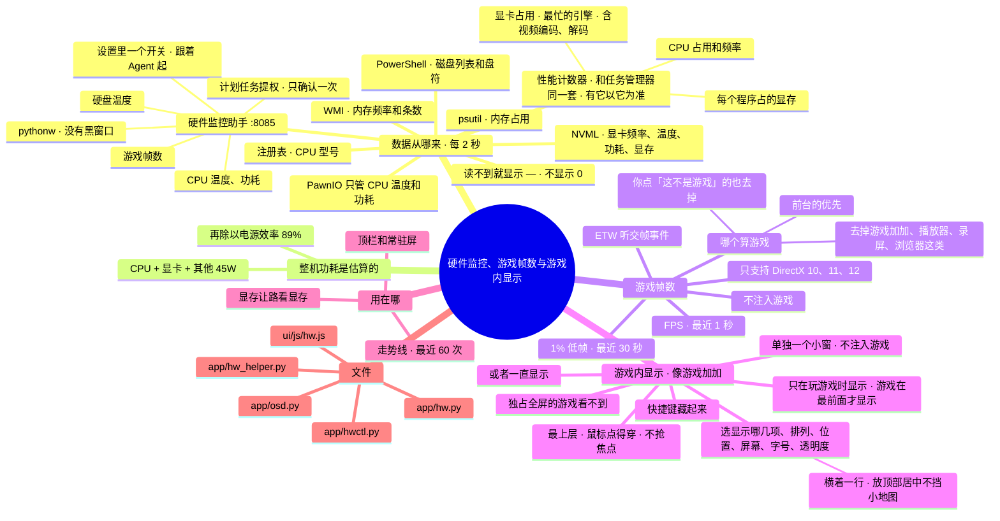

# 架构 · 硬件监控、游戏帧数与游戏内显示

> 最后核对：v1.8.4。

## 结构图

界面「说明」页会把下面这段画成可以点开、收起的树状图，GitHub 上也能直接看图。

## 做什么

顶栏和常驻屏显示 CPU、显卡、内存、整机功耗、硬盘温度，玩游戏时还有 FPS 和 1% 低帧。显存让路靠这里的显存读数和每个程序占的显存来判断（见 [02](02-本地模型.md)）。

## 数据从哪来

`app/hw.py` 每 2 秒（可调）采样一次，几个来源拼起来。优先级从低到高：psutil → 传感器（助手）→ NVML → Windows 性能计数器。**占用和频率以任务管理器的算法为准**，传感器只在读不到计数器时兜底。

| 来源 | 给什么 | 要什么条件 |
| --- | --- | --- |
| Windows 性能计数器（PDH，`hw._Pdh`） | CPU 占用 = `% Processor Utility`（任务管理器的"利用率"，算上睿频，封顶 100）；CPU 频率 = 基础频率 × `% Processor Performance`（任务管理器的"速度"）；显卡占用 = `GPU Engine` 每个引擎把各程序加起来，取最忙的那个（任务管理器的"GPU"，录屏时视频编码占满也算）；每个程序占的专用显存（`GPU Process Memory`，显存让路用） | 无，不要驱动、不要管理员 |
| 硬件监控助手 `app/hw_helper.py`（127.0.0.1:8085） | CPU 温度、功耗；硬盘温度；主板传感器；游戏帧数；（读不到计数器时）CPU 频率、占用 | 设置 › 硬件监控 打开（管理员权限，见下面）；CPU 温度、功耗还要装一次 PawnIO 驱动 |
| NVIDIA 驱动的 NVML | 显卡频率、温度、功耗、显存；（读不到计数器时）显卡占用 = 图形和视频编码、解码里最高的 | 不需要管理员 |
| psutil | 内存占用；（都读不到时）CPU 占用 | 无 |
| PowerShell `Get-Disk`（`hw._disk_info`） | 磁盘列表和盘符，读一次。和传感器的硬盘按型号对上：有几块列几块，按任务管理器的顺序（磁盘 0、1、2……），名字前面带盘符；传感器没读到的那块温度显示"—"。虚拟磁盘不算 | 无 |
| Windows 注册表 | CPU 型号（读一次记住；显卡型号来自 NVML）。不写死任何型号，换电脑也对 | 无 |
| Windows WMI（`Win32_PhysicalMemory`） | 内存频率、代数、条数，比如"32 GB DDR4 · 2 条"，不用手填 | 无 |

- **PawnIO 只管 CPU 温度和功耗：** 这两项在 CPU 内部的寄存器里，任务管理器也没有，读它要内核驱动（LibreHardwareMonitor 用 PawnIO）。没装时 LibreHardwareMonitor 给的是 0，v1.8 起 0 当成"读不到"（`hw._pos`），界面显示"—"，常驻屏下面写一句"CPU 温度、功耗读不到（要装 PawnIO 驱动，装完重启）"。
- **v1.8.4 修的：** 装了 PawnIO 以后，传感器的"各核平均频率"把睡着的核也平均进去（偏低，比如 2.12 GHz），以前它盖掉了计数器的正确读数；CPU 占用以前用的算法不算睿频，比任务管理器低；显卡占用以前只读图形 / 计算那部分，录屏时视频编码 99% 却显示 2%；硬盘以前只取前 3 块。
- **最忙的不是 3D 时标出来：** 比如视频编码占满，常驻屏和总览写「GPU · 视频编码」（`gpu.topTxt`）。
- **整机功耗是估算的：** 普通电源没法用软件读出真实值，所以按 (CPU + 显卡 + 其他部件估计) ÷ 电源效率 算。其他部件默认 45W、效率默认 89%，都可调。
- **内存温度：** 大多数内存条没有温度传感器，读不到。
- **走势线：** 后端一直记最近 60 次读数，界面一打开走势线就是满的。

## 游戏帧数怎么读

在硬件监控助手里（因为要管理员权限）。做法和 Intel PresentMon 一样：
- 开一个 ETW 实时会话，听 Windows 自带的 Microsoft-Windows-DXGI 事件里"交一帧画面"（Present）的那几个；
- 不往游戏里注入任何东西，不会被反作弊当外挂。

| 数 | 怎么算 |
| --- | --- |
| FPS | 最近 1 秒交了几帧 |
| 1% 低帧 | 最近 30 秒里最慢的 1% 帧间隔取平均，换算成帧数（越接近 FPS 越稳） |
| 读哪个程序 | 见下面「哪个算游戏」 |

**哪个算游戏：**
- 助手先去掉一张内置的名单：系统（dwm、资源管理器……）、浏览器、聊天软件（QQ、微信、Discord……）、视频和音乐播放器（PotPlayer、VLC、mpv、B 站客户端……）、壁纸、录屏（OBS……），以及帧数监控和叠加层工具——游戏加加（GamePP 开头的都算）、MSI Afterburner / RTSS、NVIDIA 叠加层、Xbox Game Bar 这些。它们也在不停出画面，以前游戏加加一打开，游戏内显示的小框就以为在玩游戏。
- 剩下的按"在最前面的排第一、其余按出画面多少"排好，最多 6 个都报给后端（`cands`，每个带 FPS、1% 低帧、在不在最前面）。
- 后端（`hw.pick_fps`）再去掉你在 设置 › 游戏内显示 › 游戏识别 里点过「这不是游戏」的（`fpsSkip`），剩下第一个就是游戏。那里会列出现在正在出画面的程序，哪个被当成了游戏、帧数多少。
- 老版本的助手（没有 `cands`）也兼容。

- 只支持 DirectX 10/11/12 的游戏，Vulkan、OpenGL 读不到。
- 依赖 `pywintrace`。
- 上次助手没正常退出的话，会先关掉留下的同名会话再开。

## 游戏内显示（`app/osd.py`，v1.7 起）

像游戏加加那样，在游戏画面一角浮一个小框，显示：帧数、1% 低帧、CPU（占用 / 温度 / 功耗）、显卡（占用 / 温度 / 功耗）、显存、内存、整机功耗、时间。

- **怎么做的：**
  - 单独一个进程 `pythonw -m app.osd`，用 Python 自带的 tkinter 开一个无边框小窗。
  - 窗口样式加上 WS_EX_LAYERED、WS_EX_TRANSPARENT（鼠标点得穿）、WS_EX_TOOLWINDOW（不进任务栏）、WS_EX_NOACTIVATE（不抢焦点）、WS_EX_TOPMOST，每半秒再压一次最上层。
  - 不往游戏里注入任何东西，不会被反作弊当外挂。
- **数据：** 小框每秒问一次 `/api/osd`，拿到设置和硬件读数；显示哪几行的规则在 `osd.lines`，设置页的预览用的是同一套规则。
- **什么时候显示（`osd.visible`）：**
  - 「只在玩游戏时」：读到帧数、而且游戏在最前面才显示（切到桌面、Agent 界面就藏起来），需要硬件监控助手开着。
  - 「一直显示」：任何时候都显示。
  - 快捷键（默认 Ctrl + Alt + F10，用 RegisterHotKey）按一下藏、再按一下出。藏的时候把整个窗口的透明度设成 0，不关窗口。
- **排列（v1.8.1）：** 竖着一列（名字靠左、数值靠右），或者横着一行（名字 数值 名字 数值……），横着的放屏幕顶部居中，不挡左上角的小地图。设置页的预览也跟着变（放不下一行就按比例缩小字）。
- **位置：** 四个角、顶部居中、底部居中（`osd.place`，v1.8.1 加了两个居中），离边多少像素都可以调。屏幕可以选主屏、第 2 块、第 3 块（用 EnumDisplayMonitors 列出来，主屏排第一）。窗口是 DPI 感知的。
- **温度变色：** CPU ≥ 85°C、显卡 ≥ 83°C 时那一行变红。
- **后端管它（`osd.ctl()`）：**
  - 每 4 秒看一次：设置里开了、它又没在跑，就拉起来；挂了 30 秒后再试。设置里关了就按进程号停掉。
  - 换了快捷键会重开一次。
  - 退出 Agent 时一起停。
  - 后端没了 15 秒，小框自己关。
- **限制：**
  - 只对「窗口化」和「无边框全屏」的游戏有效，「独占全屏」的游戏会盖住所有别的窗口。
  - 帧数只支持 DirectX 10/11/12。
  - Win32 和 tkinter 这部分只能在你的电脑上实测，沙箱里只测了"显示什么、什么时候显示"的逻辑（`dev/test_osd.py`）。

## 硬件监控助手的开和关（`app/hwctl.py`，v1.8 起）

以前要双击 `硬件监控.bat`，会留一个管理员黑窗口。现在在 设置 › 硬件监控 里一个开关：
- **打开：** 第一次用管理员身份（弹一次确认，点「是」）在 Windows 计划任务里登记 `ExperimentAgent-HwHelper`：用 `pythonw` 跑 `app\hw_helper.py`，"使用最高权限"，不限运行时长。以后都用 `schtasks /Run` 起它，Windows 直接给管理员权限，不再弹确认，也没有黑窗口；它说的话写进 `data\logs\hw_helper.log`。
- **跟着 Agent 起：** 开关开着（`hwOn`），后台照看每 30 秒看一次，没在跑就拉起来（不弹确认；没登记过任务就算了）。退出 Agent 时一起关。
- **关：** `POST 127.0.0.1:8085/quit`（带 `X-Agent` 头，网页偷偷发不了）让它自己退；退不掉再 `schtasks /End`。
- **登记不上**（没点「是」、公司电脑不让建计划任务）：退回老办法，直接用管理员身份起 pythonw（每次打开都弹一次确认）。
- 一键补齐第 6 步也走这里，成功了顺手把开关打开。
- `硬件监控.bat` 留着手动启动用：用管理员身份在后台起 pythonw，也没有黑窗口。
- 旧的「开机自启.bat」建的 `AgentHW` 任务会被删掉（助手跟着 Agent 起就够了）。

## 设置

设置 › 硬件监控，具体有这几项：
- 硬件监控助手的开关（上面那一块，显示在不在跑、CPU 温度读不读得到）
- 数据来源
- 助手地址（用 LibreHardwareMonitor 自带的网页服务也行）
- 刷新间隔
- 其他部件功耗估计
- 电源效率

设置 › 游戏内显示，具体有这几项：
- 在游戏里显示（总开关）
- 什么时候显示
- 显示哪几项（点选，带实时预览）
- 排列：竖着一列 / 横着一行
- 位置：四个角、顶部居中、底部居中
- 显示在哪块屏幕
- 离屏幕边多远
- 字号
- 不透明度
- 显示 / 隐藏的快捷键
- 游戏识别：现在正在出画面的程序，哪个当成了游戏；「这不是游戏」/「其实是游戏」

## 文件

- `app/hw.py`：采样、拼数据、估功耗、记历史。
- `app/hw_helper.py`：管理员助手（LibreHardwareMonitor 核心库 + ETW 帧数 + 哪个算游戏）。
- `app/hwctl.py`：助手的开和关（计划任务提权、跟着 Agent 起、退出时关）。
- `ui/js/hw.js`：顶栏、常驻屏的格子和走势线；演示模式里的模拟数据。
- `app/osd.py`：游戏内显示的小框，以及后端怎么管它。
- `硬件监控.bat`：手动启动用。

## 限制

- **ETW 读帧、WMI 读内存、性能计数器读频率、计划任务提权：** 只在代码层面写好（帧数统计和"哪个算游戏"有 `dev/test_fps.py`），还要在你的电脑上实测。
- **CPU 温度、功耗：** 新版 LibreHardwareMonitor 要 PawnIO 驱动才读得到，装完要重启。
