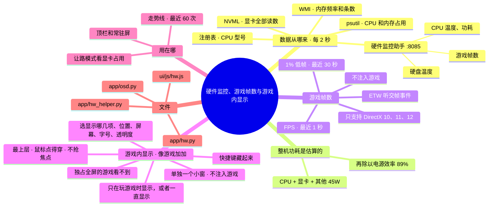

# 架构 · 硬件监控、游戏帧数与游戏内显示

> 最后核对：v1.7.0。

## 结构图

界面「说明」页会把下面这段画成可以点开、收起的树状图，GitHub 上也能直接看图。

## 做什么

顶栏和常驻屏显示 CPU、显卡、内存、整机功耗、硬盘温度，玩游戏时还有 FPS 和 1% 低帧。让路模式也靠显卡占用来判断。

## 数据从哪来

`app/hw.py` 每 2 秒（可调）采样一次，三个来源拼起来：

| 来源 | 给什么 | 要什么条件 |
| --- | --- | --- |
| 硬件监控助手 `app/hw_helper.py`（127.0.0.1:8085） | CPU 温度、频率、功耗；硬盘温度；主板传感器；游戏帧数 | 双击 `硬件监控.bat`（管理员）；CPU 温度还要装一次 PawnIO 驱动 |
| NVIDIA 驱动的 NVML | 显卡占用、频率、温度、功耗、显存 | 不需要管理员 |
| psutil | CPU 占用、内存占用 | 无 |
| Windows 注册表 | CPU 型号（读一次记住；显卡型号来自 NVML）。不写死任何型号，换电脑也对 | 无 |
| Windows WMI（`Win32_PhysicalMemory`） | 内存频率、代数、条数，比如"32 GB DDR4 · 2 条"，不用手填 | 无 |

- **整机功耗是估算的：** 普通电源没法用软件读出真实值，所以按 (CPU + 显卡 + 其他部件估计) ÷ 电源效率 算。其他部件默认 45W、效率默认 89%，都可调。
- **内存温度：** 大多数内存条没有温度传感器，读不到。
- **走势线：** 后端一直记最近 60 次读数，界面一打开走势线就是满的。

## 游戏帧数怎么读

在硬件监控助手里（因为要管理员权限）。做法和 Intel PresentMon 一样：
- 开一个 ETW 实时会话，听 Windows 自带的 Microsoft-Windows-DXGI 事件里"交一帧画面"（Present）的那几个；
- 不往游戏里注入任何东西，不会被反作弊当外挂。

| 数 | 怎么算 |
| --- | --- |
| FPS | 最近 1 秒交了几帧 |
| 1% 低帧 | 最近 30 秒里最慢的 1% 帧间隔取平均，换算成帧数（越接近 FPS 越稳） |
| 读哪个程序 | 前台正在出画面的那个；会跳过系统和常用软件（dwm、浏览器、QQ、微信……） |

- 只支持 DirectX 10/11/12 的游戏，Vulkan、OpenGL 读不到。
- 依赖 `pywintrace`。
- 上次助手没正常退出的话，会先关掉留下的同名会话再开。

## 游戏内显示（`app/osd.py`，v1.7 起）

像游戏加加那样，在游戏画面一角浮一个小框，显示：帧数、1% 低帧、CPU（占用 / 温度 / 功耗）、显卡（占用 / 温度 / 功耗）、显存、内存、整机功耗、时间。

- **怎么做的：**
  - 单独一个进程 `pythonw -m app.osd`，用 Python 自带的 tkinter 开一个无边框小窗。
  - 窗口样式加上 WS_EX_LAYERED、WS_EX_TRANSPARENT（鼠标点得穿）、WS_EX_TOOLWINDOW（不进任务栏）、WS_EX_NOACTIVATE（不抢焦点）、WS_EX_TOPMOST，每半秒再压一次最上层。
  - 不往游戏里注入任何东西，不会被反作弊当外挂。
- **数据：** 小框每秒问一次 `/api/osd`，拿到设置和硬件读数；显示哪几行的规则在 `osd.lines`，设置页的预览用的是同一套规则。
- **什么时候显示（`osd.visible`）：**
  - 「只在玩游戏时」：读到帧数才显示，需要硬件监控助手开着。
  - 「一直显示」：任何时候都显示。
  - 快捷键（默认 Ctrl + Alt + F10，用 RegisterHotKey）按一下藏、再按一下出。藏的时候把整个窗口的透明度设成 0，不关窗口。
- **位置：** 四个角选一个，离边多少像素都可以调。屏幕可以选主屏、第 2 块、第 3 块（用 EnumDisplayMonitors 列出来，主屏排第一）。窗口是 DPI 感知的。
- **温度变色：** CPU ≥ 85°C、显卡 ≥ 83°C 时那一行变红。
- **后端管它（`osd.ctl()`）：**
  - 每 4 秒看一次：设置里开了、它又没在跑，就拉起来；挂了 30 秒后再试。设置里关了就按进程号停掉。
  - 换了快捷键会重开一次。
  - 退出 Agent 时一起停。
  - 后端没了 15 秒，小框自己关。
- **限制：**
  - 只对「窗口化」和「无边框全屏」的游戏有效，「独占全屏」的游戏会盖住所有别的窗口。
  - 帧数只支持 DirectX 10/11/12。
  - Win32 和 tkinter 这部分只能在你的电脑上实测，沙箱里只测了"显示什么、什么时候显示"的逻辑（`dev/test_osd.py`）。

## 设置

设置 › 硬件监控，具体有这几项：
- 数据来源
- 助手地址（用 LibreHardwareMonitor 自带的网页服务也行）
- 刷新间隔
- 其他部件功耗估计
- 电源效率

设置 › 游戏内显示，具体有这几项：
- 在游戏里显示（总开关）
- 什么时候显示
- 显示哪几项（点选，带实时预览）
- 位置
- 显示在哪块屏幕
- 离屏幕边多远
- 字号
- 不透明度
- 显示 / 隐藏的快捷键

## 文件

- `app/hw.py`：采样、拼数据、估功耗、记历史。
- `app/hw_helper.py`：管理员助手（LibreHardwareMonitor 核心库 + ETW 帧数）。
- `ui/js/hw.js`：顶栏、常驻屏的格子和走势线；演示模式里的模拟数据。
- `app/osd.py`：游戏内显示的小框，以及后端怎么管它。
- `硬件监控.bat`。

## 限制

- **ETW 读帧、WMI 读内存：** 只在代码层面写好，还要在你的电脑上实测。
- **退出 Agent 时：** 硬件监控助手不会跟着关，它是单独的管理员窗口。
