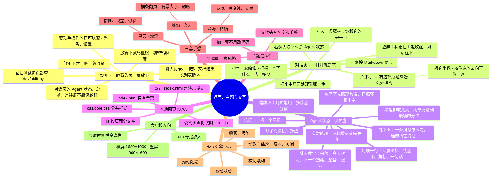

# 架构 · 界面、主题与交互

> 最后核对：v1.8.8。

## 结构图

界面「说明」页会把下面这段画成可以点开、收起的树状图，GitHub 上也能直接看图。



## 怎么搭的

界面是一个本地网页，由后端在 127.0.0.1:8765 提供。在桌面窗口里打开（见 [13](13-桌面窗口.md)），打不开时用 Edge。没有用任何框架，按页面拆成小文件，改哪块只动哪块。

```
ui\
  index.html        只有骨架：侧栏、顶栏、各页的空壳、常驻屏
  css\core.css      公共样式：布局、组件、横竖屏、交互引擎的公共部分
  themes\*.css      一个文件一套风格（颜色、字体、常驻环、手感）；themes.js 是自动生成的清单
  js\               每个页面一个文件：
    base.js         小工具：$、api()、toast、数字动画、图标
    data.js         设置的分区和字段定义、演示数据、全局状态 S
    shell.js        切页、横竖屏、亮度和缩放、换风格
    main.js         启动、和后端同步（每 5 秒拉一次 /api/state）
    chat.js         对话页（默认打开它）：聊天、右边的 Agent 状态和「这条怎么处理的」
    home / events / brains / reports / settings / prep / setup / monitor / docs .js   各页
    tts.js          配音页（v1.8.6，见 14）：整页只画一次，之后只刷新「生成」「试听」两块，打字不被打断
    tree.js         说明页的树状图（把文档里的 mermaid mindmap 画出来）
    resident.js     常驻屏（大时钟、断续环、硬件格子、后台任务进度条）
    hw.js           硬件数据和走势线
    cards.js        提醒卡片、训练询问卡片
    window.js       桌面窗口：拖动、改大小、全屏、收起、关闭
    fx.js           交互引擎（见下面）
```

- **演示模式：** 直接双击 `ui\index.html`（不经过后端）就是演示模式，用假数据，什么都不会保存。
- **切页：** 用浏览器的视图过渡。旧画面立刻隐藏，新画面立刻完整显示，只带一点位移，不会两页叠在一起、也不会发暗。侧栏、顶栏只在进出常驻屏时才淡入淡出。
- **大小：**
  - 所有尺寸都用 rem，按设计尺寸等比放大：横屏 1680×1000，竖屏 960×1600，放大倍数限制在 1 到 2.4。
  - 设置里可以关掉自动放大，或者再整体调字号。
- **横竖屏：** 默认按窗口比例自动切，也可以固定。竖屏时侧栏变成底栏。

## 规矩：一眼看的页一屏放下（v1.8 起，v1.8.1 说清楚了范围）

作者的要求（v1.8.1 补充说明）：
- **闲下来"一眼看"的页**——对话页右边的 Agent 状态、总览、常驻屏——信息要一屏看全，不靠鼠标滚轮翻。现在已经放得下的事件、后台、大脑、报告也保持。
- **但别挤得密密麻麻。** 放得下就尽量松：字大一点、留白多一点（仪表盘有 roomy2 / roomy / 普通 / dense / dense2 五级，从最松的试起）。
- **要动手操作的页可以上下滚**：整备、设置各分区。用它们时手本来就在鼠标上，滚一下不麻烦；别为了不滚硬塞成一屏（v1.8.0 把整备塞成左右两栏一屏，作者不喜欢，v1.8.1 改回上下滚动）。
- 例外：本来就是"一长串同一种东西"的地方——聊天记录、事件列表、后台日志、说明文档、报告里的两张清单、事件的回复正文、配音的文案框和时间轴——在自己的框里滚。
- 配音页（v1.8.6）横屏三栏（文案 | 音色 | 生成 + 试听），竖屏文案在上、下面两栏，一屏放下。
- **常驻屏的后台任务进度条（v1.8.8，`resident.js` 的 `renderTasks` / `fitResident`）：** 后台有带进度的活（安装配音、一键补齐、生成配音，后端 `reports.tasks()`）时，硬件格子下面多一条：任务名、正在做什么、百分比、速度、还剩多久；没任务不显示。数据来自 `/api/state` 的 `tasks`（每 5 秒），在常驻屏时另外每 2 秒拿一次 `/api/tasks`。多了这条放不下时（竖屏、字调大）先把硬件格子收紧（`.rs.tight`），还不行藏掉走势线、钟小一圈（`.tight2`），右下角「硬件数据从哪来」那行也先藏；放得下就不动。`fit.py` 不查常驻屏，`dev/ui/rtasks.py` 查（横竖屏 × 三套风格 × 字 130%）。
- `dev/ui/fit.py` 在横屏 1680×1000 和竖屏 1080×1860 查每个页面和设置分区（整备除外，列在 `SCROLL_OK`），有地方要滚就不过。

## 对话页和 Agent 状态（v1.7 起，v1.7.1 改成仪表盘，v1.8 一屏放下，v1.8.1 放松）

先查了做 AI 助手界面的几条共识，按它们改的：
- 聊天和执行过程分开放；
- agent 的状态一直看得见；
- 解释按需展开，先给一句结论，想看再点开；
- 把握度用"高 / 一般 / 低"这种简单说法，不只给百分比；
- 用了哪些工具要写出来；
- 出错时说清楚出了什么事、为什么、下一步怎么办。

- **对话页（`ui/js/chat.js`）**，在侧栏第一个，一打开就是它：
  - 左边一条窄栏（v1.8.1 起是窗口宽度的 19%，在 17rem 到 24rem 之间）只放你和它的一来一回。QQ 上发的也在这里，带一个「QQ」小标签；定时提醒显示成一行灰色小字。剩下的宽度全给右边。
  - 回复按 Markdown 显示（加粗、列表、链接、表格）。
  - 每条回复下面一行小字：交给谁 · 把握高 / 一般 / 低（隐私的写"只在本地"）· 联网几搜几读 · 查了说明书 · 花了多少 · 用了几秒。
  - 点这行小字，右边切到「这条怎么处理的」（够宽时分两栏：左边分数和为什么，右边每一步、网页、纠正）：
    - 四个去向的分数、为什么这么判；
    - 每一步（正在做的那步会闪）；
    - 查过的网页；
    - 花费和用时；
    - 判错了在这里直接纠正（记一下以后照这个判）；
    - **换它重做**（v1.8）：「交给本地小脑 / DeepSeek / 更强的模型重做」，同一句话按你选的去向马上再处理一遍，也记一次纠正（见 [01](01-决策脑与分流.md)）。隐私的事交给云端要再点一次确认。
  - 发消息是异步的：`POST /api/chat`（带 async）先拿到 token，界面每半秒问一次 `/api/chat/{token}`。打字的气泡里实时显示"DeepSeek 正在想……""正在联网搜索「……」""正在读网页 ……"，后端在每一步把进度写进事件。
  - 回复里提到"没填 Key""余额不足""本地模型没准备好""搜索次数用完"时，气泡下面直接给按钮（去填 Key、去充值、去整备……）。
  - 输入框里 Enter 发送，Shift + Enter 换行。
  - 竖屏：Agent 状态在上（高度跟着内容走，40%~62%，v1.8.2 起），对话在下。右上角「收起」把状态收成一行，那一行上还留着各状态几项。
- **Agent 状态（`app/agentstate.py`，`/api/agent`，也跟着 `/api/state` 每 5 秒给一次）：**
  - **大脑：** 嵌入模型（语义路由）、Kev、底座、每个训练出来的小脑、正在攒样本的新类别。
  - **云端：** DeepSeek（Key、余额、模型）、联网搜索（今天几次）、更强的模型（名字跟着设置；不接受时显示"没开"）。
  - **通道：** QQ（连上没有、绑定没有）、提醒（开着几条、下一个是什么）。
  - **后台：** 后端、本地模型服务、硬件监控助手、每日差事、游戏内显示、排队的事、记忆和说明书的索引。
  - 五种状态：正常（绿）/ 闲着，用到才启动（蓝）/ 要注意（黄）/ 缺了或出错（红）/ 没开（灰）。颜色各主题自己定。
  - 后端除了状态和一句话，还给数：有进度的项带 `m = {p, txt}`（今天搜了几次 / 上限、样本攒了多少 / 200、余额占余额加本月花费的多少、模型占了多少显存），顶层带 `kpi`（余额、今天联网、下一个提醒、整备、记忆）。
- **对话页右边的仪表盘（`chat.js` 里 `agentHTML`），从上到下：**
  - **健康环：** 中间是"几项能用 / 一共几项"（正常 + 闲着算能用），环按五种状态分段；旁边一句话（缺了哪几样）、每种状态几项、「去补齐」「重新自检」。
  - **一条消息怎么走（链路图）：** 界面、QQ → 决策脑（语义路由、Kev 两票）→ 本地小脑 / DeepSeek（能不能联网）/ 更强的模型；下面一条提醒的专线：提醒 → QQ，发不出就电脑通知，同时界面卡片。两头都能用的线是流动的虚线，断了是红虚线，没开是灰点线。线按节点的实际位置用 SVG 画，窗口一变就重画（`drawFlow`，ResizeObserver）。
  - **一排大数字：** DeepSeek 余额（横条 = 余额 /（余额 + 本月花费））、今天联网搜索（次数 / 上限）、下一个提醒、整备（几项就绪）、记忆（几段，说明书几段）。点了跳到对应设置。
  - **按组的列：** 大脑、云端、通道、后台四组，组名旁边一条小色带。右边有多宽就分几列（每列至少 16rem），把几组按顺序分进这几列——几组上下叠在一列，或者一组占两列（里面再分两列）——挑最高那一列最矮的分法（`agColumns`，组不多，全试一遍）。
    - 每项一行：专属图标，外面一圈状态环；右下角一个小角标（✓ 正常、‖ 闲着、! 要注意、× 缺了、– 没开），不只靠颜色；名字后面跟副名和状态标签，下面一句话（太长就省略，停在上面看全）。卡片窄于 17.5rem 时不显示副名（容器查询），免得一行挤满省略号。
    - 几列一样高，铺到底（最后一组撑满），不在下面留一块空。
    - 有数的项，环就是进度，下面还有一条横条；没数的项：正常满圈、闲着满圈但淡、要注意的环在转、缺了的红圈往外扩、没开只剩虚线圈。
    - 缺了的那项，状态标签换成按钮（去补齐、去填 Key、去打开……）。
    - 攒样本的新类别在「小脑」那一项里一行一个进度条。
  - **放得下就松，放不下才收紧（`agFit`，v1.8.1）：** 五级，从最松的试起，挑第一级放得下的：
    - roomy2：图标更大、每项那句话显示两行、间距最大；
    - roomy：字大一号、留白多（作者嫌原来密密麻麻）；
    - 普通；
    - dense：藏每项那句话、缩小图标；
    - dense2：再缩健康环、链路图的小字、大数字下面那行，藏掉状态标签（角标还在）。
    - dense3（v1.8.2）：最紧，藏掉提醒那条专线，每项更矮、图标更小。
    - 越紧，列分得越多（每列至少 16rem → 14rem → 13rem → 11rem），后台那组可以占两列。
    - **竖屏（v1.8.2）：** 状态区的高度跟着内容走（`--side-h`），最多 62%，实在放不下到 75%，最少 40%，剩下的给聊天；作者字调大（130%）时以前要滚，现在 `dev/ui/fit.py` 也查竖屏 130% 的对话页和总览。
    - 窗口大小一变就重新算（ResizeObserver）；窗口大小、字号、内容都没变就不重算（`AG_FIT.key`），防止"改高度 → 触发 ResizeObserver → 再改"来回闪。
    - **列数按整块宽度算（含滚动条那一条），`.side-body` 用 `scrollbar-gutter: stable`（v1.8.3）**：以前用 `clientWidth`，Windows 的滚动条一出一收宽度就变，竖屏会 4 列 ↔ 3 列来回闪。`dev/ui/fit.py` 模仿占宽度的滚动条，连看 2 秒布局不能变。
  - 内容没变就不重画（每 5 秒拉一次状态，只有变了才换），流动的线不会跳。
  - 省电模式、动效「减弱」时，线和环都不动，只留颜色。
- **总览上的卡片（`agentMiniHTML`）：** 小健康环 + 一句话 + 各状态几项，下面一格一个图标（名字和状态，有数的显示数），点了去补或者去对话页。v1.8.1 起这张卡更宽（总览三列 1.5 : 2.1 : 1，今日分流让出地方），格子更大、铺满卡片高度。
- **总览：** 原来的「本地处理比例」「整备」两张小卡换成了 Agent 状态。今日分流、Agent 状态、最近事件这几张不是按钮，悬停时也会浮起来。
- **事件页**不再放输入框，改成每件事的完整记录；回复也按 Markdown 显示。

## 主题是插件

`ui\themes\` 里一个 `.css` 就是一套风格。文件开头几行是说明，后端启动时扫描这个文件夹，生成 `themes.js` 清单：

```
/* @id ember          文件名和这里一致，只用英文小写
   @name 绛焰         显示的名字
   @desc …            一句话说明
   @order 3           排第几
   @fx hrail headline reveal count magnet press    这套风格的手感
*/
```

主题能改：
- 颜色和字体；
- 常驻环的样子，也就是断续的段数、长度、端头（`--ring-segs`、`--ring-fill`、`--ring-cap`）；
- 日期写法、常驻页标签语言；
- 切页动画；
- 每种交互长什么样。

想加一套：复制一个文件、改名、把旧名字全换掉、改颜色和 `@fx`，刷新界面就出现，不用改代码。

## 交互引擎（`ui/js/fx.js`）

每套风格在 `@fx` 里写用哪几种，引擎按名字开关；每种效果"长什么样"写在主题自己的 CSS 里。

| 名字 | 是什么 | 谁在用 |
| --- | --- | --- |
| reveal | 滚动触发：视野外的卡片先藏着，滚进视野才出场（星云从模糊里浮上来、深海从左往右扫出来、绛焰像幕布揭开） | 三套都有 |
| parallax | 视差：背景光斑、页面标题和内容按不同速度移动 | 星云 |
| tilt | 卡片跟着鼠标微微倾斜，带一块跟着走的光斑 | 星云 |
| glide | 惯性滚动：滚轮滚完还会顺着滑一段 | 星云 |
| sticky | 吸顶：页面标题吸在顶部，往下滚收窄 | 深海 |
| progress | 滚动联动：顶部一条细线显示滚到哪了，右下角"第几块 / 一共几块 · 百分比" | 深海 |
| snap | 滚动吸附：停下时对齐到最近的卡片。设置页不吸附，因为内容一直在变会被拉回去；每页最顶上也算一个吸附点 | 深海 |
| hrail | 横向滚动：大脑页和主题卡排成横条，滚轮往下 = 往右翻一张，能按住拖，拖完松手不会误点 | 绛焰 |
| headline | 滚动联动：标题后面一行巨大的空心字，随滚动平移、放大、变淡 | 绛焰 |
| count | 数字进入视野时从 0 跳到实际值（时间、日期不跳） | 绛焰 |
| magnet | 磁吸：鼠标在按钮上移动时，按钮被吸过去一点，松开弹回 | 绛焰 |
| press | 点击反馈：按下的位置出一圈波纹（星云柔光、深海方框、绛焰墨晕） | 三套都有 |

- **怎么实现的：**
  - 一个滚动监听管所有能滚的区域。
  - 滚进视野用 IntersectionObserver。
  - 位置变化用单独的 `translate` 属性，不和卡片自己的出场动画抢。
  - 点击波纹画在最上层，不改按钮本身。
- **哪里不加：** 后台页、日志、常驻屏、提醒卡片。
- **动效设置：**
  - 「丝滑」：全部。
  - 「减弱」或省电模式：去掉视差、倾斜、惯性、磁吸、数字跳动，出场改成短淡入。
  - 「关闭」：只留吸顶、吸附、横条这些不会动的。

## 说明页的树状图（`ui/js/tree.js`）

- **数据从哪来：** 每篇架构说明（`docs/AI文档/架构/*.md`）开头的 mermaid mindmap 段。同一段文字，GitHub 上直接显示成图，AI 读的是缩进大纲。
- **怎么画：**
  - 从左往右一列一层。地方够宽、第一层分支有 4 个以上时，分成左右两边像思维导图，高度差不多减半；两边各算各的列宽，缩到 0.9 倍还放不下就单边。
  - 第一层按主题色分色，线条跟着分支颜色。
  - 太宽就整体缩小，最小 0.62 倍；再宽就在框里左右滚。
- **能做什么：**
  - 点节点收起、展开下面的；「全部展开」「只看第一层」。
  - 鼠标停在节点上，从根到它的那条线会亮起来。
  - 带 `go-NN` 标记的节点有 →，点了跳到那一篇的图。
  - 带 `svc-xxx` 标记的节点有状态灯，用的是「后台」页同一份数据，停在说明页时每 5 秒刷新一次。
- **图和文字切换：** 架构那一组默认只显示图（总览还会加一张实时架构图），右上角能切到文字版；操作手册、更新记录照常是文字。

## 文件

- `ui/js/chat.js`、`app/agentstate.py`：对话页、Agent 状态。

见上面的目录。每个 js 文件开头都写着它管什么；[当前结构](../当前结构.md) 里有自动生成的清单。
