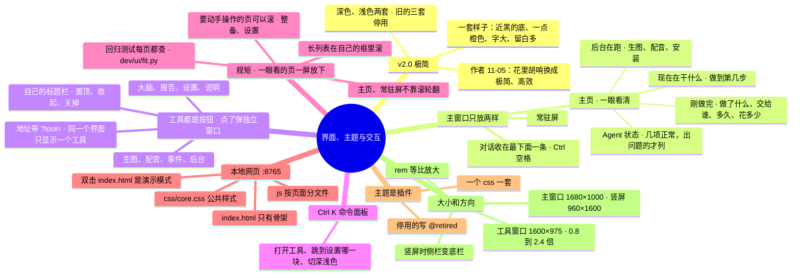

# 架构 · 界面、主题与交互

> 最后核对：v2.1.0。

## 结构图

界面「说明」页会把下面这段画成可以点开、收起的树状图，GitHub 上也能直接看图。



## 怎么搭的

界面是一个本地网页，由后端在 127.0.0.1:8765 提供。在桌面窗口里打开（见 [13](13-桌面窗口.md)），打不开时用 Edge。没有用任何框架，按页面拆成小文件，改哪块只动哪块。

```
ui\
  index.html        只有骨架：侧栏（主页、常驻、8 个工具按钮）、顶栏、各页的空壳、对话抽屉、命令面板、常驻屏
                    地址带 ?tool=img 这种就是工具窗口：<html data-tool="img">，侧栏藏掉，顶栏变成矮的标题栏
  css\core.css      公共样式：布局、组件、横竖屏；最后一段是 v2.0 的壳（主页、对话抽屉、工具窗口、命令面板）
  themes\*.css      一个文件一套风格；v2.0 起只有 dark.css（极简 · 深色）、light.css（极简 · 浅色）；themes.js 是自动生成的清单
  js\
    base.js         小工具：$、api()、toast、数字动画、图标
    data.js         设置的分区和字段定义、演示数据、全局状态 S
    tool.js         工具窗口（v2.0）：openTool / openView / openSec、工具窗口的标题栏、Ctrl K 命令面板、深浅色切换
    home.js         主页（v2.0）：现在、后台在跑、刚做完、Agent 状态、最下面的对话条
    chat.js         对话抽屉：聊天、发消息、带图片、指定交给谁；eventSideHTML 是主页「细节」的内容
    shell.js        切页、横竖屏、亮度和缩放、换风格
    main.js         启动、和后端同步（每 5 秒拉一次 /api/state）；工具窗口只显示那一个工具，不弹启动自检
    events / brains / reports / settings / prep / setup / monitor / docs .js   各工具页
    tts.js          配音（见 14）
    img.js          生图「渲染舱」（见 15）；v2.0 的「角色」页 imgchar.js 在 v2.1 撤掉了
    tree.js         说明页的树状图
    resident.js     常驻屏（大时钟、断续环、硬件格子、后台任务进度条）
    hw.js           硬件数据和走势线
    cards.js        提醒卡片、训练询问卡片
    window.js       桌面窗口：拖动、改大小、全屏、收起、关闭
    fx.js           交互引擎（见下面）
```

- **演示模式：** 直接双击 `ui\index.html`（不经过后端）就是演示模式，用假数据，什么都不会保存。这时点工具按钮不开新窗口，就在主窗口里看。
- **大小：**
  - 所有尺寸都用 rem，按设计尺寸等比放大：主窗口横屏 1680×1000，竖屏 960×1600，放大倍数 1 到 2.4。
  - 工具窗口（v2.0）没有侧栏、标题栏也矮，按 1600×975（竖屏 900×1560）算，可以小到 0.8 倍：默认 1440×880 是 0.9 倍，排版和以前在主窗口里一模一样；拉大窗口字跟着变大。
  - 设置里可以关掉自动放大，或者再整体调字号。
- **横竖屏：** 默认按窗口比例自动切，也可以固定。竖屏时侧栏变成底栏（v2.1：按钮 `flex:1` 一起变窄，桌面窗口多出「收起」「关闭」也一排放得下；以前最右边的「关闭」被切掉一半）；工具窗口没有侧栏。

## v2.0：主窗口只放主页，工具都是独立窗口

作者 11-05 看了别人自己做的 Agent：一眼就看清「现在在干什么、到了哪一步、后台在跑什么」。原来对话页右边的仪表盘（健康环、链路图、两票的百分比……）密密麻麻，看着乱；聊天其实用得不多。所以：

- **左边侧栏：** 主页、常驻，下面「工具」一栏 8 个按钮（生图、配音、事件、后台、大脑、报告、设置、说明），右上角一个小斜箭头表示「开新窗口」。生图、配音在干活时，按钮左上角一个小点在呼吸。最下面：深色 / 浅色、横竖屏、全屏、收起、关闭。
- **点工具按钮（`tool.js` 的 `openTool`）：** 桌面窗口里调 `open_tool(key, arg)` 开一个独立窗口（已经开着就拿到前面）；用浏览器打开时用 `window.open`。工具窗口打开的是同一个界面，地址带 `?tool=img`，只显示那一个工具，顶上一条矮的标题栏：工具名、命令面板、置顶（钉住，比如生图窗口放在竖屏上一直看得到）、收起、关掉。每个工具窗口自己记大小、位置、置顶（`data/window.json` 的 `tools`）。
- **跳到哪一块（`openView` / `openSec`）：** 「去补齐」「去填 Key」这类按钮以前是在主窗口里切到设置页，现在开（或拿到前面）设置窗口，并告诉它跳到哪个分区（地址里的 `arg`，已经开着的窗口用 `toolArg()`）。工具窗口里点「去对话」：把主窗口拿到前面、展开对话（`open_main` / `mainArg`）。
- **Ctrl K：** 命令面板。打开哪个工具、设置的哪一块、重新自检、切深浅色、进常驻屏，输入几个字过滤，回车。
- 主窗口和每个工具窗口各自每 5 秒拉一次 `/api/state`。

## 主页（`ui/js/home.js`，v2.0）

一屏四块（横屏两列两行，竖屏一列：现在 → 后台在跑 → Agent 状态 → 刚做完），最下面一条是对话。字大、留白多，每块自己比较内容，没变就不重画。

- **现在：**
  - 大字写正在干什么（正在决定交给谁 / 正在联网搜索 / 正在读网页 / 正在写回答……），下面一行是那句话；做完了就写那句话本身和「做完了 · 用了几秒 · 花了多少」。
  - 一条进度：收到 → 分流 → 联网搜索 → 读网页 → 回答。事件的每一步带着「离收到过了几秒」（后端 v2.0 起记第三项），每个节点下面写这一步用了几秒；正在做的那一步是橙色、在闪，连线在流动，后面的灰着；语义路由、Kev、决策脑打分并成「分流」，几次联网搜索并成一个「×2」。
  - 最下面一句：交给谁 · 为什么（要联网 / 要读文件 / 把握高……）。
  - 平时跟着最新一条（正在处理的优先：自己在对话里发的，或者 QQ 上来的）。在「刚做完」里点一条就停在那条，顶上「回到最新」（有新的一条在处理时变橙色）。
  - 正在处理时每 0.6 秒问一次 `/api/events/{id}`（自己在对话里发的那条走对话的 token），秒数每 0.25 秒走一下。
  - **细节（右上角）：** 原来对话页右边「这条怎么处理的」那一块收到这里：四个去向的分数、为什么、每一步、带的图片和读的文件、查过的网页、判错了、换它重做、去事件页看完整记录。
- **后台在跑：** 生图、配音、安装配音、一键补齐，每项一行：名字、正在做什么、还要多久、一根进度条（数据是后端 `reports.tasks()`，和常驻屏同一份）。点了打开对应的工具窗口。下面「等着的」：下一个提醒、等你决定的事。
- **刚做完：** 对话的事件 + 做完的活（后端 `feed.done()`：生图一批、配音一段，后端重启就清空），按时间倒着排，最多 6 行：几点、做了什么、交给谁、多久、花多少。点一条对话的事件 → 「现在」停在那条。
- **Agent 状态：** 一个大数字「几项正常」（正常和闲着都算），旁边启动中 / 卡住了 / 要注意 / 出错 / 没开各几项；出问题的才单独列出来（最多 3 行，卡住的排最前），缺什么直接给按钮（去补齐、去填、重启）。下面三个数：DeepSeek 余额、今天联网、下一个提醒。「全部 N 项」弹出每一项的清单。
- **对话（最下面一条）：** 平时只有一行（最新那句回答的开头 + 「问点什么 · Ctrl 空格」）。点了或者按 Ctrl 空格展开成抽屉（主页左下那一块上面），用完 Esc 收起。抽屉里：
  - 你和它的一来一回（QQ 上发的也在），回复按 Markdown 显示；
  - 每条回复下面一行小字：交给谁、把握、联网几搜几读、花了多少、几秒——点它，抽屉收起，主页「现在」停在这条、打开细节；
  - 输入框右边「交给：自动」：指定这一条交给本地小脑 / DeepSeek / 更强的模型（和「换它重做」后台是同一套，见 [01](01-决策脑与分流.md)）；
  - 带图片（回形针、Ctrl+V、拖进来）、没允许的文件夹给「允许读这个文件夹」按钮，和 v1.8.17 一样。
- 原来的对话页仪表盘（健康环、链路图、图标卡片，`chat.js` 的 `agentHTML`、`agFit`）和总览页 v2.0 起不用了，代码还留着。

## 常驻屏

- 大时钟、断续环、硬件格子，和以前一样。
- **常驻屏只在主窗口（v2.1）：** 工具窗口（`?tool=`）闲着不自动进、按 R 也不进（`enterResident` 看 `root.dataset.tool`）。时钟转盘上一秒一动的那一点是倒三角，尖朝着圆心（`secTri`，作者说圆点看着不舒服）。
- **后台任务进度条（`resident.js` 的 `renderTasks`）：** 后台有带进度的活时，硬件格子下面多几条：任务名、正在做什么、百分比、还要多久；没任务不显示。v2.0 起生图（批量、单张）也在里面（作者 11-05：生图和配音同时在跑，进了常驻屏什么都看不到），正在处理的那句对话也算一条。数据来自 `/api/state` 的 `tasks`（每 5 秒），在常驻屏时另外每 2 秒拿一次 `/api/tasks`。放不下时先把硬件格子收紧（`.rs.tight`），还不行藏掉走势线、钟小一圈（`.tight2`）。`dev/ui/rtasks.py` 查横竖屏 × 两套风格 × 字 130%。

## 规矩：一眼看的页一屏放下（v1.8 起，v2.0 范围跟着改）

- **闲下来"一眼看"的页**——主页、常驻屏——信息要一屏看全，不靠鼠标滚轮翻。工具窗口里已经放得下的事件、后台、大脑、报告、配音、生图也保持。
- **但别挤得密密麻麻。** 放得下就尽量松：字大一点、留白多一点。
- **要动手操作的页可以上下滚**：整备、设置各分区（提醒、本地模型、云端这几个列在 `SCROLL_OK`）。
- 例外：本来就是"一长串同一种东西"的地方——聊天记录、事件列表、后台日志、说明文档、报告里的两张清单、配音的文案框和时间轴、生图页里自己滚的几块、主页的「细节」弹层——在自己的框里滚。
- `dev/ui/fit.py`：主窗口的主页在横屏 1680×1000、竖屏 1080×1860（竖屏再把字调到 130%）查；每个工具窗口、每个设置分区（v2.1 加了一条：底栏、标题栏的按钮整个在屏幕里，连桌面窗口才有的「收起」「关闭」一起量）在 1440×880 和 1080×1860 查；有地方要滚就不过。主页还要连看 2 秒，每一块的大小不能变（不来回闪）。

## 主题是插件

v2.0 起只有两套：`dark.css`（极简 · 深色，默认）、`light.css`（极简 · 浅色）。左边侧栏下面那个按钮在两套之间切（从按的地方一圈扩开），设置 › 外观 也能选。
旧的星云、深海、绛焰停用了：文件留着，内容换成一行 `@retired yes`（解压覆盖时把旧的那套换掉），后端扫描时跳过。设置里存的还是旧名字的，打开时自动换成深色。
浅色时生图的「渲染舱」照样用深色（它是照深色底设计的：点阵球、发光的线），`light.css` 里给 `#view-img` 单独写了一份深色的颜色。

`ui\themes\` 里一个 `.css` 就是一套风格。文件开头几行是说明，后端启动时扫描这个文件夹，生成 `themes.js` 清单：

```
/* @id ember          文件名和这里一致，只用英文小写
   @name 绛焰         显示的名字
   @desc …            一句话说明
   @order 3           排第几
   @fx hrail headline reveal count magnet press    这套风格的手感
*/
```

主题能改：
- 颜色和字体；
- 常驻环的样子，也就是断续的段数、长度、端头（`--ring-segs`、`--ring-fill`、`--ring-cap`）；
- 日期写法、常驻页标签语言；
- 切页动画；
- 每种交互长什么样。

想加一套：复制一个文件、改名、把旧名字全换掉、改颜色和 `@fx`，刷新界面就出现，不用改代码。

## 交互引擎（`ui/js/fx.js`）

每套风格在 `@fx` 里写用哪几种，引擎按名字开关；每种效果"长什么样"写在主题自己的 CSS 里。

v2.0 的深色、浅色两套只用 `reveal`（轻轻往上浮出来）和 `press`（一圈很淡的波纹）。下表「谁在用」写的是停用的旧主题，那些手感代码还在，以后加主题能直接用。

| 名字 | 是什么 | 谁在用 |
| --- | --- | --- |
| reveal | 滚动触发：视野外的卡片先藏着，滚进视野才出场（星云从模糊里浮上来、深海从左往右扫出来、绛焰像幕布揭开） | 三套都有 |
| parallax | 视差：背景光斑、页面标题和内容按不同速度移动 | 星云 |
| tilt | 卡片跟着鼠标微微倾斜，带一块跟着走的光斑 | 星云 |
| glide | 惯性滚动：滚轮滚完还会顺着滑一段 | 星云 |
| sticky | 吸顶：页面标题吸在顶部，往下滚收窄 | 深海 |
| progress | 滚动联动：顶部一条细线显示滚到哪了，右下角"第几块 / 一共几块 · 百分比" | 深海 |
| snap | 滚动吸附：停下时对齐到最近的卡片。设置页不吸附，因为内容一直在变会被拉回去；每页最顶上也算一个吸附点 | 深海 |
| hrail | 横向滚动：大脑页和主题卡排成横条，滚轮往下 = 往右翻一张，能按住拖，拖完松手不会误点 | 绛焰 |
| headline | 滚动联动：标题后面一行巨大的空心字，随滚动平移、放大、变淡 | 绛焰 |
| count | 数字进入视野时从 0 跳到实际值（时间、日期不跳） | 绛焰 |
| magnet | 磁吸：鼠标在按钮上移动时，按钮被吸过去一点，松开弹回 | 绛焰 |
| press | 点击反馈：按下的位置出一圈波纹（星云柔光、深海方框、绛焰墨晕） | 三套都有 |

- **怎么实现的：**
  - 一个滚动监听管所有能滚的区域。
  - 滚进视野用 IntersectionObserver。
  - 位置变化用单独的 `translate` 属性，不和卡片自己的出场动画抢。
  - 点击波纹画在最上层，不改按钮本身。
- **哪里不加：** 后台页、日志、常驻屏、提醒卡片。
- **动效设置：**
  - 「丝滑」：全部。
  - 「减弱」或省电模式：去掉视差、倾斜、惯性、磁吸、数字跳动，出场改成短淡入。
  - 「关闭」：只留吸顶、吸附、横条这些不会动的。

## 说明页的树状图（`ui/js/tree.js`）

- **数据从哪来：** 每篇架构说明（`docs/AI文档/架构/*.md`）开头的 mermaid mindmap 段。同一段文字，GitHub 上直接显示成图，AI 读的是缩进大纲。
- **怎么画：**
  - 从左往右一列一层。地方够宽、第一层分支有 4 个以上时，分成左右两边像思维导图，高度差不多减半；两边各算各的列宽，缩到 0.9 倍还放不下就单边。
  - 第一层按主题色分色，线条跟着分支颜色。
  - 太宽就整体缩小，最小 0.62 倍；再宽就在框里左右滚。
- **能做什么：**
  - 点节点收起、展开下面的；「全部展开」「只看第一层」。
  - 鼠标停在节点上，从根到它的那条线会亮起来。
  - 带 `go-NN` 标记的节点有 →，点了跳到那一篇的图。
  - 带 `svc-xxx` 标记的节点有状态灯，用的是「后台」页同一份数据，停在说明页时每 5 秒刷新一次。
- **图和文字切换：** 架构那一组默认只显示图（总览还会加一张实时架构图），右上角能切到文字版；操作手册、更新记录照常是文字。

## 文件

- `ui/js/home.js`、`ui/js/chat.js`、`ui/js/tool.js`、`app/agentstate.py`：主页、对话抽屉、工具窗口和命令面板、Agent 状态。

见上面的目录。每个 js 文件开头都写着它管什么；[当前结构](../当前结构.md) 里有自动生成的清单。
