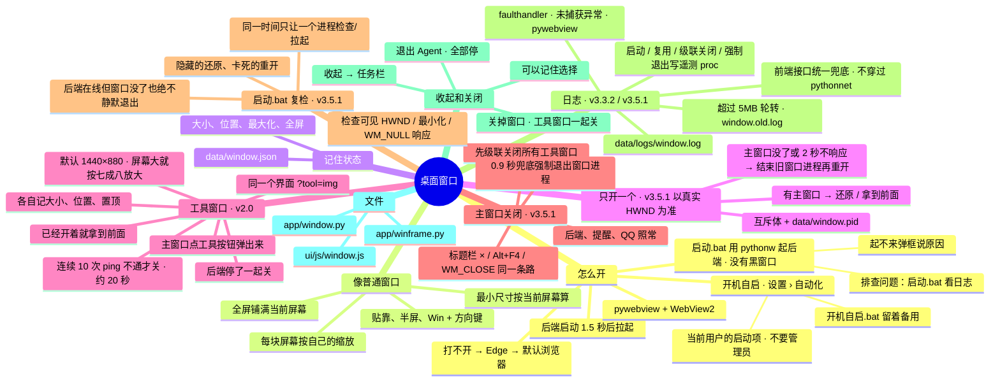

# 架构 · 桌面窗口

> 最后核对：v3.5.1（2026-11-17）。

## 结构图

界面「说明」页会把下面这段画成可以点开、收起的树状图，GitHub 上也能直接看图。



## 做什么

无边框窗口，只显示界面本身，用起来和普通 Windows 窗口一样：
- 贴靠、半屏、Win+方向键、最小化动画都有；
- 两块屏幕缩放比例不同也不会显示不全。

## 怎么搭的

```
双击 启动.bat → 装好依赖后 start pythonw -m app.launch，自己马上关掉（v1.8 起不留黑窗口）
  app/launch.py：没有命令行，说的话写进 data\logs\backend.log；
                 起不来（缺依赖、代码出错、退出码不对）就弹框，写清楚原因和日志在哪
后端启动 1.5 秒后 → pythonw -m app.window（没有黑窗口）
  pywebview + Windows 自带的 WebView2（Edge 内核）
  app/winframe.py：在 Win32 层面把无边框窗口"改造成"正常窗口
  ui/js/window.js：界面这边的拖动、改大小、全屏、收起、关闭
打不开（退出码 3）→ 后端改用 Edge 应用模式 → 再不行用默认浏览器
```

- **每块屏幕按它自己的缩放算**（Per-Monitor V2）：必须在导入 pywebview 之前设置。窗口拖到另一块屏幕时，按 Windows 建议的大小调整，网页重新排版。
- **贴靠：**
  - 窗口带上普通窗口的样式（标题栏、可改大小、最大化、最小化），Windows 才肯对它做贴靠。
  - 接管 WM_NCCALCSIZE，把系统要画的标题栏和边框全部算进内容区，所以看不到任何系统边框。最大化时往里收一圈，不然内容会伸出屏幕。
- **拖动和改大小：** 网页只告诉 Windows "从这里开始拖 / 改大小"，由系统接手，所以贴靠动画、布局条都有。双击顶栏最大化 / 还原。
- **全屏：** 自己实现：去掉边框样式，铺满当前这块屏幕，退出时原样恢复。
- **最小尺寸：**
  - 按"当前这块屏幕"的缩放算（640×480），而且不超过这块屏幕本身；全屏时不限制。
  - 以前按创建窗口那块屏幕的缩放算，主屏 125% 时最小宽 1200，到了 1080 宽的竖屏上全屏会被撑出屏幕。
- **记住状态：** 窗口大小、位置、是否最大化、是否全屏都记在 `data\window.json`。
- **只开一个（v3.5.1 修）：** 再启动一次，先把已经开着的窗口拿到前面。判断不再只看互斥体：`data\window.pid` 记主窗口进程，`FindWindowW("Agent 主控台")` 拿真实 HWND，`IsWindowVisible` / `IsIconic` 看可见和最小化，`SendMessageTimeoutW(WM_NULL, 2 秒)` 看窗口线程是否卡死。主窗口没了、隐藏且还原不了、或 2 秒不响应，就只按 PID 结束本项目的旧 `app.window` 进程，再重新拉起；不会再出现「互斥体还在 → 启动.bat 静默退出」。连续两次 `启动.bat` 由 `Local\AgentWindowLaunch` 命名互斥体排队，不会同时拉起两个窗口进程。
- **日志（v3.3.2）：** `data\logs\window.log`（pythonw 没有黑窗口）。启动时超过 5MB 先轮转成 `window.old.log`；`faulthandler`（底层访问违例）、未捕获异常、线程异常、pywebview 的 logger 都写进去，后台页的日志标签里有「桌面窗口」。
- **接口兜底（v3.3.2）：** `Api` 里暴露给前端的 `window.pywebview.api.*` 统一套了异常捕获：出错写 `window.log` 并返回安全结果（状态类返回一份默认状态，动作类返回 `False`/`0`），不让异常穿过 pythonnet 触发 CLR `0xe0434352` 把整个窗口进程炸掉；`resized` / `moved` 回调也兜住。
- **自动关（v3.3.2 放宽）：** 后端连续 10 次（约 20 秒）`/api/ping` 不通才关窗口，关之前写一行日志。原来 3 次（约 6~12 秒），后端加载模型或 NVML 偶发卡顿时容易误关。
- **主窗口关闭级联（v3.5.1）：** 主窗口的标题栏 ×、Alt+F4、任务栏关闭、系统 `WM_CLOSE` 都走 `closing` 事件：后台线程先 destroy 所有工具窗口，再关主窗口；0.9 秒还没退就 `os._exit(0)` 兜底。不会留下「主窗口没了、工具窗口还在、互斥体被占着」的僵尸进程。后端、提醒、QQ 是另一个进程，照常跑。
- **启动.bat 复检（v3.5.1）：** 后端在线时 `app/main.py` 的 `open_ui()` 调 `window.ensure_main_window()`；`app/launch.py` 在退出码 10 后再复检一次。有窗口就还原到前台；没有/卡死就清掉旧窗口进程并重开。每次检查、复用、重启、失败都写 `data\logs\window.log`（带 PID），并写遥测 `cat=proc`、`action=launch*`（后台 › 行为监控 › 接口与子进程可查）。两次都失败才退回 Edge 应用模式，不会静默退出。
- **开机自启（v1.8.7 起在 设置 › 自动化，`app/autostart.py`）：** 开关打开 = 在当前用户的启动项（`HKCU\Software\Microsoft\Windows\CurrentVersion\Run` 的 `ExperimentAgent`）写 `pythonw -X utf8 app\launch.py --autostart`：不要管理员、不弹确认、没有黑窗口，和双击 `启动.bat` 一样会打开界面。`launch.py --autostart` 先比对 `requirements.txt` 和 `.venv\requirements.done`，依赖变了（刚解压了新版本）就交给 `启动.bat` 去补装。以前用 `开机自启.bat` 建的计划任务 `AgentMain` 开关也认得出（显示开着、不再多写一条）；关掉时一起删，删它要弹一次管理员确认。`开机自启.bat`、`取消开机自启.bat` 留着备用（后者也会删启动项）。两个都开着也只会起一个 Agent。
- **图标：** 任务栏用自己的图标 `ui\icon.ico`，单独成组。

## 工具窗口（v2.0）

作者 11-05：主窗口只放主页和常驻，生图、配音这些做成按钮，点了弹一个新窗口。

- **怎么开：** 界面调 `open_tool(key, arg)`（`app/window.py` 的 `Api`）。`key` 是 img、tts、bgm、publish、events、monitor、brains、reports、ccode（Claude Code 工作台）、settings、docs 之一；`arg` 是「跳到哪一块」（JSON，比如 `{"sec": "cloud"}`）。没开着就新开一个线程建窗口（`open_tool_window`），地址是 `http://127.0.0.1:8765/?tool=key&arg=…`；已经开着就还原、拿到前面（`SetForegroundWindow`），把 `arg` 用 `toolArg()` 告诉它。
- **样子：** 一样是无边框窗口、一样装上原生那套（贴靠、改大小、Win+方向键）。界面那边看到 `?tool=` 就只显示那一个工具：没有侧栏，顶上一条矮的标题栏（工具名、命令面板、置顶、收起、关掉），可以拖动、双击最大化。
- **大小：** 默认 1440×880（界面按 1600×975 的设计尺寸缩放，0.9 倍，排版和以前在主窗口里一样）；屏幕大就按屏幕的七成八放大（`webview.screens`）。每个工具窗口自己记大小、位置、是否最大化、是否置顶，存在 `data\window.json` 的 `tools` 里。
- **置顶：** 标题栏的图钉按钮（`set_top`），比如生图窗口放在竖屏上一直看得到。
- **回主窗口：** 工具窗口里点「去对话」：`open_main(arg)` 把主窗口拿到前面，`mainArg()` 展开对话。
- **关：** 标题栏的 × 只关这一个窗口。后端停了，主窗口和所有工具窗口一起关。**主窗口关了会级联关闭所有工具窗口**（v3.5.1：标题栏 ×、Alt+F4、`WM_CLOSE` 同一条路，0.9 秒内窗口进程退出，不留僵尸）；后端照常跑，再双击 `启动.bat` 会重新开主窗口。
- 不在桌面窗口里（用浏览器打开）时，界面用 `window.open` 开新窗口；双击 `index.html` 的演示模式开不了新窗口，就在主窗口里看。

## 收起和关闭

| 按钮 | 做什么 |
| --- | --- |
| 收起 | 最小化到任务栏 |
| 关闭 → 关掉窗口 | 只关窗口，后端照常跑，提醒和 QQ 不受影响。再双击 `启动.bat` 就会把界面拿出来（退出码 10，不弹框） |
| 关闭 → 退出 Agent | 后端先停掉自己开的子进程（模型服务、Kev、游戏内显示、正在跑的安装、QQ 连接），硬件监控助手开关开着的话也一起关，再退出（退出码 11） |

关闭菜单里勾「记住」，下次就直接这样做，不再问。设置 › 外观 ›「点侧栏『关闭』时」可以改回来。

## 设置

设置 › 外观，具体有这几项：
- 打开方式：无边框窗口 / 简易拖动 / Edge
- 点侧栏「关闭」时怎么做

## 文件

- `app/window.py`：开窗口、只开一个、`probe_main_window()` / `ensure_main_window()`（v3.5.1：真实 HWND + 可见 + WM_NULL 响应 + `data\window.pid` + 启动互斥体）、主窗口级联关闭、记住状态、给界面的接口。接口有：全屏、最大化、拖动、改大小、收起、关闭、开工具窗口（`open_tool`）、回主窗口（`open_main`）、置顶（`set_top`）、告诉别的窗口（`broadcast`，v3.2：设置里改深浅色、布局、点「主窗口全屏」时用）。工具窗口多了「发布」（v3.2）和「Claude Code」工作台（v3.4，`ui/js/ccode.js`）。所有前端接口都由 `_safe` 包一层，异常写 `data\logs\window.log` 并返回安全结果（v3.3.2）。
- `app/winframe.py`：Win32 那部分，包括 DPI、样式、WM_NCCALCSIZE、WM_GETMINMAXINFO、全屏、圆角和深色边。
- `ui/js/window.js`：界面那部分，包括拖动区、四边四角、关闭菜单。
- `ui/js/tool.js`：工具窗口的标题栏按钮、`openTool` / `openView` / `openSec`、命令面板。
- `app/launch.py`：没有黑窗口的入口；起不来弹框；退出码 10 后再做一次窗口复检（v3.5.1）。
- `启动.bat`：平时用 pythonw 跑 `app.launch`，自己马上关掉。排查问题时在 Agent 文件夹打开命令行运行 `启动.bat 看日志`（或 `启动.bat log`），在黑窗口里跑，直接看输出；这时退出码 10、11 会自动关掉黑窗口。
- `data/window.pid`：主窗口进程号和 HWND（v3.5.1），只在启动.bat 检查/重启窗口时用，不进仓库。

## 限制

- Win32 那部分、pythonw 启动和出错弹框在沙箱里跑不了，只能在你的电脑上验证。
- 窗口日志、`faulthandler`、js_api 兜底（v3.3.2）也只在 Windows 真机上验证；下次闪退先看 `data\logs\window.log`。
- 工具窗口（v2.0）：pywebview 运行中再建窗口、拿到前面、置顶、按屏幕放大、各自记位置，沙箱里只测了浏览器那条路（`window.open`），桌面窗口要在你的电脑上试。
- 最小尺寸这次的修法是根据症状推断的。
- v3.5.1 真机已验证：副屏（DISPLAY2）上开主窗口 + 2 个工具窗口，发 `WM_CLOSE` 关主窗口，0.54 秒内两个工具窗口和窗口进程全部退出；后端在线时连续启动两次都复用同一 HWND / PID，没有多开。启动.bat 的 Win32 检查仍只在 Windows 生效。
