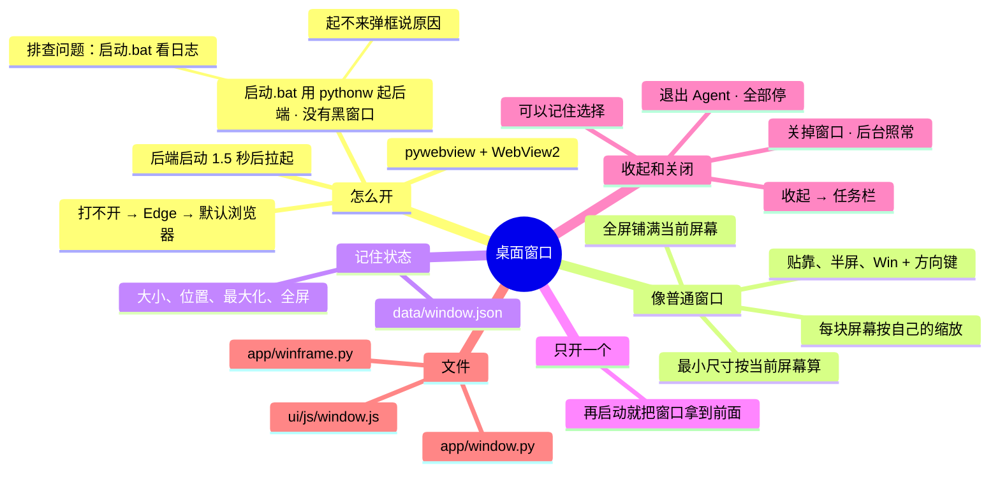

# 架构 · 桌面窗口

> 最后核对：v1.8.0。

## 结构图

界面「说明」页会把下面这段画成可以点开、收起的树状图，GitHub 上也能直接看图。



## 做什么

无边框窗口，只显示界面本身，用起来和普通 Windows 窗口一样：
- 贴靠、半屏、Win+方向键、最小化动画都有；
- 两块屏幕缩放比例不同也不会显示不全。

## 怎么搭的

```
双击 启动.bat → 装好依赖后 start pythonw -m app.launch，自己马上关掉（v1.8 起不留黑窗口）
  app/launch.py：没有命令行，说的话写进 data\logs\backend.log；
                 起不来（缺依赖、代码出错、退出码不对）就弹框，写清楚原因和日志在哪
后端启动 1.5 秒后 → pythonw -m app.window（没有黑窗口）
  pywebview + Windows 自带的 WebView2（Edge 内核）
  app/winframe.py：在 Win32 层面把无边框窗口"改造成"正常窗口
  ui/js/window.js：界面这边的拖动、改大小、全屏、收起、关闭
打不开（退出码 3）→ 后端改用 Edge 应用模式 → 再不行用默认浏览器
```

- **每块屏幕按它自己的缩放算**（Per-Monitor V2）：必须在导入 pywebview 之前设置。窗口拖到另一块屏幕时，按 Windows 建议的大小调整，网页重新排版。
- **贴靠：**
  - 窗口带上普通窗口的样式（标题栏、可改大小、最大化、最小化），Windows 才肯对它做贴靠。
  - 接管 WM_NCCALCSIZE，把系统要画的标题栏和边框全部算进内容区，所以看不到任何系统边框。最大化时往里收一圈，不然内容会伸出屏幕。
- **拖动和改大小：** 网页只告诉 Windows "从这里开始拖 / 改大小"，由系统接手，所以贴靠动画、布局条都有。双击顶栏最大化 / 还原。
- **全屏：** 自己实现：去掉边框样式，铺满当前这块屏幕，退出时原样恢复。
- **最小尺寸：**
  - 按"当前这块屏幕"的缩放算（640×480），而且不超过这块屏幕本身；全屏时不限制。
  - 以前按创建窗口那块屏幕的缩放算，主屏 125% 时最小宽 1200，到了 1080 宽的竖屏上全屏会被撑出屏幕。
- **记住状态：** 窗口大小、位置、是否最大化、是否全屏都记在 `data\window.json`。
- **只开一个：** 再启动一次，就把已经开着的窗口拿到前面。
- **自动关：** 后端停了，窗口几秒内自己关。
- **图标：** 任务栏用自己的图标 `ui\icon.ico`，单独成组。

## 收起和关闭

| 按钮 | 做什么 |
| --- | --- |
| 收起 | 最小化到任务栏 |
| 关闭 → 关掉窗口 | 只关窗口，后端照常跑，提醒和 QQ 不受影响。再双击 `启动.bat` 就会把界面拿出来（退出码 10，不弹框） |
| 关闭 → 退出 Agent | 后端先停掉自己开的子进程（模型服务、Kev、游戏内显示、正在跑的安装、QQ 连接），硬件监控助手开关开着的话也一起关，再退出（退出码 11） |

关闭菜单里勾「记住」，下次就直接这样做，不再问。设置 › 外观 ›「点侧栏『关闭』时」可以改回来。

## 设置

设置 › 外观，具体有这几项：
- 打开方式：无边框窗口 / 简易拖动 / Edge
- 点侧栏「关闭」时怎么做

## 文件

- `app/window.py`：开窗口、只开一个、记住状态、给界面的接口。接口有：全屏、最大化、拖动、改大小、收起、关闭。
- `app/winframe.py`：Win32 那部分，包括 DPI、样式、WM_NCCALCSIZE、WM_GETMINMAXINFO、全屏、圆角和深色边。
- `ui/js/window.js`：界面那部分，包括拖动区、四边四角、关闭菜单。
- `app/launch.py`：没有黑窗口的入口；起不来弹框。
- `启动.bat`：平时用 pythonw 跑 `app.launch`，自己马上关掉。排查问题时在 Agent 文件夹打开命令行运行 `启动.bat 看日志`（或 `启动.bat log`），在黑窗口里跑，直接看输出；这时退出码 10、11 会自动关掉黑窗口。

## 限制

- Win32 那部分、pythonw 启动和出错弹框在沙箱里跑不了，只能在你的电脑上验证。
- 最小尺寸这次的修法是根据症状推断的。
