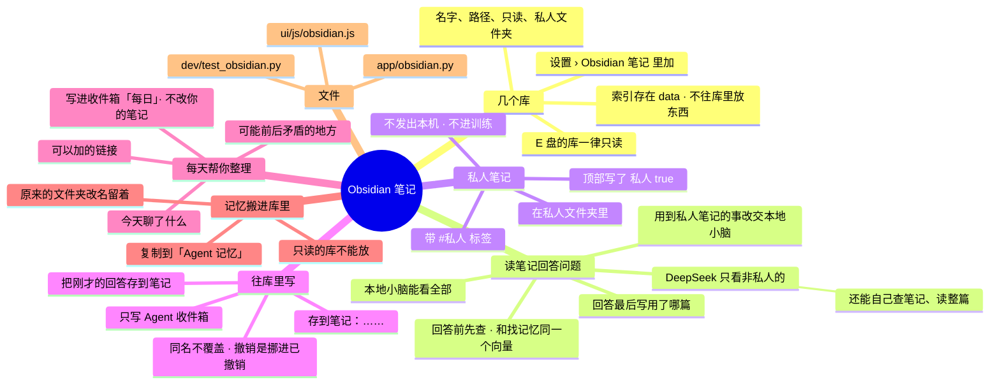

# 架构 · Obsidian 笔记

> 最后核对：v1.9.0。

## 结构图

界面「说明」页会把下面这段画成可以点开、收起的树状图，GitHub 上也能直接看图。

## 做什么

v1.9.0 加的。作者有两个库：E 盘的小说库（E 盘是他的铁律：只读）和 F 盘的数据中心库。他要的四件事都做了：

1. **读笔记回答问题**：问到他写过、记过的东西（小说设定、人物、大纲……），先查笔记再答，回答最后写「笔记：《篇名》」。
2. **往库里写**：「存到笔记：……」「把刚才的回答存到笔记」，写进能写的库的「Agent 收件箱」。
3. **每天帮你整理**：每日差事里写一篇「每日整理」：今天聊了什么、可能前后矛盾的地方、可以加的链接。只列建议，不改他的笔记。
4. **记忆直接放库里**：Agent 的记忆文件夹复制进库的「Agent 记忆」子文件夹，在 Obsidian 里就能看、能改。

## 规矩（写死在 `app/obsidian.py`，界面上改不了）

- **只读的库一个字都不写。E 盘的库一律只读**（`RO_DRIVES`；界面上那个开关锁住）。所有写操作都走 `inbox_path()`，它先查只读。
- **索引、状态全存在 `data\agent.db`**（`notes`、`note_chunks` 两张表），不往任何库里放文件，也不碰 `.obsidian`。
- **能写的库也只写「Agent 收件箱」**（`obsInbox`，默认这个名字）。路径解析后必须在收件箱里面；同名文件不覆盖，另起名字（每日整理那篇除外，同一天重写）。
- **私人笔记只给本地小脑**：
  - 在私人文件夹里（每个库在设置里点选，第一层的文件夹；也认 `a/b` 这种深一层的）；
  - 或者顶部属性写了 `私人: true`、`隐私: true`、`private: true`；
  - 或者带 `#私人`、`#隐私`、`#private` 标签。
  - 私人的段落不给 DeepSeek（提示词里不放、查笔记工具不给、整篇也不给读），不进训练数据。
  - 作者的选择（v1.9.0 问过）："普通的能发，私人文件夹只在本地"。所以笔记的私人与否只看文件夹、属性和标签，**不按隐私关键词判**——小说里写"吃药""受伤"很正常，按关键词判会把半个小说库都锁在本地。你自己发的消息还是照原来的隐私关键词判（[08](08-安全线与隐私.md)）。
- 跳过 `.obsidian`、`.trash`、`.git` 和所有点开头的文件夹，只读 `.md`。记忆搬进库以后，那个子文件夹不算笔记（它单独当记忆索引，见 [05](05-记忆与文件.md)）。

## 怎么找

- **扫库（`refresh`）**：后台每分钟一次（设置改了马上一次），只比每篇笔记的修改时间和大小，改了的重新切段，删了的去掉。私人文件夹在设置里改了，按新设置重新标（不用重新切段）。
- **切段（`chunk`）**：去掉顶部属性，按标题和段落切，每段不超过 500 字，记下所在的标题。
- **向量**：本地嵌入模型（和找记忆、语义路由同一个），没向量的段落每批 64 段补算。嵌入模型没开时，按两个字两个字的重合找（标题和文件名也算）；向量没找到够像的，也退回这个。
- **回答时（`agent.handle`）**：
  - 用这句话的向量找最像的 4 段（相似度 ≥ 0.42）。步骤里记「查了笔记 · 几段 · 哪几篇」。
  - **用到了私人笔记、决策脑又判给 DeepSeek**：本地模型能用就改交本地小脑（"为什么"里写明）；本地用不了，就只带非私人的去 DeepSeek，步骤里记「私人笔记没发出去」。你在界面上指定交给 DeepSeek（「换它重做」）的，不改去向，照样只带非私人的。
  - 本地小脑：提示词里放全部相关段落。
  - DeepSeek：提示词里放非私人的；还给它两个工具（`search_notes` 查笔记、`read_note` 读整篇，[03](03-DeepSeek与网页Claude.md) 的工具循环里），工具也只给非私人的。联网搜索关着也照样给笔记工具。

## 往库里写

- **「存到笔记：……」**：冒号后面的话写成一篇笔记。**「把刚才的回答存到笔记」**：存上一条回复。不经过模型（`agent.py` 的快捷处理，在「记住」前面认）。
- 文件名：`日期 时分 前 24 个字.md`，顶部属性写来源和时间。
- 走安全闸 `note.write`（先斩后奏，写进 报告 › 改动）。**撤销**不是删，是挪进收件箱的「已撤销」文件夹（`obsidian.undo`，`memory.undo` 认 `note:` 开头的改动）。
- 没有能写的库（都只读，或者关了「往库里写」），直接回"没存"和原因。

## 每天帮你整理（`tidy`，每日差事的第 6 步）

写一篇 `Agent 收件箱/每日/日期 每日整理.md`：
- **今天聊了什么**：界面和 QQ 上的每条（时间、问题、交给谁、回复前 80 字）。涉及隐私的只写条数，不写内容。
- **可能前后矛盾的地方**：不同笔记里向量很像（0.80～0.985）的两段，最近改过的笔记优先，每天最多查 12 对；交给模型看"数字、等级、关系、时间、名字对不对得上"。两段都不是私人的交 DeepSeek（`obs_tidy`，花钱很少）；有私人的交本地小脑，本地没开就跳过。设置里能关（`obsTidy`）。
- **可以加的链接**：笔记 A 的正文里提到了笔记 B 的名字，却没写 `[[B]]`。不花钱，一直列。
- 只列建议，你的笔记一个字不改。结果也存在 `kv: obs_tidy_last`，设置页上显示。

## 记忆搬进库里（`move_memory`）

- 设置页「把记忆搬进『某库』」（只列能写的库）：把记忆文件夹整个复制到 `库/Agent 记忆`（`.git` 一起，撤销历史还在），`memDir` 改成它，重新建记忆索引。
- 原来的文件夹（默认的 `memory\`）改名成 `memory.已搬走-日期` 留着，不删；`.gitignore` 和打包都排除它。
- 目标文件夹已经有东西就不搬（先挪开）；只读的库不能放。

## 设置（设置 › Obsidian 笔记）

| 键 | 默认 | 是什么 |
| --- | --- | --- |
| `obsVaults` | `[]` | 几个库：`{id, name, path, ro, private: [私人文件夹]}`，`clean_vaults` 清理（E 盘强制 `ro`） |
| `obsOn` | 开 | 总开关 |
| `obsRead` | 开 | 回答前先查笔记（也管 DeepSeek 的查笔记工具） |
| `obsWrite` | 开 | 往库里写（只写收件箱） |
| `obsInbox` | `Agent 收件箱` | 收件箱文件夹名 |
| `obsTidy` | 开 | 每日整理时查前后矛盾（链接建议不花钱，一直做） |

界面（`ui/js/obsidian.js`）：每个库一张卡片（名字、路径、只读开关、私人文件夹点选、篇数和向量进度、不接这个库）；加一个库（先「检查」路径：在不在、是不是 Obsidian 库、几篇、第一层文件夹）；重新扫一遍、全部重建索引、现在整理一次；记忆放在哪；上次整理的结果。这是要动手操作的页，可以上下滚。

Agent 状态「大脑」组里有一项「Obsidian 笔记」：几个库、几篇、私人几篇、收件箱在哪；还有段落等嵌入模型算向量时是「要注意」。

## 接口

`GET /api/obsidian`、`POST /api/obsidian/check {path}`、`/refresh`、`/reindex`、`/tidy`、`/move-memory {vault}`、`GET /api/obsidian/search?q=&private=`。

## 文件

- `app/obsidian.py`：库的配置、扫库切段、向量、找、两个工具、写收件箱、撤销、每日整理、记忆搬家、状态。
- `app/agent.py`：回答前查笔记、私人笔记改交本地、「存到笔记」快捷处理。
- `app/websearch.py`：DeepSeek 工具循环里加了 `search_notes`、`read_note`。
- `app/nightly.py`：每日差事第 6 步 `obsidian_tidy`。
- `ui/js/obsidian.js`、`ui/css/core.css`（`.obs-*`）。
- `dev/test_obsidian.py`：两个假库（一个只读、带私人文件夹和私人属性），测只读不写、私人不出本机、查笔记、存笔记、撤销、每日整理、记忆搬家。

## 限制

- 只认 `.md`；图片、PDF、Canvas 不读。
- 链接建议只认笔记名整串出现在正文里，名字太短（一个字）或者叫"首页、目录、模板"的不算。
- 前后矛盾靠向量挑"像的两段"，不像的矛盾查不到；每天最多 12 对。
- 没在 Windows 上实测：E 盘只读是按路径开头判断的（`E:`），映射成别的盘符的话要在设置里手动开只读。
