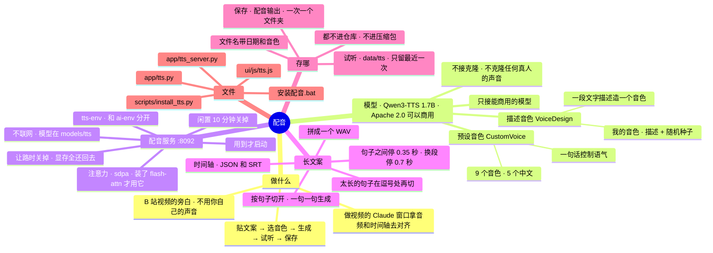

# 架构 · 配音

> 最后核对：v1.8.6（2026-10-28）。

## 结构图

界面「说明」页会把下面这段画成可以点开、收起的树状图，GitHub 上也能直接看图。



## 做什么

作者做 B 站视频（主栏目 AI 工具和资讯，副栏目开发日志），旁白不想用自己的声音。流程：

```
Agent「配音」页：贴文案 → 选音色（或写一段音色描述）→ 可选语气 → 生成 → 当场试听 → 保存
       ↓ 保存到 配音输出\2026-10-28_1530_Serena\
  2026-10-28_1530_Serena.wav          配音（16 位单声道，采样率是模型给的）
  2026-10-28_1530_Serena_时间轴.json   每句的开始、结束（秒）、原文，还有音色、模型名、许可证、停顿
  2026-10-28_1530_Serena_字幕.srt      同一份时间轴的字幕格式
  2026-10-28_1530_Serena_文案.txt      原文
       ↓
做视频的 Claude 窗口：按时间轴对齐字幕和画面、渲染
```

## 模型

| | 预设音色 | 描述音色 |
| --- | --- | --- |
| 模型 | `Qwen/Qwen3-TTS-12Hz-1.7B-CustomVoice` | `Qwen/Qwen3-TTS-12Hz-1.7B-VoiceDesign` |
| 放哪 | `models\tts\Qwen3-TTS-12Hz-1.7B-CustomVoice\` | `models\tts\Qwen3-TTS-12Hz-1.7B-VoiceDesign\` |
| 怎么用 | 选 9 个音色之一 + 可选一句语气（"语速稍快，带点兴奋"） | 写一段音色描述 + 随机种子（+ 可选语气，拼在描述后面） |
| 许可证 | Apache 2.0，可以商用 | Apache 2.0，可以商用 |

- 预设音色：Vivian（明亮的年轻女声）、Serena（温柔的年轻女声）、Uncle_Fu（低沉醇厚的成熟男声）、Dylan（北京话男声）、Eric（四川话男声）是中文；Ryan、Aiden 英文，Ono_Anna 日语，Sohee 韩语。用母语最好，但都能念中文。
- **不接 Base（克隆）**。以后接克隆时，界面上要写明：不克隆任何真人的声音。
- **只接能商用的模型**：Breeze TTS 2、Fish Audio S2 这类只限非商用的不接。
- 每个模型的文件夹里自带声音编解码器（`speech_tokenizer\`）；万一没带，安装脚本会单独下 `Qwen/Qwen3-TTS-Tokenizer-12Hz` 放进去。

## 怎么搭的

```
界面「配音」页（ui/js/tts.js）
   │ /api/tts…（app/tts.py 的 APIRouter，挂在主后端上）
后端 app/tts.py ── 管家 T：用到才启动配音服务、闲置关掉、让路关掉；切句子、拼接、写时间轴
   │ HTTP 127.0.0.1:8092（一句一次 /generate，返回那句的 WAV）
配音服务 app/tts_server.py（tts-env，CREATE_NO_WINDOW，输出写 data\logs\tts.log）
   └ qwen-tts 0.1.1 → 一次只装一个模型（换另一个先卸掉这个）
```

- **为什么单独一个环境 `tts-env`**：官方 `qwen-tts` 锁死 Transformers 4.57.3，本地模型环境 `ai-env` 用 5.x，装一起会把 ai-env 弄坏。PyTorch 用同一个版本（2.8.0 cu128），`tools\wheels` 里有安装包就直接用。非官方的 `qwen-tts-compat`（让它能用 Transformers 5）不用。
- **不装 flash-attn**（Windows 上装不上）：配音服务按 flash-attn → sdpa → eager 的顺序试，Windows 上用 PyTorch 自带的 sdpa。**不装 SoX**（只有不用的旧版 25Hz 模型才用到；`qwen-tts` 一导入就 `import sox`，而 pysox 一导入就开 cmd 跑 `sox -h`，可能闪黑窗口，所以配音服务在导入前放一个空的 `sox` 模块顶替）。**不装 gradio**（官方网页演示，我们有自己的页）。
- **只用显卡**：检测不到 CUDA 就不干（和本地模型服务一样）。
- **不联网**：启动时带 `HF_HUB_OFFLINE=1`，模型从 `models\tts` 读本地文件夹。
- **显存**：配音服务的进程登记在模型管家的 `M.extra` 里——显存让路算"我们自己的"（不会因为配音占了显存就把底座、Kev 让掉），退出 Agent 时一起停，启动时按命令行认出上次留下的（`orphan_kind` → 「配音服务」）。开始生成时显卡剩的不到 6 GB，先让模型服务卸掉底座。
- **让路**：`M.yielding`（在玩游戏、别的程序占显存）时，后台照看每 2 秒调一次 `T.tick()`：正在生成的标记停下，配音服务直接关掉，显存全还回去；让路中点生成会被拒绝（409）。
- **闲置**：`ttsIdle` 分钟（默认 10，设置 › 本地模型）没生成就关掉。

## 长文案怎么切、怎么拼

`tts.split(text, gap, para)`：
1. 空一行算换段；单个换行也算一句结束。
2. 在 `。！？!?…` 处切；英文句号后面有空格或到行尾才切（`3.5`、`v1.8.6` 不切）；后面跟着的引号、括号跟着前一句。
3. 超过 60 字的句子在 `，,、；;：:` 处再切，每块 40 字左右；没有逗号就硬切。只有标点没有字的块并到前一块。
4. 每块念完停：句子之间 `ttsGap`（默认 0.35 秒）、换段 `ttsParaGap`（默认 0.7 秒）、长句切开的块之间 0.15 秒，最后一块不停。两个停顿在配音页文案框下面能改。

一句一次调配音服务：服务按句子长短给 `max_new_tokens`（免得偶尔停不下来）、生成后切掉头尾的静音（留 0.05 秒），所以时间轴上的开始、结束就是真正开口、收声的时候。后端把每句的 PCM 和停顿的静音拼起来，同时记时间轴。种子：预设音色每次随机一个、整段用同一个；描述音色用你给的（我的音色存的就是它）。

## 我的音色和「试同一个人」

- 描述音色的「描述 + 随机种子」可以起名存起来（`db` 的 kv `tts_voices`，在 data 里，不进仓库），下次点一下就填回来。同名再存是改。
- **试同一个人**：用当前的描述 + 种子念两段内容完全不相干的话（中间停 1.2 秒），听前后像不像一个人。像，就说明"描述 + 种子"能当固定音色用；不像，以后再接克隆（先用描述音色造一段参考音频，再用 Base 模型照着念）。结果写在交付说明里。

## 接口

| 接口 | 做什么 |
| --- | --- |
| `GET /api/tts` | 页面要的一切：环境和模型装没装、服务在不在、进度、最近一次生成（时间轴）、音色、我的音色、实测速度 |
| `POST /api/tts/gen` | 开始生成（`mode` preset / design，`speaker`，`desc`，`seed`，`tone`，`lang`，`text`；`same` = 试同一个人） |
| `POST /api/tts/stop` | 念完手上这一句就停（服务不关，模型还在） |
| `POST /api/tts/off` | 关掉配音服务 |
| `GET /api/tts/draft.wav` | 最近一次生成的配音 |
| `POST /api/tts/save` | 存进配音输出（重名加 `_2`） |
| `POST /api/tts/open` | 打开配音输出文件夹 |
| `POST /api/tts/voices`、`DELETE /api/tts/voices/{id}` | 存 / 删我的音色 |

## 装

`安装配音.bat`（`scripts/install_tts.py`，可以重复运行，装过的跳过）：建 `tts-env` → 显卡版 PyTorch（复用 `install_ai.py` 的那套：本地安装包 → 多线程从镜像下 → pip）→ torchaudio（cu128，和 PyTorch 配对）→ `qwen-tts==0.1.1`（不带依赖）+ 它要的库（Transformers 4.57.3、accelerate 1.12.0、librosa、soundfile、onnxruntime……，去掉 gradio 和 sox）→ 从魔搭下两个模型（每个 4~5 GB；魔搭不通时 `AGENT_MODEL_SOURCE=hf` 走 hf-mirror）。`--env` 只装环境，`--models` 只下模型。

## 还没在真机上量的

显存（估 5~6 GB，`NEED_GB`）、一分钟音频要生成多久（页面「生成」那块会显示上次实测）、同一段描述 + 种子换文字还像不像同一个人——都要在作者电脑上实测后填进交付说明。沙箱里没有显卡，测试用的是假的配音服务（`dev/fake_tts.py`）。
