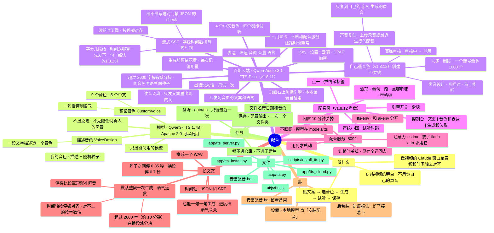

# 架构 · 配音

> 最后核对：v1.8.13（2026-10-30）。

## 结构图

界面「说明」页会把下面这段画成可以点开、收起的树状图，GitHub 上也能直接看图。



## 做什么

作者做 B 站视频（主栏目 AI 工具和资讯，副栏目开发日志），旁白不想用自己的声音。流程：

```
Agent「配音」页：贴文案 → 选音色（或写一段音色描述）→ 可选语气 → 生成 → 当场试听 → 保存
       ↓ 保存到 配音输出\2026-10-28_1530_Serena\
  2026-10-28_1530_Serena.wav          配音（16 位单声道，采样率是模型给的）
  2026-10-28_1530_Serena_时间轴.json   每句的开始、结束（秒）、原文，还有音色、模型名、许可证、停顿
  2026-10-28_1530_Serena_字幕.srt      同一份时间轴的字幕格式
  2026-10-28_1530_Serena_文案.txt      原文
       ↓
做视频的 Claude 窗口：按时间轴对齐字幕和画面、渲染
```

## 模型

| | 预设音色 | 描述音色 |
| --- | --- | --- |
| 模型 | `Qwen/Qwen3-TTS-12Hz-1.7B-CustomVoice` | `Qwen/Qwen3-TTS-12Hz-1.7B-VoiceDesign` |
| 放哪 | `models\tts\Qwen3-TTS-12Hz-1.7B-CustomVoice\` | `models\tts\Qwen3-TTS-12Hz-1.7B-VoiceDesign\` |
| 怎么用 | 选 9 个音色之一 + 可选一句语气（"语速稍快，带点兴奋"） | 写一段音色描述 + 随机种子（+ 可选语气，拼在描述后面） |
| 许可证 | Apache 2.0，可以商用 | Apache 2.0，可以商用 |

- 预设音色：Vivian（明亮的年轻女声）、Serena（温柔的年轻女声）、Uncle_Fu（低沉醇厚的成熟男声）、Dylan（北京话男声）、Eric（四川话男声）是中文；Ryan、Aiden 英文，Ono_Anna 日语，Sohee 韩语。用母语最好，但都能念中文。
- **不接 Base（克隆）**。以后接克隆时，界面上要写明：不克隆任何真人的声音。
- **只接能商用的模型**：Breeze TTS 2、Fish Audio S2 这类只限非商用的不接。
- 每个模型的文件夹里自带声音编解码器（`speech_tokenizer\`）；万一没带，安装脚本会单独下 `Qwen/Qwen3-TTS-Tokenizer-12Hz` 放进去。

## 怎么搭的

```
界面「配音」页（ui/js/tts.js）
   │ /api/tts…（app/tts.py 的 APIRouter，挂在主后端上）
后端 app/tts.py ── 管家 T：用到才启动配音服务、闲置关掉、让路关掉；切句子、拼接、写时间轴
   │ HTTP 127.0.0.1:8092（一句一次 /generate，返回那句的 WAV）
配音服务 app/tts_server.py（tts-env，CREATE_NO_WINDOW，输出写 data\logs\tts.log）
   └ qwen-tts 0.1.1 → 一次只装一个模型（换另一个先卸掉这个）
```

- **为什么单独一个环境 `tts-env`**：官方 `qwen-tts` 锁死 Transformers 4.57.3，本地模型环境 `ai-env` 用 5.x，装一起会把 ai-env 弄坏。PyTorch 用同一个版本（2.8.0 cu128），`tools\wheels` 里有安装包就直接用。非官方的 `qwen-tts-compat`（让它能用 Transformers 5）不用。
- **不装 flash-attn**（Windows 上装不上）：配音服务按 flash-attn → sdpa → eager 的顺序试，Windows 上用 PyTorch 自带的 sdpa。**不装 SoX**（只有不用的旧版 25Hz 模型才用到；`qwen-tts` 一导入就 `import sox`，而 pysox 一导入就开 cmd 跑 `sox -h`，可能闪黑窗口，所以配音服务在导入前放一个空的 `sox` 模块顶替）。**不装 gradio**（官方网页演示，我们有自己的页）。
- **只用显卡**：检测不到 CUDA 就不干（和本地模型服务一样）。
- **不联网**：启动时带 `HF_HUB_OFFLINE=1`，模型从 `models\tts` 读本地文件夹。
- **显存**：配音服务的进程登记在模型管家的 `M.extra` 里——显存让路算"我们自己的"（不会因为配音占了显存就把底座、Kev 让掉），退出 Agent 时一起停，启动时按命令行认出上次留下的（`orphan_kind` → 「配音服务」）。开始生成时显卡剩的不到 6 GB，先让模型服务卸掉底座。
- **让路**：`M.yielding`（在玩游戏、别的程序占显存）时，后台照看每 2 秒调一次 `T.tick()`：正在生成的标记停下，配音服务直接关掉，显存全还回去；让路中点生成会被拒绝（409）。
- **闲置**：`ttsIdle` 分钟（默认 10，设置 › 本地模型）没生成就关掉。

## 长文案怎么切、怎么拼

`tts.split(text, gap, para)`：
1. 空一行算换段；单个换行也算一句结束。
2. 在 `。！？!?…` 处切；英文句号后面有空格或到行尾才切（`3.5`、`v1.8.6` 不切）；后面跟着的引号、括号跟着前一句。
3. 超过 60 字的句子在 `，,、；;：:` 处再切，每块 40 字左右；没有逗号就硬切。只有标点没有字的块并到前一块。
4. 每块念完停：句子之间 `ttsGap`（默认 0.35 秒）、换段 `ttsParaGap`（默认 0.7 秒）、长句切开的块之间 0.15 秒，最后一块不停。两个停顿在配音页文案框下面能改。

**两种生成方式**（配音页「生成」那块切换，设置 `ttsWhole`，默认整段）：

- **整段一次生成（v1.8.9 起默认，`tts._whole`）：** v1.8.8 作者实测一句一句生成 9 句话 9 种语气——每句是单独采样的，没法前后连贯。Qwen3-TTS 技术报告说它能一次合成 10 分钟以上、韵律前后一致（长文本测试 200~2000 词），所以改成一段话一次念完。`whole_chunks` 把句子装进最多 `WHOLE_MAX` 字的块，优先在换段处断开（v1.8.9 是 1200 字约 5 分钟；v1.8.10 放到 2600 字约 10 分钟，作者的视频不超过 10 分钟，一次念完；分块的话块与块是分开念的，交界处语气可能变，所以尽量不分）；`chunk_text` 把句子接起来、换段处换行、没有句末标点的补一个句号（免得和下一句连成一句）。一块一次 `/generate`（`max_new_tokens` = 96 + 6 × 字数，上限 24000，10 分钟约 7200 帧，够；超时按估的时间放宽）。念完后对齐时间轴：`find_pauses` 按 10 毫秒一格的音量找停顿（比响的部分小很多、至少 0.1 秒），`align_pauses` 用动态规划给每个句子边界配一个停顿（代价 = |停顿中点 − 按字数估的时间| − 权重 × 停顿长度；句末权重 2、长句里逗号切开处 0.5；多出来的停顿不管；配不上的边界不硬配），句子的开始、结束取停顿的两头；配不上的按字数估，时间轴里这句带 `"est": true`，配音页时间前面标 ≈。`pad_pauses`：配上的停顿比设置的短就在中间补静音补够（只补不剪）。块与块之间按设置的停顿加静音。进度念完才知道，按上次实测的速度估（`public()` 的 `pct`、`eta`）；点「停下」直接关掉配音服务（一块可能要念好几分钟，等不了）。「试同一个人」固定一句一句（要两次分开采样才看得出）。
- **一句一句生成（`tts._by_sentence`，v1.8.6 的做法）：** 下面这一段。

一句一次调配音服务：服务按句子长短给 `max_new_tokens`（免得偶尔停不下来）、生成后切掉头尾的静音（留 0.05 秒），所以时间轴上的开始、结束就是真正开口、收声的时候。后端把每句的 PCM 和停顿的静音拼起来，同时记时间轴。种子：预设音色每次随机一个、整段用同一个；描述音色用你给的（我的音色存的就是它）。

## 云端引擎：百炼 Qwen-Audio-3.1-TTS-Plus（v1.8.11，`app/tts_cloud.py`）

作者觉得本地 Qwen3-TTS 的声音不够好。阿里云百炼的 Qwen-Audio-3.1-TTS-Plus 在 Artificial Analysis 语音排行榜第 13（Elo 1305）。按百炼服务协议，用阿里自家模型生成的内容知识产权归用户，可以用在 B 站视频里。本地引擎留着当备用。

**选引擎：** 配音页标题旁边「本地 Qwen3-TTS / 百炼云端 Qwen-Audio-3.1-TTS-Plus」，存在设置 `ttsEngine`（local / cloud）。云端不用显卡、不启动配音服务，在玩游戏让路时也照常生成（`T.tick` 不停 `engine == "cloud"` 的活）。

**发出去的只有：** 配音页贴的文案、选的音色、语气那一句（`instruction`）、种子、格式和采样率、要不要字级时间戳。别的一律不发（`dev/test_tts_cloud.py` 查了请求体）。

**Key：** 设置 › 云端 最下面「百炼 API Key」，存在 `data\secrets.bin`（`settings.SECRET_KEYS` 里的 `blKey`，Windows 上 DPAPI 加密），不写日志、不进导出、不进仓库；界面只拿得到最后 4 位。同一块还能改：模型名 `blModel`（默认 `qwen-audio-3.1-tts-plus`；别用体验中心默认的 Next——自带背景音乐、人声糊）、单价 `blPrice`（元/万字符，默认 1.4，只用来估算）、一次最多发多少字 `blMax`（默认 2000）、接口地址 `blBase`（默认中国站北京 `https://dashscope.aliyuncs.com/api/v1`；要用业务空间专属地址填 `https://{业务空间ID}.cn-beijing.maas.aliyuncs.com/api/v1`）。

**怎么调（官方文档，2026-10 查的）：**

```
POST {blBase}/services/audio/tts/SpeechSynthesizer
Authorization: Bearer {Key}        X-DashScope-SSE: enable（流式）
{"model": "qwen-audio-3.1-tts-plus",
 "input": {"text": 文案, "voice": "xunanchuan_v3.1", "format": "pcm", "sample_rate": 24000,
           "instruction": 语气（可选）, "seed": 种子, "word_timestamp_enabled": true}}
→ SSE：每句 sentence-begin（original_text）→ 一串 sentence-synthesis（audio.data 是 base64 的 pcm 块）→ sentence-end（sentence.words：每个字的 begin_index、end_index、begin_time、end_time 毫秒）
→ 最后 finish_reason=stop，usage.characters 是计费字符
```

- 走 HTTP + SSE，不用 WebSocket。非流式只返回一个 24 小时有效的音频链接、没有时间戳，所以用流式：边念边传回来，进度是真的（按念完的句子算）。
- 音色：Plus 只有 4 个（`龙安灵心 longanlingxin_v3.1`、`龙安欢 longanhuan_v3.1`、`龙安风悦 longanfengyue_v3.1` 三个女声，`许南川 xunanchuan_v3.1` 男声）。音色和模型要对得上，换成 Flash 时页面列 Flash 的 4 个 + 精品中文音色（`tts_cloud.VOICES`）。风格是按官方音色表 / 试听样例写的，以「试听」为准。
- 试听（`POST /api/tts/cloud/try`）：念一句固定的短句（`TRY_TEXT`），存在 `data\tts\try\`，再点不花钱。
- 语气：`instruction` 一句自然语言（界面限 100 字）。文案里还能插标签：控制类 23 个（`[excited]` `[serious]` `[sad]` `[very slowly]`……，从标签处起作用）、拟声 7 个（`[laughing]` `[sighing]`……）。标签原样发过去；时间轴和字幕里去掉（`strip_tags`），只有标签的一块并到前一句（`merge_tags`），标签后面不补句号。
- 单次最长多少字：官方文档没写。设置 `blMax` 默认 2000 字，超过就用 `whole_chunks` 按段落分块，每块同一个音色、同一句语气、同一个种子，块之间按换段停顿加静音，拼成一个 WAV。百炼报「文本太长」时提示调小。
- 输出：pcm 16 位单声道 24kHz，拼起来写 WAV。和本地完全一样的 4 个文件（WAV、时间轴 JSON、SRT、文案），时间轴 JSON 多了 `engine: cloud`、`cost`（计费字符、花费）。做视频那边不用改。

**时间轴（`word_spans`，v1.8.13 重写）：** 字级时间戳只在流式里有，Plus 的 4 个音色官方音色表都写「时间戳：支持」。作者反映生成的配音时间轴经常对不上，而百炼文档有三件事没写清楚，v1.8.11 是靠猜的；v1.8.13 改成哪种都不赌：
1. **字是一次给全还是一段一段给**：`synth` 把每个事件里的字按（位置、文字）合起来，不再用最后一次覆盖前面的（一段一段给时，以前只剩最后一段的字，句子开头就偏到后面去了）。
2. **每句的音频从哪开始**：按每个音频块自己标的句子号累加这一句的长度，不看事件到达的先后（百炼先发下一句的开头、再发这一句最后一块时，以前会把下一句的起点算早）。块上没标句子号时退回按到达算。
3. **字的时间从整段开头算还是从这一句开头算**：两种都算一遍，挑和音频对得上的那种——每句不能超出音频、不能倒着走，句子边界要落在没声音的地方（`_score`、`_quiet`：边界处最小的 30 毫秒窗口音量 < 响的地方的 12%）。
4. **百炼返回的原文和发的不完全一样**（标点、读音词典的替换、标签）：两边都只留字母数字汉字，用 `difflib` 按最长公共片段对位置，不要求一字不差。
一句的开始 = 第一个字开口、结束 = 最后一个字收声。对不上的句子夹在前后两句中间、标 `est`；一半以上对不上、或者百炼没给时间戳，就和本地整段生成一样按停顿对齐（`whole_timeline`）。停顿比设置的短照样补够（`pad_pauses`）。这个音色不支持时间戳而报参数错时，去掉时间戳再试一次（全流程唯一的一次重试）。

**准不准写出来：** 时间轴 JSON 多一个 `check`：`method`（百炼逐字时间戳 / 按停顿对齐）、`sentences`、`exact`（准的句数）、`estimated`（估的句数）、`bounds_in_silence` / `bounds`（句子边界落在停顿上的个数）、`time_base`（abs 从整段算 / rel 从这句算）。做视频那边看到 `estimated` 是 0、边界都在停顿上，就可以直接用。配音页波形下面一行写着「时间轴：百炼逐字时间戳，12 句都是准的」，有估的、有边界不在停顿上的标黄。百炼最近一次返回的时间戳原样记在 `data\tts\last_bailian.json`（每句的原文、起点、头几个字和最后两个字的时间、字是在哪种事件里给的；不含 Key），再对不上时拿它查。

**花费：** 生成前页面显示「约 N 计费字符 · ¥X」：没实测过按汉字算 2 个字符估（偏高），生成过一次就按百炼实际返回的 `usage.characters ÷ 字数` 比例估（kv `bl_ratio`）。每次调用（生成的每一块、第一次试听）记一笔进 `data\agent.db` 的 `tts_usage` 表（模型、音色、字数、计费字符、token、花费、音频长度、用途）；配音页「生成」那块写本月花了多少、几次。Plus 按字符计费（千问平台价格页 1.4 元/万字符）；Flash 按 token 计费（输入 1.5、输出 12 元/百万 token），换 Flash 时估价不准。

**出错（`explain`）：** 只试一次，不重试，一句中文：Key 不对（401 InvalidApiKey / NOT AUTHORIZED，也可能是 Key 和接口地址不是同一个地域 / 业务空间）、欠费（Arrearage / OUT_OF_SERVICE）、内容安全拦截（DataInspectionFailed）、没权限或模型名错（403 AccessDenied）、限流（429 Throttling）、找不到（404）、服务端出错（5xx）、参数不对（400，提到长度就叫你调小单次字数）、断网（连不上）、2 分钟没回音。报错里的 Key 会被换成 `***`。分块时第 2 块以后出错，会说「前 N 块已经念好、已计费，这次没保存」。

**停下：** 收到下一小段音频时断开连接（马上停），不碰本地配音服务。已经念完的部分百炼照样计费，停下的提示里写着。

## 自己造音色：声音设计、声音复刻（v1.8.12，`tts_cloud.design / clone / sync / remove`）

都走 `POST {blBase}/services/audio/tts/customization`，`model` 固定 `voice-enrollment`，`input.target_model` = 现在的配音模型（音色和模型绑定，换模型就不能用）。**创建不要钱**，用它生成照常按字计费。一个百炼账号最多 1000 个（设计和复刻共用），一年没用过会被百炼自动删掉。造好后百炼要审核：`DEPLOYING`（审核中）→ `OK`（能用）/ `UNDEPLOYED`（没通过）。后端造好后每 2 秒查一次（`watch`，最多 90 秒），配音页在有「审核中」的音色时每秒刷新。

- **声音设计**（配音页「设计」）：`input` 带 `action: create_voice`、`voice_prompt`（描述，最多 500 字，只认中英文；写性别、年龄、音色、语速、情绪、用在哪，不要写「像某某」）、`preview_text`（试听句，15~200 字，默认 `DESIGN_TEXT`）、`prefix`（`_prefix()`：`ag` + 时间的 36 进制，字母数字 10 个以内）、`language_hints`（zh / en）；`parameters` 要 wav 24kHz。返回 `voice_id`（`{模型}-vd-{前缀}-{随机}`）和一段试听（Base64），存进 `data\tts\try\`：审核中也能先听，不花钱。页面上点灵感词接在描述后面；不满意就改描述再设计一个，比着听，不要的删掉。
- **声音复刻**（配音页「复刻」）：`input.audio` 用 **Base64 Data URI**（`data:audio/wav;base64,…`，不用把录音传到网上），可选 `enable_preprocess`（降噪、增强、音量规整）、`language_hints`。录音要求：WAV / MP3 / M4A，10~20 秒最好、最长 60 秒、10 MB 以内、采样率 ≥ 16kHz、至少 5 秒连续清楚的说话、没有背景音乐和别人的声音（`sniff()` 认格式，WAV 先查时长和采样率）。两种来源：上传的录音（页面先解码画个小波形、显示时长）；或者**最近生成的配音**（`draft_sample()`：超过 20 秒就在 12~20 秒之间的停顿处截断）——先用本地的描述音色或云端的设计音色念一段，再复刻，就是一个固定下来的 AI 声音。**必须先勾「这段声音是我自己的，或者是 AI 生成的」**（后端没有 `consent` 就 400），不复刻别人的声音。复刻的试听要念一句（花不到一分钱，念过的存着）。
- **我造的音色**存在 db 的 kv `bl_voices`（ID、名字、设计 / 复刻、描述或来源、模型、状态），只在本机。**同步**（`list_voice` 分页拿全）：百炼控制台造的也加进来（名字先用 ID 后几位），状态跟着更新，百炼上没了的标「已删」（列表是空的、或者刚造 5 分钟内的不动）。**删除**：`delete_voice` 百炼那边也删（省配额），百炼说没有了也照样从本机删。改名只改本机。
- 生成时 `find_voice` 只认现成的 + 我造的里状态 `OK` 的；审核中、没通过的不能用（400 说清楚）。

## 表达和读音词典（v1.8.12）

- **语速** `rate`（0.5~2）、**音调** `pitch`（0.5~2）、**音量** `volume`（0~100，默认 50）、**目标语言** `language_hints`（自动就不发）：配音页「表达」那块的滑块（双击回到默认）。跟默认一样的不发（`expr_input`），时间轴 JSON 的 `voice.expr` 记着发了哪些。
- **读音词典** `hot_fix`：`pronunciation`（多音字按拼音念，拼音后面跟声调数字 1~5，轻声写 5，比如 `chong2 qing4`）、`replace`（念的时候换成别的字，比如 `LHY` → `L H Y`），合计最多 200 条，存在 kv `bl_hotfix`。发的时候是对象数组（`[{"重庆": "chong2 qing4"}]`），**只发这次文案里出现的词**。
- 没做：`enable_aigc_tag`（AIGC 隐性标识只嵌进 wav / mp3 / opus，我们流式要的是 pcm）、SSML。

## 配音页（v1.8.12 重做，`ui/js/tts.js`）

作者嫌 v1.8.11 的配音页丑、交互简陋。重做成一张「控制台」：

```
[配音] [本地 Qwen3-TTS | 云端 百炼 Plus]  只发文案和语气……              [Key 已填] [本月 ¥0.86 · 61 次]
┌ 文案 ──────────────┐┌ 音色 ──────────────────┐┌ 生成配音  用 许南川 念 ──────────┐
│ 插标签 兴奋 严肃 …   ││ 音色库 设计 复刻 读音    ││ 预估：约 124 计费字符 · ¥0.02     │
│ ┌────────────────┐ ││ ▮▯▮ 龙安灵心 女声   ▶  ││ ┌ 波形（每句一段，点哪听哪）──┐ │
│ │ 文案框          │ ││ ▮▮▯ 许南川 男声     ▶  ││ └──────────────────────────┘ │
│ └────────────────┘ ││ 我造的 3/1000  同步     ││ ▶ 00:03.2 / 00:13.8  保存 …   │
│ 句子之间停 换段停   ││ ── 语气指令 / 语速 音调 音量 语言 ││ 时间轴（跟着播放亮）            │
└────────────────────┘└────────────────────────┘└───────────────────────────────┘
```

- 引擎开关是两格，底下亮的那块滑过去；云端时文案框上面一排情绪标签（点一下插在光标处）。
- 每个音色前面一个「声纹」小图：按音色 ID 算出来的一排竖条（`ttsGlyph`），每个音色长得不一样；试听时跳。试听按钮再点一下停。
- 波形台是这页最显眼的东西：`ttsPeaks` 直接读 `draft.wav` 的 PCM 算峰值，canvas 画；放过的部分亮、正在放的那句底下亮一段、按字数估的句子标黄；点哪跳到哪播放，鼠标移上去亮那一句（提示写着那句的字）；**空格键**播放 / 暂停（光标在输入框里时不管）；生成中波形台上有一道扫描光。时间轴列表跟着走。
- 颜色全用主题变量（`--accent`、`--text2`、`--line2`、`--c-neu`），三套风格都跟着变。横屏三栏一屏放下；竖屏文案在上、下面两栏。文案框、音色面板（`.tts-vb`）、时间轴在自己里面滚（`fit.py` 的 LISTS）。

## 我的音色和「试同一个人」

- 描述音色的「描述 + 随机种子」可以起名存起来（`db` 的 kv `tts_voices`，在 data 里，不进仓库），下次点一下就填回来。同名再存是改。
- **试同一个人**：用当前的描述 + 种子念两段内容完全不相干的话（中间停 1.2 秒），听前后像不像一个人。像，就说明"描述 + 种子"能当固定音色用；不像，以后再接克隆（先用描述音色造一段参考音频，再用 Base 模型照着念）。结果写在交付说明里。

## 接口

| 接口 | 做什么 |
| --- | --- |
| `GET /api/tts` | 页面要的一切：环境和模型装没装、服务在不在、进度、最近一次生成（时间轴）、音色、我的音色、实测速度 |
| `POST /api/tts/gen` | 开始生成（`mode` preset / design，`speaker`，`desc`，`seed`，`tone`，`lang`，`text`；`same` = 试同一个人；`engine: cloud` + `voice` 走百炼云端，还能带 `rate`、`pitch`、`volume`、`lang`） |
| `POST /api/tts/stop` | 停下：一句一句的念完手上这句；整段的关掉配音服务；云端的断开百炼 |
| `POST /api/tts/cloud/try` | 试听一个云端音色（固定的短句，念过的不再花钱；设计的音色用创建时给的那段），返回 WAV |
| `POST /api/tts/cloud/design` | 声音设计（`name`、`prompt`、`text` 试听句、`lang`） |
| `POST /api/tts/cloud/clone` | 声音复刻（`source` upload / draft、`data` Base64、`file`、`name`、`lang`、`denoise`、`consent` 必须为真） |
| `POST /api/tts/cloud/sync` | 和百炼对一遍音色列表 |
| `PATCH /api/tts/cloud/voices/{id}`、`DELETE /api/tts/cloud/voices/{id}` | 改名（只改本机）/ 删除（百炼那边也删） |
| `PUT /api/tts/cloud/hotfix` | 存读音词典（`pronunciation`、`replace`） |
| `POST /api/tts/off` | 关掉配音服务 |
| `GET /api/tts/draft.wav` | 最近一次生成的配音 |
| `POST /api/tts/save` | 存进配音输出（重名加 `_2`） |
| `POST /api/tts/open` | 打开配音输出文件夹 |
| `POST /api/tts/voices`、`DELETE /api/tts/voices/{id}` | 存 / 删我的音色 |

## 装

**设置 › 本地模型 最上面的「配音」一块**（v1.8.7 起，`app/tts_install.py` + `ui/js/tts.js` 的 `ttsInstHTML`）：显示配音环境装没装、两个模型下没下、各多大；一个按钮「安装配音」（装了一半是「接着装」，都装好了是「重新检查一遍」）。点了在后台跑 `scripts/install_tts.py`（CREATE_NO_WINDOW，放进 Job Object，后端没了一起结束），可以关掉界面；进度条在这一块和配音页上，每一步写进展报告（任务名「安装配音」），原始输出在 `data\logs\setup_tts.log`。失败了再点一次接着装，或者点「改从 hf-mirror 下」（`AGENT_MODEL_SOURCE=hf`）；「停下」按进程号结束它和它开的 pip。一键补齐正在跑时不开始。启动时 `setup.cleanup_orphans` 也认得上次留下的 `install_tts.py` 和 tts-env 里的 pip。配音页缺东西时给一个「去 设置 › 本地模型」的按钮。

**装完的自检**（`install_tts.CHECK`）：在 tts-env 里真的导入一次 qwen_tts，导入前也放空的 `sox` 模块（v1.8.7 忘了放：自检报 `No module named 'sox'`、退出码 6、模型没下，界面上只显示 qwen-tts 打的那段 flash-attn 提示「********」）。自检失败时写真正的报错那一行，完整报错进 `setup_tts.log`。装的时候进度也显示在常驻屏上（`reports.tasks()`）。

`安装配音.bat` 留着备用，做的事一样（`scripts/install_tts.py`，可以重复运行，装过的跳过）：建 `tts-env` → 显卡版 PyTorch（复用 `install_ai.py` 的那套：本地安装包 → 多线程从镜像下 → pip）→ torchaudio（cu128，和 PyTorch 配对）→ `qwen-tts==0.1.1`（不带依赖）+ 它要的库（Transformers 4.57.3、accelerate 1.12.0、librosa、soundfile、onnxruntime……，去掉 gradio 和 sox）→ 从魔搭下两个模型（每个 4~5 GB；魔搭不通时 `AGENT_MODEL_SOURCE=hf` 走 hf-mirror）。`--env` 只装环境，`--models` 只下模型。

## 还没在真机上量的

显存（估 5~6 GB，`NEED_GB`）、一分钟音频要生成多久（页面「生成」那块会显示上次实测）、同一段描述 + 种子换文字还像不像同一个人——都要在作者电脑上实测后填进交付说明。沙箱里没有显卡，测试用的是假的配音服务（`dev/fake_tts.py`）。

云端：沙箱连不上百炼，测试用假的百炼接口（`dev/fake_bailian.py`，8097，假 Key `sk-test-0000`）。真机上要看：真 Key 能不能调通、4 个音色的声音、字级时间戳这几个音色给不给（不给就按停顿对齐）、单次 2000 字会不会报太长、`usage.characters` 是不是汉字算 2 个、实际花费和估的差多少。
