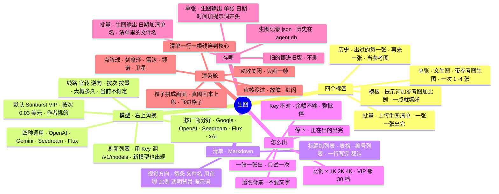

# 架构 · 生图

> 最后核对：v1.8.16（2026-10-30）。v1.8.15 加的这一页，v1.8.16 整页重做成「渲染舱」（作者定的界面档次标准）。

## 结构图

界面「说明」页会把下面这段画成可以点开、收起的树状图，GitHub 上也能直接看图。



## 为什么做

作者 10-30：视频窗口按《自媒体正本》每期出一份「生图清单」（这期的视觉方向 + 10~20 条：编号文件名、用在哪一段、比例、透明背景开不开、提示词），他要一条一条复制提示词去生成、再一张张按文件名保存，"太麻烦了，而且命名也不是很标准"。v1.8.15 做了第一版。

v1.8.16（同一天）：v1.8.15 默认的官转模型按 token 计费，作者选了「最高 + 2K」一张扣了 $0.17；他要的是精挑细选的 **GPT Image 2.5 Sunburst VIP**（按次 $0.03/张，画质够）。界面「丑哭了」，给了一张科幻 HUD 的图当参照，最后定下「渲染舱」草图当以后整个 Agent 界面的档次标准（Project 里 `UI标准_生图渲染舱草图.html`）。又照着 API易 网页版「AI 图片大师」要了：文生图、参考图生图、批量、历史记录、素材模板、页面上换模型（像 DeepSeek 那样「获取模型列表」，按厂商分好、带标签）。**不要**：模型对比、识别图片、推理测试、收起菜单，也不要失败了自动换别的模型重出。

## 后端（`app/imagegen.py`）

**认清单（`parse`）：** 不要求一种固定写法，几种都认：
- 标题 + 列表：`### img01_重点_地铁站.png（用在：本周重点）` 下面 `- 比例：16:9`、`- 透明背景：不开`、`- 提示词：……`（粗体、换行写、代码块里的都认）。
- 表格：表头里有「提示词」那一列，按表头认「文件名 / 用在哪 / 比例 / 透明背景 / 提示词」。
- 编号列表、一行写完（`img03.png 比例 21:9 提示词：……`）、一行写两样（`比例：16:9 ｜ 透明背景：开`）。
- 视觉方向：带「视觉方向」的标题或标签之后，到下一个标题或第一条之前。标题：第一个 `# ` 标题，没有就用文件名。
- 文件名统一成 `.png`（存的就是 PNG），去掉 Windows 不让用的字，重名加 `_2`；比例不在正本那 10 种里就取最近的；没写比例按 16:9（透明的按 1:1）、没写透明背景按不开、没认出提示词的——都写进 `warn`，界面上「N 处没认全」，卡片上能补。只提到一个文件名、别的都没有的行（比如开头那句「文件名统一 imgNN_xxx.png」）不算一条。

**模型（`KNOWN` + `card` + `catalog` + `refresh_models`）：** `KNOWN` 是认识的生图模型（按 API易 文档和网页版的列表）：厂商、名字、线路（官转 / 逆向）、按次多少钱（`None` = 按量）、大概多少秒、一句说明、调用方式 `proto`（openai / gemini / seedream / flux）、尺寸写法 `size`（preset 写 VIP 那 30 档像素 / prompt 比例写进提示词 / gemini 写 aspectRatio + imageSize / seedream 固定 2K 那档 / flux 固定 1K 那档）、认哪几档画质 `q`、透明背景能不能用参数要 `trans`、最多几张参考图 `refs`、提醒 `warn`（「当前不稳定」）。没收录的模型按名字猜厂商（`VENDOR_RE`），按那家的方式调。「刷新模型列表」用 Key 调 `GET {imgBase}/models`，用 `IMG_RE` 挑出生图模型（聊天、向量、语音的不要），存 kv `img_models`；列表里有、`KNOWN` 里没有的也列出来（标「没收录」），`KNOWN` 里有、这个 Key 列表里没有的标出来。

**比例 → 尺寸（`SIZES`、`dims`）：** 清单 / 单张只写比例（正本那 10 种），像素按档位查 API易 VIP 的 30 档（1K / 2K / 4K，作者给视频窗口念过的那套），这些也合官转的规矩（16 的倍数、长边 ≤3840、0.65~8.3 百万像素）。

**四种调用（`_call_openai` / `_call_gemini` / `_call_seedream` / `_call_flux`）：**
- OpenAI（GPT Image 全家、Grok、没收录的）：`POST {imgBase}/images/generations`（JSON）；带参考图走 `/images/edits`（multipart，一张字段叫 `image`，多张 `image[]`）。VIP、All 明着要 `response_format: b64_json`、**不发 `n`**（VIP 不认）；官转要 `output_format: png`。认画质的才发 `quality`，`trans=api` 的才发 `background`。All 不认尺寸：比例写在提示词最前面。
- Gemini（Nano Banana）：`POST {根地址}/v1beta/models/{id}:generateContent`，`contents[0].parts` = 提示词 + 参考图（`inlineData`），`generationConfig.imageConfig` = `aspectRatio` + `imageSize`（1K/2K/4K）；取最后一张 `inlineData`（复杂的会先给草稿）。被安全审核拦了回 200 但没图（`finishReason: IMAGE_SAFETY`，不扣钱）→ 这张报错。
- Seedream：`/images/generations`，`size` 写像素、`watermark: false`（默认会加水印）、5.0 要 `output_format: png`（4.x 只出 JPEG，存成 .jpg 并提醒）；参考图放 `image` 数组（data URI）；4.x 和 5.0 Lite 带参考图时 `sequential_image_generation: disabled`（5.0 Pro / Flash 不认这个）。
- Flux：`/images/generations`，`size` 写像素，参考图放 `input_image`、`input_image_2`……；回来的只有 `data[0].url`（10 分钟有效），马上下载。

**提示词（`build_prompt`）：** （打开「拼视觉方向」时）视觉方向 + 这一条 +（透明背景开）「只画主体本身，背景完全透明……」+（默认）「画面里不要出现任何文字、字母、数字、水印或 logo。」（正本规矩 6）。单张不拼视觉方向。

**一批（`Gen._new_job` / `_run` / `_one`）：** 批量（全部 / 补齐没出的 / 指定几张）和单张（1~4 张）走同一条路，`imgConc` 默认 1（一张一张出）。只试一次、不自动重试、不自动换模型。报错（`explain`）说人话：Key 不对、余额不够、被限流 / 上游太忙、找不到模型 → 后面的不再发；审核没过、参数不对、服务端出错、超时（6 分钟）→ 只坏这一张。点「停下」：还没开始的不出了，正在出的出完。`job.cur` 给页面当前这张（文件名、提示词、比例、尺寸、出了几秒、大概多久），`job.results` 给每张的结果（历史编号、尺寸、花费、报错），渲染舱的动画就靠这两样。

**存：** 批量 → `生图输出\<日期>_<清单名>\<清单里的文件名>`；单张 → `生图输出\单张\<日期>\<时分秒>_<提示词开头>.png`（一次几张加 `_1`、`_2`）。同名的旧图挪进 `旧版\`，不删。每个文件夹一份 `生图记录.json`（实际发出去的提示词、参数、尺寸、花费）。单张的参考图存一份在 `data\img\refs`。

**历史（`img_history` 表，在 `data\agent.db`）：** 每出一张记一行：时间、单张 / 批量、清单名、文件名、存在哪、模型、提示词、实际发的提示词、比例、档位、画质、透明背景、尺寸、有没有透明通道、花费、用时、几张参考图。图被挪走了也留着记录（页面标「文件不在了」）。

**素材模板（kv `img_templates`，参考图在 `data\img\templates`）：** 名字、提示词、比例、张数、透明背景、模型、档位、画质、参考图；同名替换（旧参考图删掉），最多 60 个。

**花费：** 按次的就是那个价；官转按 API易 返回的 `usage`（输出 $30、输入 $5 每百万 token）；都没有的记 0。每月张数、美元记 kv `img_usage`。

**老设置迁移（`settings.load`）：** 没有 `imgMig: 1816` 的设置文件（v1.8.15 的），一次性换成 Sunburst VIP、画质「高」、2K、一张一张出，存回去；之后在页面上换的不会再被改回去。

| 接口 | 做什么 |
| --- | --- |
| `GET /api/img` | 页面要的一切：当前清单、正在出的这批（`cur`、`results`）、当前模型的说明卡、尺寸表、模板、最近 12 张、本月花了多少 |
| `GET /api/img/models` / `POST /api/img/models/refresh` | 按厂商分好的模型 / 用 Key 拉一遍 API易 的模型列表 |
| `POST /api/img/load` | 上传清单（`md`、`name`） |
| `PATCH /api/img/item/{id}` | 改一张：`prompt`、`ratio`、`transparent` |
| `POST /api/img/run` | 批量：默认全部，`missing` 补齐没出的，`ids` 指定几张 |
| `POST /api/img/single` | 单张：`prompt`、`ratio`、`n`、`transparent`、`refs`（data URI） |
| `POST /api/img/stop` / `POST /api/img/clear` | 停下 / 清掉当前清单（文件夹里的图不动） |
| `GET /api/img/file/{id}` / `GET /api/img/hfile/{hid}` | 清单里出好的那张 / 历史里那张 |
| `GET /api/img/hist` | 历史（`q` 搜、`limit`、`before`） |
| `POST /api/img/templates` / `DELETE /api/img/templates/{tid}` / `GET /api/img/tplref/{tid}/{k}` | 存、删模板，模板的参考图 |
| `POST /api/img/open` / `POST /api/img/zip` | 打开文件夹（清单的 / `single` / `hid`）/ 出好的图打 zip |

**设置：** 设置 › 云端 只剩 `imgKey`（API易 Key，DPAPI 加密，不进导出）和 `imgBase`；模型、画质、档位、两个开关都在生图页上换（存进 `imgModel`、`imgQuality`、`imgRes`、`imgNoText`、`imgWithDir`）。

## 生图页「渲染舱」（`ui/js/img.js`）

```
┌IMAGE FORGE┐┌模型 ▾ 推荐·逆向·$0.03/张·⏱80s┐┌队列│已出│没出来│平均│已花│还要┐┌▶ 批量生成 ┐
[单张][批量][历史][模板]                              档位 1K 2K 4K · 画质 自动 低 中 高
┌ 清单（一行一张）─◆┐          ╭─ 刻度环 · 雷达 · 频谱 ─╮          ┌ 出好的图 ┐
│ 01 img01… 16:9 ✓ ◆│~~~~~~~~ ●   点阵球 + 正在拼的画面   ● ~~~~~~ │ ▣ ▣      │
│ 02 img02… 1:1  ◉ ◆│          ╰────────────────────────╯          │ ▣ ▣      │
│ （点一行：改提示词）│        img02_道具_灶台.png · 2048×2048       │ 打开 ZIP │
└───────────────────┘                                              └──────────┘
┌ 日志（最近 5 行）                                  ┐┌ API LINK 示波器 ┐
```
- 整页底下一块画布（`#fgFx`）：斐波那契点阵球（带坑洞、两种颜色）、刻度环、虚线环、雷达扫过、144 根频谱、4 颗带尾巴的卫星、浮尘；左边清单每行（单张是参考图和提示词框）一根线连到核心的入口，核心出口连到右边每个格子。颜色全从主题变量来（`--accent` 主色、`--c-neu` 琥珀、`--h5` 品红、`--ok`、`--bad`），三套风格都跟着变。
- 出图时：球转快、频谱跳、进度环按「大概多久」估（`1 - e^(-1.6·已用/大概)`，最多 97%）、电弧打到画框、粒子从球上飞过来拼成画面、提示词一个字一个字打出来。图回来了：用真图的颜色给粒子上色（从上往下扫），图浮出来，缩小、飞进右边那一格（格子这时才弹出来），冲击波 + 「+$0.03 · SAVED」。审核没过：画框故障、红色印章、红闪、抖一下。一批出完：大爆发，日志写总结。
- 单张：参考图（拖进来 / 点 / Ctrl+V，最多按模型的 `refs`）、提示词（Ctrl+Enter 生成）、10 种比例（带小图标，旁边写像素）、张数 1~4、透明背景、套用模板 / 存为模板。
- 批量：清单拖到这页任何地方，或者「选清单」「粘贴」；点一行在下面改提示词、比例、透明背景、重生成；右上角按情况是「批量生成」「补齐没出的」「全部出好了（打开文件夹）」「停下」。
- 历史：搜、一格一张，右边看详情：再来一张、当参考图、打开文件夹、复制提示词。模板：一张卡一个，套用 / 删（点两下）。
- 换模型：点右上角的模型那块 → 左边厂商、右边模型卡（名字、ID、推荐 / 线路 / 按次多少钱或按量 / ⏱ 多少秒 / 当前不稳定 / 没收录 / 你的 Key 列表里没有、说明）；「刷新模型列表」；没列出来的手动填 ID。换到按量的模型会提醒贵。
- 第一次进这页有一秒多的开机（LINK、MODEL、OUTPUT……，点一下跳过）。
- 动效「关闭」：不跑动画，状态变了才画一帧；「减弱」/ 省电：点少一半、30 帧、不抖。离开这页、窗口藏起来就停。
- 横屏一屏放下；竖屏核心在上、两块面板在下（不画线）。自己滚的几块都带 `.fg-scroll`（`fit.py` 的 LISTS 里有）。

## 还没在真机上量的

沙箱连不上 API易，测试用假的接口（`dev/fake_apiyi.py`，8096，假 Key `sk-test-0000`：`/v1/models`；generations、edits（multipart）、Gemini generateContent；VIP 只认那 30 档、不许带 n；Seedream 要关水印、4.x 出 JPEG；Flux 回链接；`【拦截】` 触发审核没过；`fake_img_slow.flag`（里面写秒数）、`quota`、`opaque` 测停下、余额不够、没透明）。真机上要看：VIP 实际多久一张、`background: transparent` 真的透不透、edits 带参考图的字段名对不对（API易 文档没写死）、`/v1/models` 回来的生图模型有哪些、Nano Banana / Seedream / Flux 用这个 Key 调不调得通（分组）、动画在他的电脑上帧率够不够。
