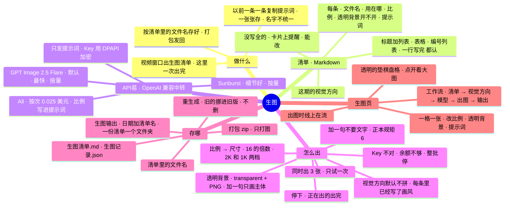

# 架构 · 生图

> 最后核对：v1.8.15（2026-10-30）。

## 结构图

界面「说明」页会把下面这段画成可以点开、收起的树状图，GitHub 上也能直接看图。



## 为什么做

作者 10-30：视频窗口按《自媒体正本》每期出一份「生图清单」（这期的视觉方向 + 10~20 条：编号文件名、用在哪一段、比例、透明背景开不开、提示词），他要一条一条复制提示词去生成、再一张张按文件名保存，"太麻烦了，而且命名也不是很标准"。要一个像 ComfyUI 工作流那样的板块：上传清单，按视觉方向、提示词、比例、透明背景这些条件出图，自动存进文件夹，他直接从文件夹上传给视频窗口。

## 后端（`app/imagegen.py`）

**认清单（`parse`）：** 不要求一种固定写法，几种都认：
- 标题 + 列表：`### img01_重点_地铁站.png（用在：本周重点）` 下面 `- 比例：16:9`、`- 透明背景：不开`、`- 提示词：……`（粗体、换行写、代码块里的都认）。
- 表格：表头里有「提示词」那一列，按表头认「文件名 / 用在哪 / 比例 / 透明背景 / 提示词」。
- 编号列表、一行写完（`img03.png 比例 21:9 提示词：……`）、一行写两样（`比例：16:9 ｜ 透明背景：开`）。
- 视觉方向：带「视觉方向」的标题或标签之后，到下一个标题或第一条之前。标题：第一个 `# ` 标题，没有就用文件名。
- 文件名统一成 `.png`（存的就是 PNG），去掉 Windows 不让用的字，重名加 `_2`；比例不在正本那 10 种里就取最近的；没写比例按 16:9（透明的按 1:1）、没写透明背景按不开、没认出提示词的——都写进 `warn`，界面上「N 处没认全」，卡片上能补。只提到一个文件名、别的都没有的行（比如开头那句「文件名统一 imgNN_xxx.png」）不算一条。

**比例 → 尺寸（`SIZES`）：** 清单只写比例（正本规定 LHY 只能选比例：1:1、3:2、2:3、4:3、3:4、16:9、9:16、5:4、4:5、21:9），API 要像素：16 的倍数、长边 ≤3840、长短边比 ≤3:1、0.65~8.3 百万像素（API易 文档）。「2K」档每张 200 多万像素（16:9 = 2048×1152，API易 推荐的生产尺寸；21:9 = 2240×960），「1K」档 100 多万像素（16:9 = 1536×864），便宜一半多。

**发出去的（`build_prompt` + `_one`）：** `POST {imgBase}/images/generations`，`Authorization: Bearer <imgKey>`：
- 官转（Flare、Sunburst）：`model`、`prompt`、`size`、`quality`（low / medium / high / xhigh / max）、`output_format: png`、`n: 1`、`background`（透明背景开 = `transparent`，不开 = `opaque`）。回来 `data[0].b64_json`（纯 base64）+ `usage`（token 数）。
- 官逆（All）：只发 `model`、`prompt`、`response_format: b64_json`；它不认 size、quality，比例写在提示词最前面（「画面比例 4:5（竖版）。」）；b64 可能带 `data:` 前缀，也可能给 `url`，都认。
- 提示词：（打开「拼进每条提示词」时）视觉方向 + 这一条 +（透明背景开）「只画主体本身，背景完全透明：不要场景、不要地面、不要投影。」+（默认）「画面里不要出现任何文字、字母、数字、水印或 logo。」（正本规矩 6）。视觉方向默认不拼：正本要求每条提示词里已经写了统一画风，再拼一段讲版式、动效的话反而容易画出字和招牌。
- 超时 6 分钟（API易：高画质 + 2K 要 3~5 分钟，客户端断开照样计费、图却丢了）。

**一批（`Gen.start` / `_run`）：** 全部 / 只补没出的 / 指定几张；`asyncio.Semaphore(imgConc)` 同时出几张（默认 3）。只试一次、不自动重试（失败的那张点重生成）。报错（`explain`）说人话：Key 不对（401）、余额不够（402 / quota）、被限流（429）、找不到模型（404）→ 这一批后面的不再发（fatal）；审核没过（403 / safety）、参数不对（400）、服务端出错（5xx）、超时 → 只坏这一张。报错里的 Key 换成 `***`。点「停下」：还没开始的不出了（状态退回原来的），正在出的出完。

**存（`_put`、`_write_md`、`_log`）：** `生图输出\<日期>_<清单名>\`（清单名去掉「生图清单」这类后缀；`imgOut` 能改）。出第一张时才建文件夹。按清单里的文件名存（API易 万一给的不是 PNG 就按实际格式改扩展名、卡片上说）；同名的旧图挪进同一个文件夹的 `旧版\`（名字后面加时间），不删。清单原文存成 `生图清单.md`（内容变了旧的也挪进旧版），每张实际发出去的提示词、尺寸、模型、画质、用时、花费、有没有透明通道写进 `生图记录.json`（按清单的顺序）。存完读 PNG 文件头（不用 Pillow）：尺寸、有没有透明通道；要透明却没透明、比例不对，卡片上提醒。

**当前这份清单（`data\img\board.json`）：** 清单原文、每张的状态、改过的提示词都在这里，关了 Agent 再开还在；上次跑到一半的标回「还没出」。重新上传同一份清单时，文件夹里已经有的图认出来算出好了（「只补没出的」就只补缺的，不用再花钱）。

**花费：** 官转按 API易 返回的 `usage`（输出 $30、输入 $5 每百万 token，粗算）；没给就按 1024² 一张的输出 token（low 196 / medium 439 / high 1756 / xhigh 3122 / max 7024）× 像素数估。官逆按次 $0.025。每张记进 kv `img_usage`（每月张数、美元），页面显示本月花了多少；人民币按设置里的 `usdCny` 换（只用来估）。

| 接口 | 做什么 |
| --- | --- |
| `GET /api/img` | 页面要的一切：当前清单、正在出的这批、模型、比例和尺寸表、本月花了多少 |
| `POST /api/img/load` | 上传清单（`md`、`name`） |
| `PATCH /api/img/item/{id}` | 改一张：`prompt`、`ratio`、`transparent`、`use` |
| `POST /api/img/run` | 出图：默认全部，`missing` 只补没出的，`ids` 指定几张 |
| `POST /api/img/stop` | 停下 |
| `POST /api/img/clear` | 清掉当前清单（文件夹里的图不动） |
| `GET /api/img/file/{id}` | 出好的那张图 |
| `POST /api/img/open` | 打开输出文件夹 |
| `POST /api/img/zip` | 出好的图打成 zip（不含旧版），放在输出文件夹旁边；重名加 `_2` |

**设置（设置 › 云端 最下面）：** `imgKey`（API易 Key，DPAPI 加密，不进导出）、`imgModel`、`imgQuality`、`imgRes`（2k / 1k）、`imgConc`（1~6）、`imgBase`（默认 `https://api.apiyi.com/v1`）、`imgOut`、`imgNoText`、`imgWithDir`。模型、画质、尺寸、两个开关在生图页上也能直接点。

## 生图页（`ui/js/img.js`）

```
┌ 生图清单 ┐──┌ 视觉方向 ┐──┌ GPT Image 2.5 Flare ┐──┌ 出图 ┐──┌ 生图输出 ┐
│ 15 张    │  │ 这期的…  │  │ 模型 · 画质 · 2K/1K │  │ 8/15 │  │ 文件夹   │
│ 换 粘贴 ×│  │ 两个开关 │  │                     │  │ 停下 │  │ 打开 zip │
└──────────┘  └──────────┘  └─────────────────────┘  └──────┘  └──────────┘
┌ 01 img01_重点_地铁站.png ┐ ┌ 02 … ┐ ┌ 03 … ┐ ……（一格一张，在自己里面滚）
│ 预览（透明的垫棋盘格）   │
│ 比例 ▾  透明背景 开/不开 │
│ 提示词（能改）           │
│ 2048×1152 · 31 秒 · $0.03 [重生成] │
└──────────────────────────┘
```
- 上面一条像 ComfyUI 的工作流：五个节点，标题栏一个颜色点 + 类型，左右有接口圆点，节点之间一段虚线；出图时线上的虚线在流、模型和出图两个节点发光。
- 清单拖到这页任何地方（盖一层「松开就认这份清单」），或者点「选文件」「粘贴」。
- 卡片：没出时按比例画一个虚线框；出图中有一道扫描光和秒数；出好了显示图（缩略图直接用原图，`loading=lazy`），透明背景开的垫棋盘格、标「透明 ✓」；点图看大图（Esc 关），能在大图里重生成。提示词停手 0.6 秒存到后端，改过的标「改过」。
- 每秒（出图时）/ 每 5 秒刷新状态；只更新变了的卡片，正在改的提示词框不动。
- 横屏：五个节点一排、下面卡片自动排列（一行 5 张左右）；竖屏：节点三列两行、不画线。一屏放下，卡片区在自己里面滚（`fit.py` 的 LISTS 里有 `.ig-grid`）。

## 还没在真机上量的

沙箱连不上 API易，测试用假的接口（`dev/fake_apiyi.py`，8096，假 Key `sk-test-0000`：按 size 出纯色 PNG，透明的带透明通道；`【拦截】` 触发审核没过；`fake_img_slow / quota / opaque.flag` 测停下、余额不够、没透明）。真机上要看：真 Key 调不调得通、GPT Image 2.5 Flare 出图要多久、`background: transparent` 真的透不透、实际花费和估的差多少（API易 控制台账单）、同时 3 张会不会被限流、视频窗口出的清单格式能不能全认出来。
