# 架构 · Agent 的本事（工具循环、计划、技能、工具箱、Claude Code 引擎）

> 最后核对：v3.2.0（2026-11-13）。

## 结构图

界面「说明」页会把下面这段画成可以点开、收起的树状图，GitHub 上也能直接看图。

```mermaid
mindmap
  root((Agent 的本事))
    工具循环 · app/websearch.py answer_with_tools
      一件事最多 120 步 · agSteps
      一件事花的钱有上限 · agBudget
      老的工具输出缩短 · 消息一条不少
      每一轮先看有没有喊停、有没有插话
    计划 · update_plan
      存在事件里 · events.plan
      主页清单 · 核心外面那一圈
    停下和插话 · app/agentkit.py CTRL
      停下 · 正在跑的命令也停
      插话 · 下一步之前当成一条消息给它
    新工具
      look 看图片 · 视频抽帧
      media_info 多长多大
      download_file 只下公网
      make_voice 本地配音进工作区
      make_music ACE-Step
      make_image 默认关 · 有上限
      publish_douyin 发抖音 · 默认关 · 默认要他确认
      read_skill 翻技能
    技能 · skills 和 工作区的技能文件夹
      用在 · 触发 · 步骤
      对上触发词就把全文带上
    工具箱 · toolbox 同步进工作区
      录网页.py
      合成.py
      口型.py
    Claude Code 引擎 · app/ccode.py
      默认关 · ccOn 是权限
      claude -p 流式 JSON · 只在工作文件夹里
      只许改文件和跑名单里的命令
      每一步和待办清单进事件
      继续 = 接同一个会话
      没跑起来退回 DeepSeek
    权限 · PERM
      只能走 /api/agent/caps · 记进动作日志
```

## 做什么

v2.x 的 Agent 在工作区里只会「读、写、跑命令」，一件事 40 步，中途不能停也不能改方向，做视频这种长活经常做不完。v3.0 把它补成一个能把一件事做到底的干活的：会列计划、能看自己做出来的画面、有现成的脚本和成套做法可用，做的时候你能停、能插话，还能把活整个交给本机的 Claude Code。

## 工具循环（`app/websearch.py` 的 `answer_with_tools`）

- 工具 = 联网搜索 + 读文件 + 工作区（`workspace.tools()`）+ 本事（`agentkit.tools()`，按开关给）。
- 步数上限 `agSteps`（默认 120）。钱的上限 `agBudget`（默认 5 元，只算这件事里 DeepSeek 和生图的钱）：到了就不再给工具，让它汇报做到哪，事件里记一步「到预算了」。
- `_trim()`：消息多了以后，老的工具输出只留头尾（各两百多字），最近十几条完整留着；消息条数不变，工具调用和结果照样一一对上。
- 每一轮开头：`ctl["stop"]` 有了就收尾返回；`ctl["inbox"]` 里有话就当成用户消息塞进去（「他中途补了一句，照这个调整，接着做」），事件里记一步「你插了一句」。

## 每件事的开关（`agentkit.CTRL`）

`agent.handle()` 一开始 `open_ctl(eid)`，结束 `close_ctl(eid)`。`POST /api/events/{id}/stop` 同时喊 `agentkit.request_stop`、`workspace.cancel_run`（正在跑的命令）和 `ccode.request_stop`（Claude Code 的进程，按 PID 停）。`POST /api/events/{id}/say` 往 inbox 里放一句。事件已经做完的回 409。

## 计划

`update_plan(items)`：每项 `{text, status}`（todo / doing / done，几种写法都认），最多 20 条，存进 `events.plan`。界面三处用它：主页「现在」的清单、核心外面一圈（一段一步）、对话里正在做的那条下面。Claude Code 的 `TodoWrite` 也转成同一份计划。

## 新工具（`agentkit.run_tool`）

| 工具 | 干什么 | 开关 |
|---|---|---|
| `look(path, at)` | 图片直接给它看；视频用 ffmpeg 抽帧（不说时间就看开头、中间、快结尾；最多 4 处），画面跟在下一条消息里 | 一直有 |
| `media_info(path)` | 多长、多大、分辨率（`app/mediainfo.py`，不依赖 ffprobe） | 一直有 |
| `read_skill(name)` | 翻一份技能的全文 | 一直有 |
| `download_file(url, path)` | 下到工作区；只认 http(s) 的公网地址，本机和局域网不碰；500 MB | `agDownload` |
| `make_voice(text, dir, name)` | 用配音页上次的设置出音频 + 时间轴 + 字幕，放进工作区；云端要另开 | `agVoice` / `agVoiceCloud` |
| `make_music(prompt, seconds, path)` | 交给 ACE-Step 出纯音乐 | `agMusic` |
| `make_image(prompt, path, ratio, refs)` | 走生图页选的模型；一件事最多 `agImageMax` 张；钱算进这件事 | `agImage`（默认关） |
| `publish_douyin(path, title, desc, tags, schedule, cover)` | v3.2：把工作区里的视频发到他的抖音（[19](19-发布.md)）。默认交给他在「发布」窗口确认，工具马上返回；关掉确认才直接发、等发完 | `agPublish`（默认关）/ `agPublishAsk`（默认开）；登录过才给 |

## 技能和工具箱

- 技能：`skills/*.md`（自带）和 `工作区\技能\*.md`（他自己写的）。文件头两行 `用在：一句话`、`触发：正则`。用户的话对上触发词，`agentkit.hint()` 把全文带进系统提示；对不上的只列名字，它要用就 `read_skill`。
- 工具箱：`toolbox/*.py`，每次进工具循环前 `sync_toolbox()` 复制到 `工作区\工具箱\`（被改过的换回来，旧的先备份）。脚本头一行注释是用途，列在系统提示里。
  - `录网页.py`：接管页面的时间（Date、performance.now、rAF、定时器、CSS 和 WAAPI 动画），一帧一帧截图喂给 ffmpeg，不掉帧；`--png 秒` 只截一张检查。
  - `合成.py`：几段画面接起来、配音、配乐（侧链压缩自动压低）、字幕、头尾淡入淡出。
  - `口型.py`：按配音的音量在闭嘴 / 半张 / 张嘴 / 闭眼几张差分图之间切，出一段角色视频或直接叠到画面上。

## Claude Code 引擎（`app/ccode.py`）

- 什么时候用：`ccOn` 开着、找得到 `claude`、不是隐私的事，并且（这一条指定了用它，或者 `ccAuto` 开着且这是工作区的活 / 带了文件 / 是接着上一件 Claude Code 做的事说「继续」）。
- 怎么叫：`claude -p --output-format stream-json --verbose --permission-mode acceptEdits --allowedTools …`，工作目录 = 工作文件夹，事情从标准输入给，`--append-system-prompt` 带上规矩、技能和工具箱。PATH 最前面放工作区专用的 Python 环境。不开黑窗口。
- 能做什么：改文件类的工具 + `Bash(名字 *)`，名字来自 `ccBash`（默认 python、pip、ffmpeg、ffprobe、node、npm、npx、git）。别的命令它那边会被拒，被拒的记进事件。
- 怎么显示：流里的每个 `tool_use` 变成事件的一步（写文件、运行……），`TodoWrite` 变成计划，最后的 `result` 是回复；会话号存下来，「继续」时 `--resume`。
- 不碰的：不读、不改 `~/.claude` 里的任何东西；用的是他自己登录好的账号和额度。
- 退路：没装、没登录、超时（`ccMinutes`）、没有结果 → 事件里写原因，改回 DeepSeek 自己带工具做。

## 权限

`agDownload、agVoice、agVoiceCloud、agImage、agMusic、ccOn、ccCmd、ccBash` 在 `settings.PERM` 里：通用的 `PUT /api/settings` 改不了，只能走 `PUT /api/agent/caps`（设置 › Agent 能力 里点），每次改动记进动作日志。

## 接口

| 接口 | 干什么 |
|---|---|
| `GET / PUT /api/agent/caps` | 本事的开关、技能和工具箱的清单、Claude Code 的状态 |
| `POST /api/events/{id}/stop` | 停下 |
| `POST /api/events/{id}/say` | 插话 |
| `POST /api/chat` 的 `engine` | 这一条指定 `cc`（Claude Code）或 `ds`（DeepSeek 自己做） |

## 测试

`dev/test_agent.py`（56 项）：计划、技能、工具箱同步、下载只许公网、看视频抽帧、三个脚本真的跑一遍（Chromium + ffmpeg）、预算、插话、喊停、配音配乐生图当工具、Claude Code 引擎（假的命令行 `dev/fake_claude.py`）。

## 还没在真机上量的

- 真的 Claude Code：登录状态、Windows 上 `claude.cmd` 的启动、流式输出的编码、长活的耗时和额度。
- 录网页在 Windows 上的速度（一帧截一张，1080p 30 帧大约每秒录 5~10 帧）。
- 口型脚本配真的差分图好不好看。
