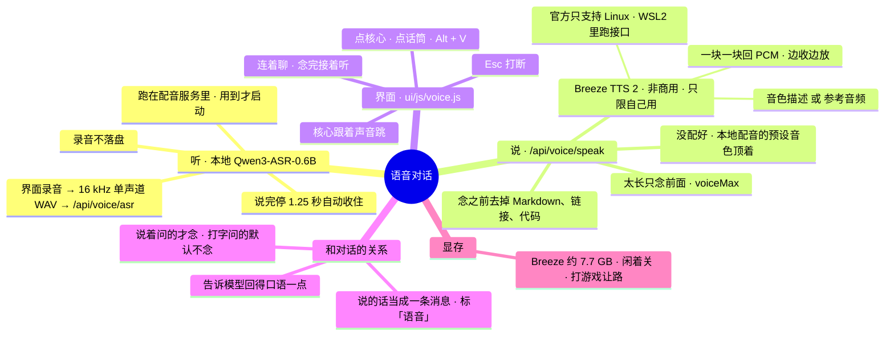

# 架构 · 语音对话

> 最后核对：v3.1.0（2026-11-12）。

## 结构图

界面「说明」页会把下面这段画成可以点开、收起的树状图，GitHub 上也能直接看图。

## 做什么

不用打字，直接和它说话。说的话变成字发出去，走和打字完全一样的流程（分流、DeepSeek、工具）；回答念出来。

## 听（`voice.V.transcribe`）

- 模型：Qwen3-ASR-0.6B，装在现有的配音环境里（`scripts/install_tts.py --asr`；设置 › 整备 ›「配音、语音、配乐」的听写那一项，或者 设置 › 语音 里「一键装听写」，约 1.9 GB）。`app/tts_server.py` 多一个 `/asr`，用到时才把模型装进显存。
- 界面录音：`getUserMedia` → ScriptProcessor 收 PCM → 降到 16 kHz → 16 位单声道 WAV，整段 POST 给 `/api/voice/asr`。只在内存里，不落盘。
- 什么时候收住：听到过声音以后静了 1.25 秒；最长 60 秒；8 秒没听到声音就提示看看麦克风。

## 说（`voice.V.speak`）

- `voiceEngine`：`auto`（Breeze 能用就用它，否则本地配音）、`breeze`、`local`。
- Breeze TTS 2：`POST {voiceUrl}/v1/audio/speech`（multipart：text、instruction 或 ref_audio + ref_text、cfg_scale、seed），回 24 kHz 单声道 16 位 PCM 流。忙的时候回 409，等一下再试。
  - **v3.1 起一键装好**（设置 › 整备 ›「配音、语音、配乐」的 Breeze TTS 2 那一项，或 设置 › 语音 里「一键装 Breeze」）：
    - 代码随包：`vendor/breeze-tts/`（官方仓库 breezeblue-ai/breeze-tts，Apache-2.0，原样拷进来，见里面的 `README-本项目.md`）。他那边连 GitHub 不稳，所以不现下。
    - 环境：和配音共用 tts-env（torch 2.8.0 cu128、transformers 4.57.3），不另装一套。Breeze 要求的 torch 2.9.1 只是它的锁定版本，推理走的都是标准接口。
    - 权重：`scripts/install_tts.py --breeze`，`BreezeBlue/breeze-tts-2` 下到 `models\tts\breeze-tts-2`：先 hf-mirror（`HF_HUB_DISABLE_XET=1`），不行魔搭。要是 Hugging Face 上这个模型要登录同意协议才给下，会说清楚怎么办：网页上同意协议、建一个 Read 令牌，填到 设置 › 语音 ›「Hugging Face 令牌」（`hfToken`，DPAPI 存，只在下载时给下载程序）。
    - 启动：`app/breeze_run.py`（先放两个空的 `sox`、`nagisa` 模块：只有训练和日语才用，tts-env 里没装），用配音环境的 Python 跑 `breeze_infer.api 权重文件夹 --host --port`，工作目录是随包的代码。`voice.installed()` = 配音环境在 + 权重全了（没有 `.incomplete`）+ 代码在。
  - 也能用自己装的：`voiceDir` 填它的文件夹（它自己的 Python 跑 `-m breeze_infer.api`），或 `voiceCmd` 写整条启动命令（比如 WSL：`wsl -d Ubuntu -- bash -lc "…"`）；Agent 自己开、闲 `voiceIdle` 分钟关、打游戏让路。都不填、也没一键装：就是他自己开着，只连 `voiceUrl`。
  - 权重非商用：只用在和他自己对话。做视频的配音照旧走「配音」页（Qwen3-TTS，可商用）。
- 本地配音顶着：走配音服务的 `/generate`（预设音色 `voiceSpeaker`），一句一句出。
- `speakable()`：去掉 Markdown 记号、链接、代码块（说一句「这里有一段代码，看屏幕」）、表格线；超过 `voiceMax` 字在句号处截断，补一句「后面的在屏幕上」。

## 界面（`ui/js/voice.js`）

- 入口：主页核心、指令条的话筒、Alt + V。在念 → 打断；在听 → 取消；闲着 → 开始听。
- 状态喂给核心：`coreOver('listen' / 'think' / 'speak')`、`coreLevel(0~1)`。
- 念：`fetch` 流式读 PCM，一块排一块进 WebAudio（奇数个字节留一个到下一块）。
- `voiceAuto`：说着问的回答念出来；`voiceAll`：打字问的也念；`voiceHands`：念完自动接着听。

## 接口

| 接口 | 干什么 |
|---|---|
| `GET /api/voice` | 状态：听写装没装、用谁出声、参考音频 |
| `POST /api/voice/asr` | WAV → 文字 |
| `POST /api/voice/speak` | 文字 → PCM 流（`X-Sr` 是采样率） |
| `POST / DELETE /api/voice/ref` | 参考音频（3~30 秒 WAV） |
| `POST /api/voice/off` | 关掉 Agent 开的 Breeze |

## 测试

`dev/test_agent.py` 的语音部分（假听写、假 Breeze：`dev/mocks.py` 8093 端口）；`dev/ui/deck.py` 用浏览器的假麦克风把「点核心 → 听 → 发 → 念」走了一遍。

## 还没在真机上量的

- 桌面窗口（WebView2）里要麦克风权限时弹不弹询问、弹了以后记不记得住。
- 真的 Qwen3-ASR 认得准不准、装进显存要几秒。
- 真的 Breeze TTS 2：在 Windows 的 tts-env（torch 2.8）里能不能直接跑起来（官方只说支持 Linux；沙箱里没有显卡和权重，没跑过）、第一句要等多久、和游戏抢显存时的表现。
- hf-mirror 上 `BreezeBlue/breeze-tts-2` 要不要登录才给下（沙箱里连不上，按要登录也能走通做的）。
- 外放时它自己的声音会不会被麦克风收回去（开着回声消除，但没在真机上试）。
