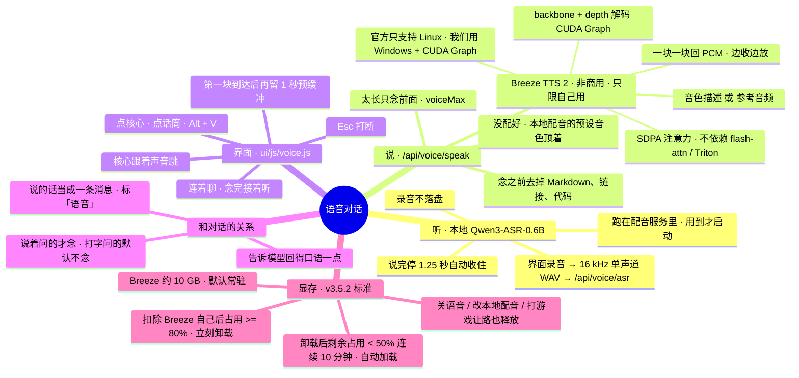

# 架构 · 语音对话

> 最后核对：v3.5.2（2026-11-18）。

## 结构图

界面「说明」页会把下面这段画成可以点开、收起的树状图，GitHub 上也能直接看图。

## 做什么

不用打字，直接和它说话。说的话变成字发出去，走和打字完全一样的流程（分流、DeepSeek、工具）；回答念出来。

## 听（`voice.V.transcribe`）

- 模型：Qwen3-ASR-0.6B，装在现有的配音环境里（`scripts/install_tts.py --asr`；设置 › 整备 ›「配音、语音、配乐」的听写那一项，或者 设置 › 语音 里「一键装听写」，约 1.9 GB）。`app/tts_server.py` 多一个 `/asr`，用到时才把模型装进显存。
- 界面录音：`getUserMedia` → ScriptProcessor 收 PCM → 降到 16 kHz → 16 位单声道 WAV，整段 POST 给 `/api/voice/asr`。只在内存里，不落盘。
- 什么时候收住：听到过声音以后静了 1.25 秒；最长 60 秒；8 秒没听到声音就提示看看麦克风。

## 说（`voice.V.speak`）

- `voiceEngine`：`auto`（Breeze 能用就用它，否则本地配音）、`breeze`、`local`。
- Breeze TTS 2：`POST {voiceUrl}/v1/audio/speech`（multipart：text、instruction 或 ref_audio + ref_text、cfg_scale、seed），回 24 kHz 单声道 16 位 PCM 流。忙的时候回 409，等一下再试。
  - **v3.1 起一键装好**（设置 › 整备 ›「配音、语音、配乐」的 Breeze TTS 2 那一项，或 设置 › 语音 里「一键装 Breeze」）：
    - 代码随包：`vendor/breeze-tts/`（官方仓库 breezeblue-ai/breeze-tts，Apache-2.0，原样拷进来，见里面的 `README-本项目.md`）。他那边连 GitHub 不稳，所以不现下。
    - 环境：和配音共用 tts-env（torch 2.8.0 cu128、transformers 4.57.3），不另装一套。Breeze 要求的 torch 2.9.1 只是它的锁定版本，推理走的都是标准接口。
    - 权重：`scripts/install_tts.py --breeze`，`BreezeBlue/Breeze-TTS-2` 下到 `models\tts\breeze-tts-2`：先 hf-mirror（`HF_HUB_DISABLE_XET=1`），不行魔搭。要是 Hugging Face 上这个模型要登录同意协议才给下，会说清楚怎么办：网页上同意协议、建一个 Read 令牌，填到 设置 › 语音 ›「Hugging Face 令牌」（`hfToken`，DPAPI 存，只在下载时给下载程序）。
    - 启动：`app/breeze_run.py`（先放两个空的 `sox`、`nagisa` 模块：只有训练和日语才用，tts-env 里没装），用配音环境的 Python 跑 `breeze_infer.api 权重文件夹 --host --port`，工作目录是随包的代码。`voice.installed()` = 配音环境在 + 权重全了（根目录没有 `.incomplete`；`.cache` 里的下载缓存不算，和 `install_tts.py` 的 `breeze_done()` 同一规则，v3.3.2）+ 代码在。
  - 也能用自己装的：`voiceDir` 填它的文件夹（它自己的 Python 跑 `-m breeze_infer.api`），或 `voiceCmd` 写整条启动命令（比如 WSL：`wsl -d Ubuntu -- bash -lc "…"`）；Agent 自己开、闲 `voiceIdle` 分钟关、打游戏让路。都不填、也没一键装：就是他自己开着，只连 `voiceUrl`。
  - 权重非商用：只用在和他自己对话。做视频的配音照旧走「配音」页（Qwen3-TTS，可商用）。
- 本地配音顶着：走配音服务的 `/generate`（预设音色 `voiceSpeaker`），一句一句出。
- `speakable()`：去掉 Markdown 记号、链接、代码块（说一句「这里有一段代码，看屏幕」）、表格线；超过 `voiceMax` 字在句号处截断，补一句「后面的在屏幕上」。

## v3.5.2：Breeze 速度与显存

作者反馈官方/测评都说 Breeze 很快，但我们这里 RTF 13.9~14.9、朗读两字一卡。定位结果：

- **我们之前把官方的 `--fast-*` 参数全部过滤掉了**，跑的是 eager 路径；官方 fast 路径依赖 flash-attn / torch.compile / CUDA Graph，Windows 上之前被判定为“不稳”而没试。
- **模型跑在 GPU**（不是 CPU）；慢的原因是 depth decoder 每帧 15 个 codebook 逐步 eager 调用，Python/内核启动开销远大于计算。
- **Windows 没有 flash-attn**；`--fast-all` 需要 torch.compile + Triton，Windows 上静态 CUDA 启动器还会 `OverflowError`，不适合作为默认。

v3.5.2 的方案（`app/breeze_run.py`）：

1. **SDPA 注意力**：把 `api.load_runtime(attn_implementation="eager")` 改成 `sdpa`（PyTorch 自带，比 eager 快，不依赖 flash-attn）。
2. **CUDA Graph 兼容模式**：不编译，用官方 `BackboneGraph.capture()` 捕获 backbone 单步解码图；把 `DepthDecoderGraph.prepare_eager` 换成 `capture()`，把 15 个 codebook 的完整循环捕获成一张 CUDA Graph。图会重放，不需要 Triton。
3. **可选模式**：`voiceFast=auto` 默认 `graph`；`compile` 是官方 depth decoder 编译 + CUDA Graph（更慢的启动，约 70 秒）；`all` 是官方 `--fast-all`（需要 triton-windows 和更多显存）；`eager` 只开 SDPA；`off` 完全官方原样。设置 › 语音 里有下拉，改完重启 Breeze。
4. **前端预缓冲**：v3.5 的 180ms 是从请求开始算，TTFA 一长就被吃光；现在第一块 PCM 到达后才开始计时，Breeze 留 1 秒、本地配音仍 180ms。每块至少提前 350ms（Breeze）/150ms（本地）排期。
5. **Breeze 预热**：用户按话筒开始说话、或确定要朗读时，`POST /api/voice/warm` 在后台加载；不再在 Agent 启动时无条件占 10GB。
6. **显存标准**：Breeze 活着时，**扣除 Breeze 自己后**的显存占用 ≥80% 立刻卸载；卸载后剩余占用 <50% 连续 `voiceIdle` 分钟（默认 10）自动加载；关语音、改本地配音、打游戏让路也释放。用“扣除自己”的占用是因为 Breeze 自身约 10GB，按总占用会在刚加载时就超过 80% 自己卸自己。
7. **闲置不再卸载**：低于 80% 时一直常驻，不再按原来的 10 分钟闲置关（`voiceIdle` 现在表示“低占用多久自动加载”）。
8. **硬件采样移出事件循环**：PDH/WMI 采样慢时 3~5 秒，原来会卡住 `/api/voice` 和首包；现在 `app/main.py` 用 `asyncio.to_thread` 采样，`/api/hw` 也走同一条线。

真机（RTX 5060 Ti 16GB）实测：同样的中文短句，RTF 从 **14.9** 降到 **约 1.05~1.2**，TTFA 约 **0.5~1.9 秒**；9 秒音频和 19 秒音频用真实浏览器播放，**0 次断续**（修复前 5.8 秒音频停顿 20.4 秒、17 次断续）。

## 界面（`ui/js/voice.js`）

- 入口：主页核心、指令条的话筒、Alt + V。在念 → 打断；在听 → 取消；闲着 → 开始听。
- 状态喂给核心：`coreOver('listen' / 'think' / 'speak')`、`coreLevel(0~1)`。
- 念：`fetch` 流式读 PCM，一块排一块进 WebAudio（奇数个字节留一个到下一块）。
- `voiceAuto`：说着问的回答念出来；`voiceAll`：打字问的也念；`voiceHands`：念完自动接着听。
- **朗读按钮（v3.4）：** 每条 AI 回复下面有「朗读」，点了调 `voiceSay(reply)`（`/api/voice/speak`，Breeze TTS 2；没配好用本地配音顶着）。指令条上有「自动念」开关，切 `voiceAuto`；语音没开时点它会提示并跳到 设置 › 语音。

## 接口

| 接口 | 干什么 |
|---|---|
| `GET /api/voice` | 状态：听写装没装、用谁出声、参考音频 |
| `POST /api/voice/asr` | WAV → 文字 |
| `POST /api/voice/speak` | 文字 → PCM 流（`X-Sr` 是采样率） |
| `POST /api/voice/warm` | 用户开始说话/确定朗读时后台预热 Breeze（v3.5.2，不常驻；显存标准见上） |
| `POST / DELETE /api/voice/ref` | 参考音频（3~30 秒 WAV） |
| `POST /api/voice/off` | 关掉 Agent 开的 Breeze |

## 测试

`dev/test_agent.py` 的语音部分（假听写、假 Breeze：`dev/mocks.py` 8093 端口）；`dev/ui/deck.py` 用浏览器的假麦克风把「点核心 → 听 → 发 → 念」走了一遍；`dev/test_voice_policy.py` 测 80% 卸载、50% 低 10 分钟重载的纯策略。

## 还没在真机上量的

- 桌面窗口（WebView2）里要麦克风权限时弹不弹询问、弹了以后记不记得住。
- 真的 Qwen3-ASR 认得准不准、装进显存要几秒。
- 真的 Breeze TTS 2（v3.5.2 已在 RTX 5060 Ti / Windows 实测）：SDPA + CUDA Graph 能跑，RTF 约 1.05~1.2、TTFA 约 0.5~1.9 秒、9/19 秒音频真实播放 0 次断续；**官方 fast-all（`compile` / `all` 模式）仍只在部分机器上可用，冷启动约 70 秒，默认不用**。
- hf-mirror 上 `BreezeBlue/Breeze-TTS-2` 要不要登录才给下（沙箱里连不上，按要登录也能走通做的）。
- 外放时它自己的声音会不会被麦克风收回去（开着回声消除，但没在真机上试）。

- **朗读探针（v3.5）：** `ui/js/telemetry.js` + `ui/js/voice.js` 记录 `voice.stream_start`、`voice.first_chunk`（TTFA）、`voice.underrun`（断流次数、停顿毫秒、RTF、最大分块间隔）。真机实测（RTX 5060 Ti）：第一次 TTFA 57.7s、5.84s 音频断续 17 次/停顿 20.4s、RTF 14.97；第二次 TTFA 32.5s、3.12s 音频断续 7 次/停顿 8.0s、RTF 13.93。说明当前「断断续续」的主因是 Breeze 生成速度远慢于播放（RTF >> 1），不是单纯的前端 30ms 贴边调度；v3.5 已把初始预缓冲改成 180ms、每块至少提前 150ms 排期，后续若还要更顺，需要加大启动缓冲（例如先攒 2~3 秒音频）或优化 Breeze 推理（flash-attn / 量化）。
