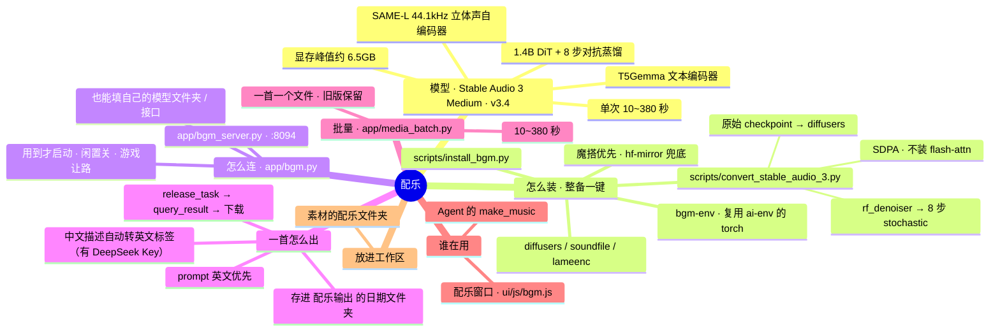

# 架构 · 配乐

> 最后核对：v3.4.0（2026-11-17）。

## 结构图



## 做什么

做视频要垫的背景音乐，本机出，不花钱、不出本机。手动在「配乐」窗口里出，Agent 做视频时也自己用。

v3.4 起引擎换成 **Stable Audio 3 Medium**：
- 1.4B rectified-flow DiT，对抗蒸馏成 8 步（`rf_denoiser`）；
- SAME-L 自编码器，44.1kHz 立体声；
- T5Gemma 文本编码器（`google/t5gemma-b-b-ul2`，随模型仓库一起下）；
- 单次 10~380 秒；显存峰值约 6.5GB（H200 官方数据；消费卡以实测为准）。

许可证：**Stability AI Community License + Gemma Terms**。非商用免费；年收入 100 万美元以下可免费商用；超过要 Enterprise 许可；HF 仓库是 gated，要同意条款。用在要挣钱的视频前先看清。

## 怎么装（整备 ›「配音、语音、配乐」› 配乐）

`scripts/install_bgm.py`，整备里的 `bgm` 那一步跑它（`app/setup.py` 的 `s_bgm`）。不用自己去 GitHub 下、解压、填文件夹。

1. **bgm-env**：`app/paths.py` 的 `BGM_ENV`。只装 `diffusers>=0.43`、`soundfile`、`lameenc`；`torch` / `transformers` 通过 `bgm-env/Lib/site-packages/ai-env.pth` 复用 `ai-env`，不另装一份 3GB 的 PyTorch。tts-env 的 transformers 4.57.3 和 diffusers 0.43 的 huggingface-hub 依赖冲突，所以不动配音环境。
2. **原始权重**：`stabilityai/stable-audio-3-medium`，约 10.4GB（含 `model.safetensors` 9.22GB、`model_config.json`、`t5gemma-b-b-ul2/` 1.18GB）。先魔搭 ModelScope，失败换 `hf-mirror.com`（`HF_HUB_DISABLE_XET=1`，gated 仓库要 `HF_TOKEN`）。放到 `models\bgm\stable-audio-3-medium-src`。
3. **转换**：`scripts/convert_stable_audio_3.py`（diffusers 官方转换脚本，Apache-2.0，v3.4 随包）。读出原始 checkpoint，拆成 `vae` / `duration_embedder` / `text_encoder` / `tokenizer` / `transformer` / `scheduler`，写 `model_index.json`，放 `models\bgm\stable-audio-3-medium`。脚本看到 `model_config.json` 的 `diffusion_objective == "rf_denoiser"` 会自动写 `stochastic_sampling=True` 的 8 步调度器。转换时 T5Gemma 固定 `attn_implementation="sdpa"`。
4. **自检**：`bgm-env` 能导入 torch / diffusers / soundfile / lameenc，显卡看得见；核心 safetensors 和配置齐备。

完成判定 `bgm.model_ok()`：`model_index.json` 在、`transformer` / `vae` / `text_encoder` 各有 `*.safetensors`、`scheduler/scheduler_config.json` 在，且 `.cache` 之外的 `*.incomplete` 一个都没有。`.cache` 里的下载缓存不算（和 Breeze 的规则一致）。

测试用 `AGENT_BGM_FAKE=1` 造一份小的假模型，不下载 10GB；`AGENT_BGM_MODEL` / `AGENT_BGM_SRC` / `AGENT_BGM_ENV` 可以换目录。

## 怎么连

- 一键装好的那一份（`Bgm.builtin()`：没填 `bgmDir`、`Bgm.folder() == MODEL`）：
  ```text
  bgm-env\Scripts\python.exe app\bgm_server.py --model models\bgm\stable-audio-3-medium --host 127.0.0.1 --port 8094 --log
  ```
  没有黑窗口（`Proc` 用 `CREATE_NO_WINDOW`），日志 `data\logs\bgm.log`。
- 也能用自己转换好的一份：`bgmDir` 填模型文件夹（同样由 `bgm_server.py` 拉起）；或者自己把接口开着，Agent 只连 `bgmUrl`（默认 `http://127.0.0.1:8094`）。
- 用到才启动（`Bgm.ensure()` 等 `/health`），闲 `bgmIdle` 分钟关，认出在玩游戏也关。只停 Agent 自己开的那个进程（连它开的子进程）。

## 一首怎么出（`Bgm._gen`）

1. 如果描述是纯中文且设置了 DeepSeek Key：先让 DeepSeek 轻量转成一句英文音乐提示词（风格、情绪、乐器、BPM）。隐私关键词命中、没 Key、离线或翻译失败就原样送 T5Gemma。
2. `POST /release_task`：
   ```json
   {"prompt": "...", "duration": 60, "format": "wav", "num_inference_steps": 8, "seed": 123}
   ```
   服务端夹到 10~380 秒；`duration` 也接受 `audio_duration` / `seconds`，`format` 也接受 `audio_format`。
3. 每隔一会儿 `POST /query_result`：`status` 0=跑着，1=好了，2=失败；好了的 `result` 里给 `/v1/audio?path=...`。
4. `GET /v1/audio?path=...` 把音频取回来，存成 `配乐输出\日期\时分秒_描述.wav`，旁边一份同名 `.json`（原文描述、英文描述、时长、用时、模型、步数、种子、格式）。批量的带 `dest`：存成 `配乐输出\日期_清单名\名字.wav`，同名的旧文件先挪进「旧版」。

## 推理超参（`app/bgm_server.py`）

| 参数 | 值 | 说明 |
|---|---|---|
| `num_inference_steps` | 8 | 对抗蒸馏模型；`bgmSteps` 默认 8，上限保护 1~32 |
| `guidance_scale` | **1.0** | CFG 已蒸馏进权重；>1.0 只对非蒸馏 base 有意义 |
| `negative_prompt` | **不传** | 蒸馏模型不需要；传了反而可能坏 |
| `silence_padding_duration` | 0.0 | 不加边界静音 |
| `num_waveforms_per_prompt` | 1 | 一次一首；批量一首一首出 |
| 采样率 | 44100 Hz 立体声 | `pipe.vae.config.sampling_rate` |
| 时长 | 10~380 秒 | 服务端和界面都夹 |

Windows 没有 flash-attn：服务端显式把 DiT / VAE 的注意力设成 `AttnProcessor2_0`（PyTorch 原生 SDPA），T5Gemma 转换时也固定 SDPA。用 `bfloat16`（显卡支持时）或 `float16` 加载到 CUDA。这样避免官方库在缺 flash-attn 时回退不当产生电流杂音。

## 批量（`app/media_batch.py` 的 `BgmBatch`，界面 `ui/js/mbatch.js`）

- 配乐页左边那一栏顶上切「一首 / 批量」。一份配乐清单：`## 名字` + `时长：30 秒`（30、0:30、1分30秒 都认，10~380 秒）+ `描述：…`（不写「描述：」就把这一节的字当描述）；也能一行一首 `名字 | 时长 | 描述`，或者 Markdown 表格。
- 清单存在 `data\batch\bgm.json`。一首一首出（`B.generate(..., dest=)`），出好的绿点；点一首，中间就放它（也进「最近出的」）。点开一首能改描述、时长，↻ 重来这一首。
- 「停下这一批」：手上这一首不等了（服务端那边出完不存），后面的不出；连着两首没出成也停。跑的时候单个「出一首」不让开（409）。
- 文件夹里：每首 `名字.wav` + `名字.json`、`配乐清单.md`；「打包」做一个 zip 放在这一批的文件夹里；「放进工作区」进 `工作区\素材\配乐\<清单名>\`。

## 接口

| 接口 | 干什么 |
|---|---|
| `GET /api/bgm` | 服务在不在、正在出的、最近 30 首、模型名、最大时长 |
| `POST /api/bgm/gen` | 出一首 `{prompt, seconds}`（10~380） |
| `POST /api/bgm/stop` | 不等了 |
| `POST /api/bgm/off` | 关掉配乐服务 |
| `GET /api/bgm/file/{id}` | 听 |
| `POST /api/bgm/tows` | 放进 `工作区\素材\配乐\` |
| `POST /api/bgm/open` | 打开文件夹 |
| `GET /api/bgm/batch` | 批量：当前清单、这一批的进度 |
| `POST /api/bgm/batch/load` | 认清单 `{md, name}` 或 `{files:[{name, text}]}` |
| `PATCH /api/bgm/batch/item/{id}` | 改一首的描述、时长（10~380） |
| `POST /api/bgm/batch/run` | 开始 `{ids, only_missing}` |
| `POST /api/bgm/batch/stop`、`/clear`、`/zip`、`/tows`、`/open`；`GET /api/bgm/batch/file/{id}` | 停下、换一份、打包、放进工作区、打开文件夹、听 |

内部服务接口（`bgm_server.py`）：`GET /health`、`POST /release_task`、`POST /query_result`、`GET /v1/audio`、`POST /generate`、`POST /quit`（带 `X-Agent: 1`）。

## 测试

`dev/mocks.py` 里假的 Stable Audio 3（8001 端口，`【失败】`、`【慢】` 两个记号；异步任务契约和真服务一样）；`dev/test_agent.py`、`dev/ui/deck.py`；`dev/test_media.py`（`AGENT_BGM_FAKE=1` 假模型 + 配乐批量）、`dev/ui/batch.py`。

## 还没在真机上量的

- 真实模型下载 10.4GB、转换耗时/内存、第一次加载模型要几秒、380 秒峰值显存。
- 消费级显卡上 8 步 + SDPA 的音质；中文描述转英文后的效果。
- 它出的音乐能不能商用，以 Stability AI Community License 和 Gemma Terms 为准，发视频前自己看一眼。

## DeepSeek 帮我认（v3.3）

配乐批量认清单时开着「DeepSeek 帮我认」（默认开），load 带 `smart: true`：先让 DeepSeek 整理成本页的标准格式再认，顶上 warn 写着是它认的、它没把握的地方。细节见 [03](03-DeepSeek与网页Claude.md) 最后一节。
