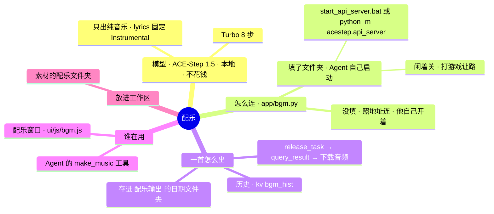

# 架构 · 配乐

> 最后核对：v3.0.0（2026-11-11）。

## 结构图

界面「说明」页会把下面这段画成可以点开、收起的树状图，GitHub 上也能直接看图。

## 做什么

做视频要垫的背景音乐，本机出，不花钱、不出本机。手动在「配乐」窗口里出，Agent 做视频时也自己用。

## 怎么连

- `bgmUrl`（默认 `http://127.0.0.1:8001`）是 ACE-Step 自带接口的地址。
- `bgmDir` 填了它的文件夹：`Bgm.cmd()` 找里面的 `start_api_server.bat`，没有就用它自带的 Python 跑 `python -m acestep.api_server --host 127.0.0.1 --port 8001`。用到才启动（`ensure()` 等 `/health`），闲 `bgmIdle` 分钟关，认出在玩游戏也关。不开黑窗口。
- 只停 Agent 自己开的那个进程。

## 一首怎么出（`Bgm._gen`）

1. `POST /release_task`：`prompt`、`lyrics: "[Instrumental]"`、`audio_duration`、`audio_format`、`inference_steps`（`bgmSteps`）、`thinking: false`、`batch_size: 1`。
2. 每隔一会儿 `POST /query_result`，状态 1 = 好了，2 = 失败。
3. `GET /v1/audio?path=…` 把音频取回来，存成 `配乐输出\日期\时分秒_描述.wav`，旁边一份同名 `.json`（描述、多长、用了多久）。

## 接口

| 接口 | 干什么 |
|---|---|
| `GET /api/bgm` | 服务在不在、正在出的、最近 30 首 |
| `POST /api/bgm/gen` | 出一首 `{prompt, seconds}` |
| `POST /api/bgm/stop` | 不等了 |
| `POST /api/bgm/off` | 关掉服务 |
| `GET /api/bgm/file/{id}` | 听 |
| `POST /api/bgm/tows` | 放进 `工作区\素材\配乐\` |
| `POST /api/bgm/open` | 打开文件夹 |

## 测试

`dev/mocks.py` 里假的 ACE-Step（8001 端口，`【失败】`、`【慢】` 两个记号）；`dev/test_agent.py`、`dev/ui/deck.py`。

## 还没在真机上量的

- 真的 ACE-Step 1.5：整合包里启动脚本的名字和端口、第一次装模型要多久、一分钟的音乐出多久、占多少显存。
- 它出的音乐能不能商用，以 ACE-Step 自己的许可证和模型说明为准，发视频前自己看一眼。
