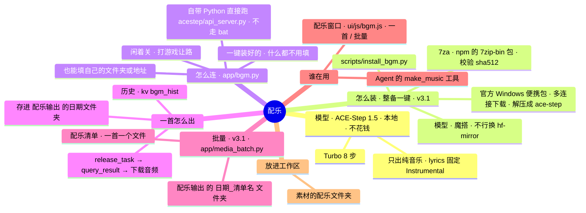

# 架构 · 配乐

> 最后核对：v3.2.0（2026-11-13）。

## 结构图

界面「说明」页会把下面这段画成可以点开、收起的树状图，GitHub 上也能直接看图。

## 做什么

做视频要垫的背景音乐，本机出，不花钱、不出本机。手动在「配乐」窗口里出，Agent 做视频时也自己用。

## 怎么装（v3.1：设置 › 整备 ›「配音、语音、配乐」一键装好）

`scripts/install_bgm.py`，整备里的 `bgm` 那一步跑它（`app/setup.py` 的 `s_bgm`）。不用他自己去 GitHub 下、解压、填文件夹。

1. **7za**：从 npm 的 `7zip-bin` 5.2.0 包里拿（npmmirror，不行换 npmjs），每次都对 sha512；放 `tools\7z\`。
2. **代码**：ACE Studio 官方的 Windows 便携包 `ACE-Step-1.5.7z`（files.acemusic.ai，自带 `python_embedded` 和装好的 PyTorch），用 `scripts/fastdl.py` 多连接、能续传，下到 `tools\downloads\`；`7za t` 测一遍（坏的改名 `.坏的-时间`，不删），解到 `ace-step.tmp`，找到带 `acestep\api_server.py` 和 `python_embedded` 的那一层，改名成 `ace-step\`（原来有的先改名留着）。下好的 7z 留着不删（要腾地方他自己删）。
3. **模型**：用它自带的 Python 调它自己的下载工具 `acestep.model_downloader.download_main_model`（就是它的 `acestep-download` 命令；旧版没有 `prefer_source` 参数也行），下 `ACE-Step/Ace-Step1.5` 主仓库（turbo、vae、Qwen3-Embedding-0.6B、1.7B 语言模型），先魔搭，不行 hf-mirror；放 `ace-step\checkpoints\`。
   - v3.2 修的：v3.1 调的是 `acestep.api.model_download`，那是 GitHub 上新版代码才有的，官方便携包里没有，一导入就退出（作者 11-12 真机：两个源都「退出码 1」）。现在先用 `model_downloader`，没有它才用新版那个。
   - 它打印的东西（包括报错）原样转进整备的日志（`run_fwd`）：以前子进程开着 `CREATE_NO_WINDOW` 又没接输出，输出进了看不见的控制台，日志里只剩退出码。「没下全」后面写着它最后一句报错。
4. **自检**：它自带的 Python 导入 PyTorch、看得见显卡没有。

测试时用 `AGENT_7Z_URLS`、`AGENT_ACE_URLS` 换下载地址（`dev/test_media.py` 现做一个假的便携包放到假下载站）。`ace-step\`、`tools\7z\`、`tools\downloads\` 不进仓库、不进压缩包。

## 怎么连

- 一键装好的那一份（`Bgm.builtin()`：没填 `bgmDir`、`ace-step\acestep\api_server.py` 在）：`Bgm.cmd()` = `ace-step\python_embedded\python.exe ace-step\acestep\api_server.py --host --port`。不走它的 `start_api_server.bat`（会检查更新、问 Y/N，没有窗口就卡住）。环境变量 `ACESTEP_INIT_LLM=false`（不装语言模型，省 3GB 显存）、`ACESTEP_CHECKPOINTS_DIR` 指到 `ace-step\checkpoints`。
- 也能用自己装的：`bgmDir` 填它的文件夹（同样直接跑 `acestep\api_server.py`，没有就 `-m acestep.api_server` / `uv run acestep-api`）；或者自己开着，只填 `bgmUrl`（默认 `http://127.0.0.1:8001`）。
- 用到才启动（`ensure()` 等 `/health`），闲 `bgmIdle` 分钟关，认出在玩游戏也关。不开黑窗口，日志 `data\logs\bgm.log`。只停 Agent 自己开的那个进程（连它开的子进程）。

## 一首怎么出（`Bgm._gen`）

1. `POST /release_task`：`prompt`、`lyrics: "[Instrumental]"`、`audio_duration`、`audio_format`、`inference_steps`（`bgmSteps`）、`thinking: false`、`batch_size: 1`。
2. 每隔一会儿 `POST /query_result`，状态 1 = 好了，2 = 失败。
3. `GET /v1/audio?path=…` 把音频取回来，存成 `配乐输出\日期\时分秒_描述.wav`，旁边一份同名 `.json`（描述、多长、用了多久）。批量的带 `dest`：存成 `配乐输出\日期_清单名\名字.wav`，同名的旧文件先挪进「旧版」。

## 批量（v3.1，`app/media_batch.py` 的 `BgmBatch`，界面 `ui/js/mbatch.js`）

- 配乐页左边那一栏顶上切「一首 / 批量」。一份配乐清单：`## 名字` + `时长：30 秒`（30、0:30、1分30秒 都认，10~600 秒）+ `描述：…`（不写「描述：」就把这一节的字当描述）；也能一行一首 `名字 | 时长 | 描述`，或者 Markdown 表格。贴进去或者选 .md / .txt（能一次选几个、能拖）。
- 清单存在 `data\batch\bgm.json`。一首一首出（`B.generate(..., dest=)`），出好的绿点；点一首，中间就放它（也进「最近出的」）。点开一首能改描述、时长，↻ 重来这一首。
- 「停下这一批」：手上这一首不等了（ACE-Step 那边出完不存），后面的不出；连着两首没出成也停。跑的时候单个「出一首」不让开（409）。
- 文件夹里：每首 `名字.wav` + `名字.json`、`配乐清单.md`；「打包」做一个 zip 放在这一批的文件夹里；「放进工作区」进 `工作区\素材\配乐\<清单名>\`。

## 接口

| 接口 | 干什么 |
|---|---|
| `GET /api/bgm` | 服务在不在、正在出的、最近 30 首 |
| `POST /api/bgm/gen` | 出一首 `{prompt, seconds}` |
| `POST /api/bgm/stop` | 不等了 |
| `POST /api/bgm/off` | 关掉服务 |
| `GET /api/bgm/file/{id}` | 听 |
| `POST /api/bgm/tows` | 放进 `工作区\素材\配乐\` |
| `POST /api/bgm/open` | 打开文件夹 |
| `GET /api/bgm/batch` | 批量：当前清单、这一批的进度 |
| `POST /api/bgm/batch/load` | 认清单 `{md, name}` 或 `{files:[{name, text}]}` |
| `PATCH /api/bgm/batch/item/{id}` | 改一首的描述、时长 |
| `POST /api/bgm/batch/run` | 开始 `{ids, only_missing}` |
| `POST /api/bgm/batch/stop`、`/clear`、`/zip`、`/tows`、`/open`；`GET /api/bgm/batch/file/{id}` | 停下、换一份、打包、放进工作区、打开文件夹、听 |

## 测试

`dev/mocks.py` 里假的 ACE-Step（8001 端口，`【失败】`、`【慢】` 两个记号；`/files/` 当假下载站）；`dev/test_agent.py`、`dev/ui/deck.py`；`dev/test_media.py`（真跑一遍 `install_bgm.py`、配乐批量）、`dev/ui/batch.py`。

## 还没在真机上量的

- 真的官方便携包：多大、下多久、`7za` 解不解得开（沙箱里连不上 acemusic.ai，是拿假包测的）；它自带的 Python 直接跑 `acestep\api_server.py` 找不找得到 `acestep` 包。
- 魔搭上 `ACE-Step/Ace-Step1.5` 下不下得动、下全要多久；一分钟的音乐出多久、占多少显存。
- 它出的音乐能不能商用，以 ACE-Step 自己的许可证和模型说明为准，发视频前自己看一眼。
