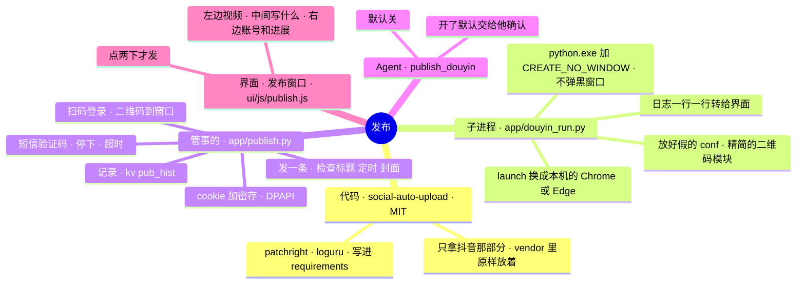

# 架构 · 发布到抖音

> 最后核对：v3.2.0（2026-11-13）。

## 结构图

界面「说明」页会把下面这段画成可以点开、收起的树状图，GitHub 上也能直接看图。

## 做什么

作者 11-13：「让 Agent 平台多一个能力，自动发布抖音视频」，点名用 GitHub 上的开源项目 social-auto-upload。做好的视频在「发布」窗口里写好标题、话题，点两下就发到他的抖音；Agent 做完视频也能交过来（默认要他确认）。

## 代码从哪来（`vendor/social-auto-upload/`）

- dreammis/social-auto-upload，提交 `3847fff`（2026-10-23），MIT。只拷了抖音要用的 9 个文件，原样没改（见那里的 `README-本项目.md`）。
- 原项目的依赖很多（Flask、biliup、opencv……），抖音这块只要 `patchright`（改过的 Playwright，不容易被认出是自动化）和 `loguru`，写进了 `requirements.txt`（启动.bat 自动装；没装上的话「发布」窗口里点「装一下」，`POST /api/publish/install`，先默认源再清华镜像）。

## 子进程（`app/douyin_run.py`）

每次登录、查登录、发布单独起一个：`python.exe app\douyin_run.py login|check|upload|selftest 任务.json`。

- **不弹黑窗口：** 用同一个环境的 `python.exe`（不是 pythonw）加 `CREATE_NO_WINDOW`：它自己有一个看不见的控制台，它再起的 patchright 驱动（node）、浏览器都待在里面。放进 Job Object，Agent 关了它也停。
- **导入原项目之前放好三样，所以原项目的文件不用改：**
  1. 假的 `conf` 模块：`BASE_DIR` 指到 `data\publish\run\`，它的日志、`cookies\`、`verify_code.txt` 都写那里。它要的 `utils\stealth.min.js` 每次复制过去。
  2. 精简的 `utils.login_qrcode`：原来那个要 opencv 在终端里画二维码，我们的二维码直接显示在窗口里。
  3. 改 patchright 的 `BrowserType.launch`：原项目写死 `channel="chromium"`（要另外下一个 Chromium），换成 `executable_path=` 他电脑上的 Chrome，没有就 Edge。不另外装浏览器；用的是临时的空白配置，不碰他自己浏览器里的账号、书签。
- **输出：** 原项目用 loguru 打日志，换成一行一行的 `@@J {"t":"log"}` 给界面，另外记一份 `data\publish\run\logs\douyin.log`；二维码 `{"t":"qr","img":"data:image/png;base64,…"}`；日志里出现「验证码」弹窗 → `{"t":"sms"}`；最后 `{"t":"done","ok","msg"}`。
- **selftest：** 不联网，导入原项目、看 `douyin_setup`、`cookie_auth`、`DouYinVideo` 和要用的参数都在；给了浏览器就真开一下空白页（看 launch 换没换对）。原项目更新以后先跑这个。
- 测试时环境变量 `AGENT_SAU_FAKE=dev/fake_sau.py` 换成假的（不开浏览器、不联网）。

## 管事的（`app/publish.py`）

- **一次只做一件：** 登录 / 查登录 / 发布 / 装组件，`P.job`。超时就停：登录 5 分钟、查 3 分钟、发布 45 分钟。「停下」只停自己开的（按进程号，连它开的驱动、浏览器）。
- **登录信息：** 扫码成功后，原项目把 cookie 存成一个 JSON。我们拿过来**加密**存 `data\publish\douyin.cookie`（`settings.seal`：Windows DPAPI，只有这个 Windows 账号解得开）。每次用时解到 `run\douyin_<时间>.json` 给子进程，用完：里面有 `sessionid` 就重新加密存（抖音会刷新它），明文文件删掉。Agent 半路关了留下的明文，下次启动、下次开始前都会删。日志里不记 cookie。「退出」删掉加密的那份。
- **发一条之前的检查（`check_item`）：** 视频（他在窗口里可以填任何路径；Agent 只能用工作区里的）、格式；标题必填、最多 30 字（抖音会截）；简介最多 1000 字；话题去 `#`、去重、最多 10 个；定时 `2026-11-14 20:00`，2 小时以后、14 天以内（抖音的规矩）；封面可选，按宽高认横（4:3）竖（3:4）；自主声明默认「内容由AI生成」（他的视频是 AI 配音、生图做的；抖音要求标注），只能选抖音上那几项；合集可选（要已经建好的）。
- **短信验证码：** 抖音有时候发布前要验证码。原项目会点「获取验证码」，然后等 `run\verify_code.txt`。界面弹框，他填了 → `POST /api/publish/code` 写进去。
- **记录：** kv `pub_hist`（最近 100 条：什么时候、标题、视频名、定时、结果、谁发的）；动作日志（`safety.log`）记每一次发布和退出。主页「刚做完」里也有。
- **浏览器：** `find_browser()`：设置 › 发布 填了就用填的；不然 Chrome（Program Files、x86、LOCALAPPDATA），再不然 Edge。

## Agent 的 `publish_douyin`

- 设置 › Agent 能力：「自己发抖音」（`agPublish`，默认关）、「发抖音之前要我点确认」（`agPublishAsk`，默认开）。都是权限，只能在那里点（`settings.PERM`），通用的改设置改不了；开关记进动作日志。登录过才给这个工具。
- 参数：`path`（工作区里的视频）、`title`、`desc`、`tags`、`schedule`、`cover`。
- 要确认时：整理好放进 kv `pub_pending`，「发布」窗口中间顶上出现一条「Agent 想发：……」——「填进来看看」把它填进表单（能改），再点两下发布（`POST /api/publish/pending/{id} {act: ok, edits}`）；「不发」扔掉。工具马上返回「交给他确认了」，不等。
- 不用确认时：直接发，等它发完（主页「现在」里看得到进展），返回结果。

## 界面（`ui/js/publish.js`，「发布」工具窗口）

- 左边：要发的视频（预览）、工作区里最近的视频（点一下选上）、填路径、选文件 / 拖进来（先放进 `工作区\收到的\`）。
- 中间：Agent 交来的（顶上）、标题（字数）、简介、话题（变成小标签）、封面、马上 / 定时、自主声明、合集，「发布到抖音」**点两下才发**（第一下先让后端检查一遍，变成「再点一下就发」，4 秒不点就回去）。写到一半的存在浏览器里。
- 右边：抖音账号（没装组件 → 装一下；没浏览器 → 去设置；没登录 → 扫码登录；登录了 → 看看还在不在、换个号、退出）、正在做的（二维码、验证码框、最近几行进展、停下）、最近发的。
- 一屏放下（`dev/ui/fit.py`）；视频列表、记录、进展在自己的框里滚。

## 接口

| 接口 | 干什么 |
|---|---|
| `GET /api/publish` | 组件、浏览器、代码在不在；账号；正在做的；最近发的；Agent 交来的；工作区里最近的视频 |
| `POST /api/publish/login`、`/check`、`/logout` | 扫码登录、看登录还在不在、退出 |
| `POST /api/publish/preview` | 整理一遍要发的（不行就 400 说哪里不行） |
| `POST /api/publish/go` | 发一条 |
| `POST /api/publish/code` | 交短信验证码 |
| `POST /api/publish/stop` | 停下 |
| `POST /api/publish/pending/{id}` | Agent 交来的：`{act: ok / drop, edits}` |
| `POST /api/publish/install`、`/selftest` | 装组件、自检 |
| `GET /api/publish/media?path=` | 预览视频、封面 |
| `POST /api/publish/batch/load` | 批量（v3.3）：`{folder, files?, smart}` 认一批 |
| `POST /api/publish/batch/run`、`/stop`、`/clear` | 一条一条发、停下、换一批 |

## 批量发布（v3.3，`PubBatch`，kv `pub_batch`）

- 中间「一条 / 批量」切换；批量时左边那栏收起来。填一个文件夹（完整路径或工作区里的），清单可以另外选（.md / .txt），不选就读文件夹里的（GBK 的 txt 也认）。
- 认清单两种：开着「DeepSeek 帮我认」→ `smartlist.ask("pub")`，带着文件夹里的视频、图片文件名和今天的日期，它回每条的 video / cover / title / desc / tags / schedule / collection / declaration；关着 → `parse_pub` 固定格式（`## 标题` 下面 `视频：` `封面：` `简介：`（可以多行）`话题：` `定时：` `合集：` `声明：`）。
- 配文件 `match()`：一模一样 > 去掉扩展名、空格、下划线一样 > 只有一个包含它 > 只有一个同序号。没写封面 `auto_cover()` 找同名、「同名_封面」、同序号带「封面」的图。时间 `norm_when()` 换成 `YYYY-MM-DD HH:MM`（「11月14日 晚上8点」也行）。
- 每条用 `check_item` 查一遍（批量必须定时）；不行的标红写原因，发的时候跳过。「全部定时发出去」点两下；后台线程一条一条 `P.start("upload", by="batch")`，每条发前再查一遍（2 小时的规矩），登录失效就停下等重扫，「接着发」只发没发的。记录里 `by = batch`（界面标「批量」）。

## 测试

`dev/fake_sau.py`（假抖音）、`dev/test_smart.py`（v3.3 批量发布）、`dev/test_publish.py`（真代码自检 + 假抖音走全流程 + Agent 工具）、`dev/ui/publish.py`（窗口点一遍）、`dev/ui/fit.py`。

## 还没在真机上试的

- 真的扫码登录、真的发一条（沙箱连不上抖音）：抖音创作者中心改版的话原项目要更新。
- 用他电脑上的 Chrome / Edge 跑 patchright（原项目默认用它自己下的 Chromium）：会不会被抖音认出来要验证。
- 发的过程中弹验证码时，窗口里的框交过去好不好使。
- 有没有黑窗口（应该没有：python.exe + CREATE_NO_WINDOW）。
- 批量：连着发好几条，抖音会不会限流、要验证（每条之间只歇 3 秒）。
