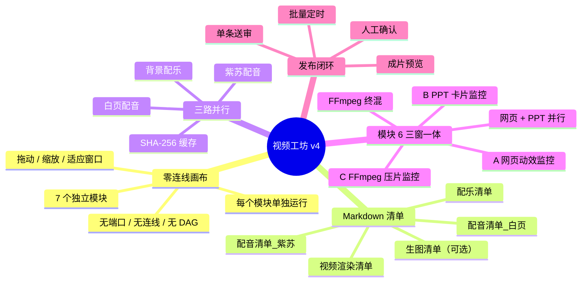

# 架构 · 视频工坊（v4.0）

> 最后核对：v4.0.1（2026-11-18）。

## 结构图



## 做什么

v4.0 把视频工坊从「自由节点 + 端口连线」彻底改成**零连线、全独立可测的模块画布**：

- 画布固定 7 个模块：**剧本与策划 / 生图测试台 / 角色配音·白页 / 角色配音·紫苏 / 背景配乐 / 视频制作总成 / 成片预览与抖音发布**。
- **没有端口、没有连线、没有 DAG、没有「缺上游」**：每个模块都能随时单独点运行；模块 6 没有配音时也能用静音成片。
- 模块之间靠项目 `Lists/` 下的 **Markdown 清单**协作，不再靠连线传数据。
- 生图测试台是**独立工具**，全流程跑视频时跳过，不参与成片。

## 数据模型（`app/studio_graph.py`）

`project.json` 里存 `modules` 数组，不再有 `graph` / `edges` / `shots`：

```json
{
  "modules": [
    {
      "id": "voice-white",
      "type": "voice",
      "title": "角色配音 · 白页",
      "x": 850, "y": 40, "w": 400, "h": 500,
      "params": {
        "role": "白页",
        "speaker": "local:preset:Serena",
        "engine": "auto",
        "tone": "冷静吐槽",
        "lines": [
          {"id": "l1", "line_index": 1, "text": "第一句台词。", "tone": "冷静吐槽"}
        ]
      },
      "outputs": [
        {"rel": "tts/shot01.wav", "kind": "audio", "line": "1", "sha256": "…", "duration": 2.1}
      ],
      "status": "ok", "error": "", "cache_key": "…", "cache_hit": false
    }
  ],
  "modules_version": 4
}
```

7 个固定 id：`script`、`image`、`voice-white`、`voice-zisu`、`bgm`、`compose`、`publish`。模块只能拖动/缩放，不能增删。

## Markdown 清单（`Lists/`）

| 文件 | 谁读 | 内容 |
| --- | --- | --- |
| `配音清单_白页.md` | 模块 3 | 音色、默认语气、每句台词和语气，`## NN` 的 NN 是全局句序 |
| `配音清单_紫苏.md` | 模块 4 | 同上 |
| `配乐清单.md` | 模块 5 | 英文描述、时长、步数、种子 |
| `视频渲染清单.md` | 模块 6 | 每一镜的时长、方式（网页动效 / PPT 卡片 / 静态）、画面要点、字幕、转场 |
| `生图清单.md` | 模块 2 | 可选参考，只给生图测试台按需测图 |

- 模块 1 导入剧本或 DeepSeek 拆解后，一次性写全部 5 份清单。
- 任何模块里都能展开清单直接编辑；「保存清单并重新载入」会把内容解析回对应模块参数。
- 清单解析失败时保留原文，界面提示具体行/字段；不会静默跳过。

## 七个模块

### 1. 剧本与策划

- 主题/完整口播、标题、简介、话题；DeepSeek 拆解；导入 JSON/Markdown 剧本。
- 运行本模块 = 按当前内容重新生成 5 份 Markdown 清单（不花钱）。
- 导入剧本只建清单和模块参数，不触发生成。

### 2. 生图测试台（独立）

- API易 GPT Image 2.6 Sunburst 全参数：普通 / GIF / SVG；PNG/JPEG/WebP；比例 7 种或自定义 16 倍数尺寸；1K/2K/4K；n=1~4；quality 6 档；complexity 3 档；透明；GIF 2~16 帧、每帧 20~2000ms；最多 16 张参考图。
- 「▶ 立即生成测试」只跑这一张/这一批，点击缩略图开灯箱。
- **全流程一键跑视频时跳过本模块**，成片不依赖生图。

### 3/4. 角色配音 · 白页 / 紫苏

- 完全独立：引擎（本地 Qwen3-TTS / 百炼云端）、音色、默认语气、多句台词、逐句语气、单句试听/重配、单独运行。
- 每句按 `line_index` 写 `tts/shotNN.wav`；两个模块的已有音频按全局句序汇总成 `tts/voice.wav`、`subtitles.srt`、`timeline.json`。
- 逐句 SHA-256 缓存；重跑只补缺的/变了的句子。

### 5. 背景配乐

- 英文提示词、10~380 秒、步数、种子；单独生成、内置试听、SHA-256 缓存。
- 产出 `bgm/bgm.wav`。

### 6. 视频制作总成（Claude Code 驱动，三窗一体）

内部并排三个实时监控窗口：

| 窗口 | 显示 | 单独重跑 |
| --- | --- | --- |
| A 网页动效渲染 | 当前预览帧、镜头号、FPS、Claude Code/Playwright 状态 | `▶ 仅重跑网页动效` |
| B PPT 卡片 | 幻灯片缩略图、页数、渲染状态 | `▶ 仅重跑 PPT 卡片` |
| C FFmpeg 混流 | 进度百分比、编码帧率、画幅、字幕开关、配乐音量、闪避深度、日志摘要 | `▶ 仅重跑 FFmpeg 压制` |

- 读 `视频渲染清单.md` 决定每一镜用网页动效还是 PPT 卡片；不再用生图。
- 网页动效：Claude Code 可用且勾选「用 Claude Code 写网页动效」时，按清单/台词/时长/60-30-10 规范写单文件 HTML，Playwright 逐帧录成 H.264；Claude Code 不可用时退回内置模板。
- PPT 卡片：`python-pptx` 自动生成或导入 `.pptx`，无头 Chromium 渲染成 PNG；渲染期间监控窗实时出现缩略图。
- FFmpeg：网页动效流 + PPT 卡片流 + 白页/紫苏配音 + 配乐（侧链闪避）+ 硬字幕合成 `.mp4`；没有配音时自动生成静音轨，保证模块 6 单独可测。
- 渲染出来的网页/PPT 轨路径写回模块参数，单独重跑 FFmpeg 时直接复用，不重新渲染。

### 7. 成片预览与抖音发布

- `<video>` 预览、封面灯箱、标题/简介/话题、单条送审 / 批量清单、定时、合集、AI 合规声明。
- 全流程只把成片标成「待发布」，绝不自动发送；「发布」窗口仍要人工点两下。

## 调度与缓存

- **全流程**：第一阶段 `voice-white`、`voice-zisu`、`bgm` 三个 `asyncio.Task` 同时启动；全部结束后重建全局配音，再进模块 6。
- **模块 6**：网页动效与 PPT 卡片并行渲染（各自线程/监控窗），都结束后 FFmpeg 压制。
- **生图模块**不在全流程里；只由用户点「▶ 立即生成测试」时运行。
- 模块缓存键 = SHA-256(`模块类型`, `参数`, 依赖产出哈希, `v=studio-modules-4.0.0`)；模块 6 的依赖包含两份配音、配乐和 `视频渲染清单.md` 内容哈希。
- 单句配音/配乐/生图仍沿用原有内容寻址缓存 `_cache/`、`_cache/tracks/`。

## 旧工程迁移

`Studio._load()`：

1. 没有合法 `modules` 时，先把 `project.json` 复制成 `project.json.v3.bak`。
2. 旧 `graph` 的 image/voice/bgm/mux/publish 节点和旧 `shots` 合并成 7 个模块：每句配音按全局句序拆进白页/紫苏，产出保留；网页/PPT 规划写进 `视频渲染清单.md`。
3. 清掉 `graph`、`edges`、`shots`、`node_layout`。
4. 失败恢复 `.bak`，原工程不动。

## 接口

| 方法 | 地址 | 做什么 |
| --- | --- | --- |
| GET | `/api/studio/state` | 7 个模块、Lists、成片、音色、模型、三窗任务状态 |
| POST | `/api/studio/new` | 新建项目 + 默认 7 模块 + 5 份清单 |
| POST | `/api/studio/select` | 切换项目（旧工程自动迁移） |
| POST | `/api/studio/script/import` | 导入剧本 → 5 份清单 |
| POST | `/api/studio/script/plan` | DeepSeek 拆解 → 5 份清单 |
| GET/PUT | `/api/studio/list` | 读/存 Markdown 清单并回填模块 |
| POST | `/api/studio/module/update` | 改模块位置/宽高/标题/参数 |
| POST | `/api/studio/module/layout` | 批量保存模块位置大小 |
| POST | `/api/studio/module/run` | 跑一个模块 / 全流程；`part=web/ppt/ffmpeg` 仅重跑一窗 |
| POST | `/api/studio/stop` | 停下 |
| POST | `/api/studio/to_publish` | 送进待确认队列/批量清单 |
| GET | `/api/studio/media` | 项目文件 |
| GET/POST | `/api/studio/asset`、`/asset/info`、`/reveal` | 灯箱只读取图、信息、打开文件夹 |
| POST | `/api/studio/ref` | 生图测试台参考图上传 |
| GET | `/api/studio/export_prompt_pack` | Gemini 策划包 |
| POST | `/api/studio/open` | 打开项目/output |

## 测试

- `dev/test_studio.py`：7 模块/0 连线/0 端口、每个模块独立运行、清单生成/编辑回填、全局句序配音、静音也能独立成片、三窗状态与 mp4、全程三路并行且跳过生图、旧工程迁移。
- `dev/ui/canvas.py`：0 连线 0 端口、7 模块、拖动缩放、三窗、适应窗口、页面不滚。
- `dev/ui/compose.py`：模块 6 真实渲染网页/PPT/FFmpeg，三窗状态、成片进模块 7、仅重跑 FFmpeg。
- `dev/ui/lightbox.py`、`dev/ui/fit.py`、`dev/ui_smoke.py`。

## 只在 Windows 真机上验证

- 真实 API易 生图测试台（普通/GIF/SVG、16 参考图、透明）。
- 真实 Qwen3-TTS / 百炼双角色逐句配音、Stable Audio 3 显存串行。
- 作者电脑上的 Edge/Chrome 渲染网页动效和 PPT 卡片的速度、字体。
- 真的 Claude Code 写网页动效 HTML：`claude.cmd`、流式编码、长活、额度、停下。
- 抖音真实发布待确认/批量清单、字幕遮挡。
- 真实旧工程迁移后的排布、清单内容和缓存命中。


## v4.0.1 修复（真机阻断问题）

### 媒体播放

- `/api/studio/asset` 不只给图片：WAV / MP3 / FLAC / OGG / MP4 / WEBM 都走这里。
- 文件头校验：`RIFF....WAVE`、`ID3` 或 MP3 帧同步、`fLaC`、`OggS`、`ftyp`、EBML；后缀和内容对不上就拒绝。
- `FileResponse` 原生支持 `Accept-Ranges: bytes` / `206 Partial Content`，`<audio>` / `<video>` 能加载、拖动、循环。
- 前端媒体 URL 带产出 `sha256` 的 `&v=`，重配/重生成后不会播旧缓存。
- 模块内是原生 `<audio controls>`（播放/暂停、当前时间/总时长、进度条）；失败时模块内显示后端具体原因。

### 多模块真并发

- `Studio._tasks: dict[module_id, asyncio.Task]`；不同模块独立任务，互不阻塞，不会因为别的模块在跑而返回 409。
- 同一模块重复点会提示等它完成；`stop(module_id)` 只停这个模块，不传停全部。
- 每个模块有独立 `threading.Event` 停止位；contextvars 记录当前模块，子任务里的 `_stopped()` 同时看全局和本模块。
- API 通道仍 `Semaphore(4)`；本地 GPU 共用 `GPU_LOCK`，第二个本地模块 runtime 先是 `queued`，文案「正在等待上一本地模型释放 GPU…」，拿到锁后自动变 `running`。
- 模块保存用「只合并当前模块」的 `_save`，并发写 `project.json` 不会互相覆盖节点布局；拖动位置优先保留磁盘最新值。

### 实时进度

每个模块 `runtime`：

```json
{"status": "running", "pct": 42.5, "phase": "正在合成第 2/5 句（白页，语气：冷静吐槽）…",
 "started_at": 1795012345.6, "last_took_s": 0}
```

- `status`：`idle / queued / running / ok / error`。
- 阶段埋点：模块 1 DeepSeek→清单；模块 2 API易→下载校验；模块 3/4 逐句合成→拼接/SRT；模块 5 启动服务→扩散→写 bgm.wav；模块 6 网页帧号→PPT 页数→FFmpeg 百分比/帧率/帧号。
- 前端有运行中模块时 600ms 轮询，否则 1300ms；只更新 `.st-rt` 进度条/阶段/秒表/按钮，不重绘正在输入的表单。
- 运行按钮立即变「运行中 · X%（点此停止）」；模块边框呼吸流光；排队时显示「排队中」。

### 生图测试台真出图与配乐响度（v4.0.1 补充）

- 生图模块每次点「立即生成测试 / 只跑」都会带一次性 `_force_nonce`：模块缓存键和生图全局缓存指纹都变，真的请求 API易；图片大预览放在模块顶部。
- `bgm_server` 生成完按峰值归一到 -1 dBFS；配乐指纹加 `v=2`，旧的偏小文件不会继续命中。
- 配乐页打开先渲染连接状态；后台没响应时显示原因并禁用生成按钮，轮询恢复后自动可用，避免黑屏/灰按钮无反馈。
