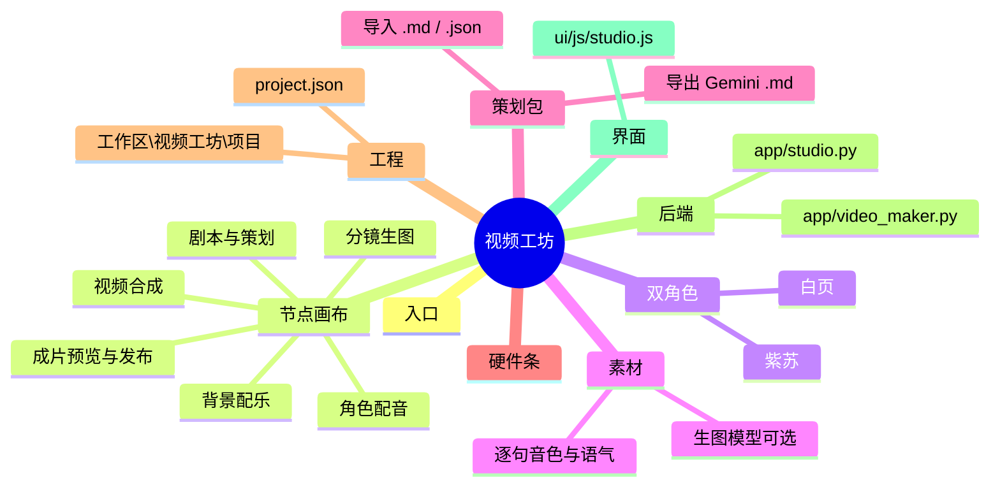

# 架构 · 视频工坊（v3.7）

> 最后核对：v3.7.0（2026-11-18）。

## 结构图

界面「说明」页会把下面这段画成可以点开、收起的树状图，GitHub 上也能直接看图。



## 做什么

v3.6 的「视频工坊」是一条四步流水线；v3.7 把它升级成 **ComfyUI 风格的可视化节点工作流**：六个节点串在一条画布上，每个节点有自己的状态灯、进度、当前动作和「▶ 只跑本节点」。固定风格为 **知识科普 × 科技数码 × 搞笑段子**，白页 / 紫苏双角色逐句配音；支持导出 Gemini 策划包、导入 Gemini 剧本，以及生图模型选择和实时硬件状态条。

旧页面（生图、配音、配乐、发布、监控等）保持原样，工坊只调用它们的底层能力。

## 六节点工作流（`ui/js/studio.js`）

| 节点 | 做什么 | 后端步骤 |
| --- | --- | --- |
| ① 剧本与策划 | 主题 / 完整口播；导出 Gemini 策划包；粘贴或上传 `.md` / `.json` 剧本；DeepSeek 一键拆解 | `plan` |
| ② 分镜生图 | 选生图模型、画幅；逐镜画面提示词；生成缺的图 / 全部重出 / 单镜重出 | `images` |
| ③ 角色配音 | 白页 / 紫苏 / 旁白默认音色；逐句改角色、音色、语气；单句试听与重配 | `tts` |
| ④ 背景配乐 | Stable Audio 3 提示词、时长、步数；生成与试听 | `bgm` |
| ⑤ 视频合成 | 字幕烧录、画幅、配乐闪避音量；单独合成 | `video` |
| ⑥ 成片预览与发布 | `<video>`、封面、送去抖音发布待确认、打开输出文件夹 | 读 `video` |

- **画布：** 独立节点卡片 + SVG 贝塞尔连线；空白拖动平移、滚轮缩放、节点标题拖动、一键「居中复位」。外层窗口不滚，画布/节点内部滚。
- **执行反馈：** 节点右上角状态灯（待命 / 排队 / 运行中 / 已完成 / 出错）、进度条、当前动作文字；连线在目标节点运行时显示琥珀色流光，完成后变绿。
- **总控：** 「▶ 从头跑通全流程」「■ 停下」「居中复位」、新建 / 切换历史项目。
- 布局默认蛇形：①→②→③ 在上排，④在③下方，⑤、⑥依次往左，连线不横穿整个画布。节点位置和缩放存 `uiState` 的 `U.studioCanvas`。

## 硬件状态条

- 位置：总控栏下面，紧凑一行；每 2 秒轮询 `GET /api/hw`；窗口隐藏时暂停，恢复可见时继续。
- 显示：CPU 占用 % + 频率 GHz；内存已用 / 总量 GB + %；GPU 占用 % + GPU 温度；显存已用 / 总量 GB + %。每个指标带细进度条。
- 数据复用 `app/hw.py`（和主页、常驻屏同一套）；没有硬件监控助手时，CPU 温度等读不到，但占用、频率、内存、显存、GPU 温度照常。

## 固定三合一风格

- 后端常量 `STYLE_TAG = "知识科普 × 科技数码 × 搞笑段子"`，`PLAN_SYS` 固化创作准则：硬核科技科普内核 + 白页 × 紫苏搞笑漫剧冲突。
- 不再有单选风格；`project.json` 的 `style` 始终写这个标签。
- 时长要求 65~85 秒（严格超过 1 分钟），开头 2 秒钩子，结尾互动暗号「下期暗号：白页紫苏」。

## 双角色逐句配音

- 分镜字段：`role`（白页 / 紫苏 / 旁白）、`speaker`（音色 ID）、`tone`（百炼语气指令）、`text`（台词）。
- 项目 `settings.role_voices` 存三个角色的默认音色；每句可以单独覆盖 `speaker`。
- `_shot_voice()` 解析顺序：逐句 `speaker` → 角色默认音色 → 项目音色。
- `_gen_tts()` 逐句调用 TTS：本地 Qwen3-TTS 用每句的 `instruct`（就是 `tone`），百炼用 `synth_once_more()`；本地和云端可以混用。每句存 `tts/shotNN.wav`，再拼成 `voice.wav`、`subtitles.srt`、`timeline.json`。
- 换角色音色时，后端会把该角色、且仍用旧默认音色的句子一起换掉，并把这些句子标成要重配。

## 生图模型选择

- 节点 ② 的模型下拉来自 `imagegen.catalog()`（认识的模型 + 用 Key 拉过的），摊平成 `state.models`。
- 选中的模型存 `project.settings.img_model`，同时存 `U.studio.imgModel`；换模型会把所有图标成 `stale`，视频标成要重新合成。
- `_gen_images()` 用项目的模型调 `imagegen.card(mid)` / `build_prompt()` / `CALL`；不碰生图页的 `data/img/board.json`。

## Gemini 策划包闭环

### 导出（`GET /api/studio/export_prompt_pack`）

返回一份 Markdown 启动包，内含：

- 固定风格「知识科普 × 科技数码 × 搞笑段子」；
- 65~85 秒、270~350 字、2 秒钩子、结尾暗号「下期暗号：白页紫苏」；
- 白页 / 紫苏 / 旁白人设；
- 阿里云百炼逐句语气指令规范（`tone` 写自然语言；正文不要写 `[笑]` 等音效词）；
- 严格的 JSON 输出格式（`title`、`desc`、`tags`、`bgm_prompt`、`shots[{role,tone,text,image_prompt,seconds_hint}]`），以及 Markdown 备选格式；
- 当前项目的主题 / 标题（如果有）。

### 导入（`POST /api/studio/import_script`）

- 支持 JSON（可包在 ```json 代码块里）和 Markdown（`## 分镜` + `角色：` / `语气：` / `台词：` / `画面提示词：`）。
- `parse_script()` 自动认标题、简介、话题、配乐提示词、角色、语气、台词、画面提示词；缺角色时按白页 / 紫苏交替补。
- `import_script()` 回填节点 ①~④：标题、话题、配乐描述、分镜、角色默认音色；图 / 配音 / 配乐 / 视频标成 `stale`，解析后可直接点运行。

## 工程结构

`工作区\视频工坊\<项目名_时间戳>\`：

| 位置 | 内容 |
| --- | --- |
| `project.json` | 画幅、固定风格、标题、话题、生图模型、角色音色、逐句分镜、五步状态、成本 |
| `images\` | 分镜图 |
| `tts\` | 每句配音、拼好的 `voice.wav`、`subtitles.srt`、`timeline.json` |
| `bgm\bgm.wav` | 配乐 |
| `output\成片.mp4`、`output\封面.png` | 成片与封面 |

`工作区/` 被 `.gitignore` 和打包禁止清单排除，不进仓库、不进压缩包。

## 视频合成（`app/video_maker.py`）

- 时间轴按每句配音的真实 `start/end`（含 0.25 秒停顿）；图不够就循环铺满；画面不够长用 `tpad` 补最后一帧。
- `zoompan` 推近 / 拉远 / 横向微移；9:16 1080×1920（默认）/ 16:9 1920×1080、30fps。
- 字幕 libass 烧录，白字黑边，竖屏 `MarginV=76`、字号 18，避开抖音底部文案区；横屏 `MarginV=42`、字号 22。
- 配乐循环 / 裁剪，`sidechaincompress` 人声闪避，结尾 2 秒淡出。
- `ffmpeg -progress pipe:1` 实时进度；停下 `terminate`，4 秒不退再 `kill`，删 `.part.mp4`；所有子进程 `CREATE_NO_WINDOW`。
- FFmpeg 探测：PATH → `imageio_ffmpeg` → 工作区 `ws-env`。

## 发布

`POST /api/studio/to_publish` 只把成片、封面、标题、话题放进 `publish.ask()` 的 `pub_pending` 待确认队列；「发布」窗口点两下才发，绝不绕过人工确认。重复点同一视频不会重复入队。

## 接口

| 方法 | 地址 | 做什么 |
| --- | --- | --- |
| GET | `/api/studio/projects` | 历史项目列表 |
| GET | `/api/studio/state` | 当前项目、分镜、五步状态、文件 URL、音色、生图模型 |
| POST | `/api/studio/select` | 切换当前项目 |
| POST | `/api/studio/new` | 新建空白项目 |
| POST | `/api/studio/plan` | DeepSeek 按固定三合一风格拆解（可指定 pid 覆盖当前项目） |
| POST | `/api/studio/import_script` | 导入 Gemini JSON / Markdown 剧本 |
| GET | `/api/studio/export_prompt_pack` | 导出 Gemini 策划包 .md |
| PUT | `/api/studio/project` | 改标题 / 话题 / 画幅 / 生图模型 / 角色音色 / 逐句角色音色语气 / 字幕 / 配乐参数 |
| POST | `/api/studio/run` | 一键全自动，或单步 `images/tts/bgm/video`（可带 ids） |
| POST | `/api/studio/stop` | 停下 |
| POST | `/api/studio/to_publish` | 放进发布待确认队列 |
| GET | `/api/studio/media` | 项目里的图片、音频、视频、字幕 |
| POST | `/api/studio/open` | 打开项目或 output 文件夹 |

## 测试

`dev/test_studio.py`（不连后端、不用显卡、不花钱）：

- 工程目录与 `project.json`；
- AI 拆解结构化解析（代码块、`#` 话题、空分镜）；
- 固定三合一风格、生图模型透传、换模型 → 图过期；
- 白页 / 紫苏双角色逐句配音拼接、时间轴保留 role/speaker；
- Gemini 策划包内容（风格、65~85 秒、2 秒钩子、双角色、百炼语气、严格字段、结尾暗号）；
- Gemini JSON / Markdown 剧本导入与回填；
- 真实 FFmpeg 竖屏 / 横屏、音轨、字幕、封面、图片少于分镜；
- 节点级单步状态、只重新合成视频、改台词/画面只让对应步骤过期；
- 停下安全结束 FFmpeg，不留半截成片。

另跑 `dev/ui_smoke.py`、`dev/ui/fit.py`、`compileall`、`node --check`。

## 本机测试防误覆盖（`dev/serve.sh`）

v3.7 起，`dev/serve.sh start` 检测到本机真实 `data/secrets.bin` 时默认**拒绝启动**（退出码 3），避免测试把 Key 写成假值；确实要覆盖，必须显式设 `AGENT_ALLOW_OVERWRITE_DATA=1`。允许时也会先把 `data/secrets.bin` / `settings.json` 备份到 `dev/.run/data_backup/`，`dev/serve.sh stop` 自动还原。

## 只在 Windows 真机上验证

- 真实 DeepSeek 拆解质量、65~85 秒节奏、白页/紫苏台词是否好笑；
- 真实 API易 各生图模型的画幅、人物一致性、出图时间；
- 真实 Qwen3-TTS / 百炼逐句音色与语气、本地配音与 Stable Audio 3 的显存串行；
- FFmpeg 合成速度、zoompan 观感、libass 字幕在抖音里的实际遮挡；
- 节点画布在作者桌面窗口（WebView2）里的拖动/缩放手感；
- 真实发布待确认队列的显示。
