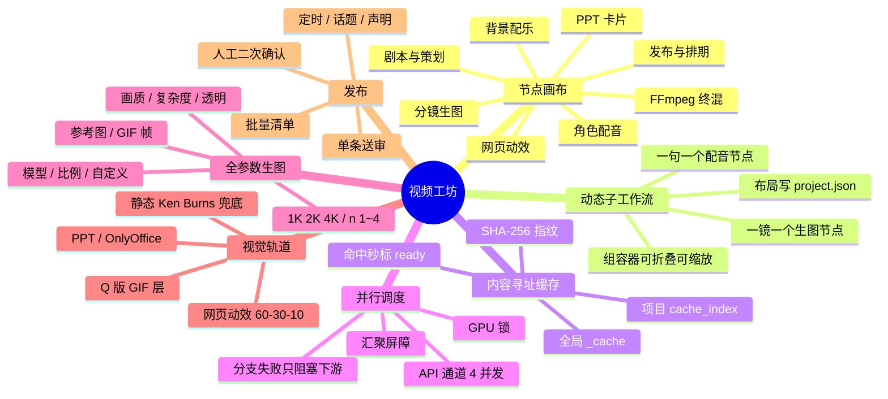

# 架构 · 视频工坊（v3.8）

> 最后核对：v3.8.0（2026-11-18）。

## 结构图

界面「说明」页会把下面这段画成可以点开、收起的树状图，GitHub 上也能直接看图。



## 做什么

v3.8 把视频工坊从「6 张固定卡片」重构为专业生产工作台：

- **8 个顶层节点** + **动态子工作流**：每个分镜一个独立生图节点，每句台词一个独立配音节点，挂在可折叠、可缩放的组容器里。
- **节点可调大小**：右下/右侧/底边拖拽，节点 `(x,y,w,h,collapsed)` 防抖写进 `project.json` 的 `node_layout`，刷新/重开原样恢复；`ResizeObserver` 实时重算 SVG 贝塞尔连线锚点。
- **内容寻址缓存**：生图/配音/配乐按确定性 SHA-256 指纹查全局缓存，命中直接复用，节点显示「缓存命中」绿色徽章，不再调用付费 API。
- **三路异构并行 DAG**：API 通道（生图 + 百炼云端配音，`asyncio.Semaphore(4)`）与本地 GPU 通道（本地 Qwen3-TTS / Stable Audio 3，`GPU_LOCK` 串行）同时启动；全部 `ready` 后汇聚到视觉渲染和 FFmpeg。
- **全参数生图**：模型、比例/自定义宽高、1K/2K/4K、n=1~4、画质、复杂度、透明、参考图、GIF 帧数/每帧毫秒。
- **网页动效 + PPT 双轨渲染**：网页动效（深色毛玻璃、粒子、动态字幕、Q 版 GIF 贴纸）与 PPT/OnlyOffice 卡片（自动生成 `.pptx` / 导入）在 FFmpeg 前显式呈现；静态图仍作 Ken Burns 兜底。
- **完整发布清单**：单条送审 / 批量清单、定时、标题、简介、默认话题 `#ai漫剧 #ai创作浪潮计划 #搞笑`、封面、AI 合规声明；仍由「发布」窗口人工点两下才发。

## 顶层节点与动态子工作流

| 节点 | 做什么 |
| --- | --- |
| ① 剧本与策划 | 主题/完整口播；导出 Gemini 策划包；导入 `.md`/`.json`；DeepSeek 拆解 |
| ② 分镜生图 · 子工作流 | 每镜一个子节点：模型、比例/自定义、分辨率、n、画质、复杂度、透明、GIF、参考图、单镜重出、选图 |
| ③ 角色配音 · 子工作流 | 每句一个子节点：角色、音色、语气、台词、单句试听/重配 |
| ④ 背景配乐 | Stable Audio 3 提示词、时长、步数、种子、缓存命中 |
| ⑤ 网页动效渲染 | 背景风格、字幕位置/字号/颜色、GIF 缩放/动效、fps；渲染成片轨 |
| ⑥ PPT / OnlyOffice 卡片 | 自动生成 `.pptx`；导入精修 `.pptx`；逐镜切换 PPT/网页/静态 |
| ⑦ FFmpeg 混流压制 | 字幕、画幅、配乐基础音量、闪避深度、淡出 |
| ⑧ 发布与排期 | 标题/简介/话题/封面/定时/声明；单条送审或批量清单 |

- 组容器（②③）有折叠按钮和缩放手柄；子节点按分镜/台词数量动态生成，列表在组内滚动。
- 所有顶层节点都有右下角缩放手柄；折叠状态也写入 `node_layout`。
- 画布空白拖动平移、滚轮缩放、节点标题拖动、一键居中复位。

## 内容寻址缓存（`app/studio_cache.py`）

存哪：

```
工作区\视频工坊\_cache\
  cache_index.json          全局索引：sha256 → {kind,path,ts,meta}
  image\<前2位>\<sha>.<ext>
  tts\<前2位>\<sha>.wav
  bgm\<前2位>\<sha>.wav
<项目>\cache_index.json      项目子节点 → 指纹 / 相对路径 / 是否命中
```

指纹（`json.dumps(sort_keys=True)` 后 SHA-256）：

- **生图**：`model + prompt + aspect_ratio + resolution + quality + complexity + custom_w + custom_h + transparent + gif_frames + gif_delay_ms + ref_image_sha256 + variant`
- **配音**：`engine + speaker + tone + text`（描述音色时 speaker 含描述+种子）
- **配乐**：`prompt_en + duration + steps + seed`

调度或单步重跑前先查项目索引 → 全局索引；命中就把缓存文件复制到项目产出路径，标 `image_cache_hit` / `tts_cache_hit` / `bgm_cache_hit` 和节点「缓存命中」，不调用 API。指纹变了才标 `stale` 重做。

## 三路异构并行 DAG

- `API_GATE = asyncio.Semaphore(4)`：生图（API易）和云端配音（百炼）并发请求，不占本地显卡。
- `GPU_LOCK = asyncio.Lock()`：本地 Qwen3-TTS 与 Stable Audio 3 串行；本地配音组先停配乐服务、起配音服务，出完释放锁，配乐再停配音服务、起配乐服务。
- 生图、配音、配乐三个分支同时 `asyncio.gather`；全部结束后才进入视觉渲染和 FFmpeg。
- 任一分支失败只阻塞下游：生图全失败才阻塞；部分失败先合成已有图；配音任一句失败阻塞成片；配乐失败降级无配乐。
- 已完成分支的缓存保留，下次只重跑失败/变更的子节点。

## 全参数生图

每镜参数（项目级默认 + 单镜覆盖）：

- 模型：`image_models()` 来自 `imagegen.catalog()`（认识的 + 用 Key 拉过的），带 `gif` 能力标记。
- 比例：`9:16`、`16:9`、`1:1`、`3:4`、`4:3`、`2:3`、`3:2`；`custom_w/custom_h` 自定义像素。
- 分辨率：`1k` / `2k` / `4k`；数量 `n=1~4`；画质 `low/medium/high/...`；复杂度 `low/medium/high`。
- 透明背景、参考图（上传到项目 `refs/`，也可 `shot:s1` 引用同工程其他分镜图）。
- GIF：`gpt-image-2.6-sunburst` / VIP 等带 `gif` 能力的模型；`gif_frames` 默认 8、`gif_delay_ms` 默认 150；`output_format=gif` 透传，节点内循环预览，选中的 GIF 可直接作为动态画面轨。
- `imagegen.png_info()` 新增 GIF 文件头识别；`call_images()` 对 OpenAI 兼容线路一次请求 n 张，其它线路循环 n 次。

## 视觉轨道

### 网页动效（`app/render_web.py`）

- Playwright 无头 Chromium + 虚拟时间逐帧截图，pipe 给 ffmpeg 生成 H.264 轨。
- V4 模板：深色毛玻璃底板、网格/粒子/光影、角色与语气、按 timeline 高亮的字幕、Q 版 GIF 白边圆角贴纸 + 空间位移。
- 可调：背景 `dark/tech/warm/light`、字幕位置/字号/颜色、GIF 缩放、动效强度、fps。
- 浏览器按 `AGENT_CHROMIUM` → Edge/Chrome → 默认 Chromium 回退；失败时降级静态 Ken Burns。

### PPT / OnlyOffice（`app/render_ppt.py`）

- 自动：`python-pptx` 生成 `output/卡片.pptx`（9:16 / 16:9），再用无头 Chromium 渲染每页 PNG。
- 导入：`settings.ppt_file` 指向项目里的 `.pptx`；找到 `soffice` / `libreoffice` 时转 PDF + `pdftoppm` 取图；没有工具时明确降级自动卡片。
- 每镜可选 `render=web/ppt/static`；PPT 图交给 video_maker 做 Ken Burns。
- `python-pptx`、`playwright` 已加入 `requirements.txt`。

### FFmpeg 终混（`app/video_maker.py`）

- 每镜按 `render_clip`（网页轨）→ `render_image`（PPT 图）→ `image`（生图/GIF）→ 循环兜底的顺序取画面。
- 网页/PPT 轨按分镜时长裁切/循环；静态图 zoompan；GIF 当作视频轨循环。
- 逐句拼接配音、Stable Audio 3 侧链闪避配乐、字幕烧录、封面；配乐基础音量、闪避深度、淡出秒可调。
- `ffmpeg -progress pipe:1` 实时进度；停下安全结束，不留半截成片。

## 发布与排期

`app/studio.py` 的 `to_publish` 支持：

- **单条送审**：`publish.check_item()` 校验后 `publish.ask()` 放进 `pub_pending`。
- **加入批量清单**：必须有定时（2 小时~14 天），把一条写进 `pub_batch` 的 `items`（同视频去重更新）。
- 字段：标题（≤30）、简介、话题（默认 `ai漫剧 ai创作浪潮计划 搞笑`）、封面（自动/指定分镜）、定时、合集、自主声明。
- AI 合规声明默认「内容由AI生成」；节点内勾选。
- 无论哪种模式，都不会自动点击最终发送；「发布」窗口仍保留人工二次确认锁。

## 接口

| 方法 | 地址 | 做什么 |
| --- | --- | --- |
| GET | `/api/studio/projects` | 历史项目 |
| GET | `/api/studio/state` | 项目、分镜、8 节点状态、模型、音色、发布计数 |
| POST | `/api/studio/select` | 切换项目 |
| POST | `/api/studio/new` | 新建空白项目 |
| POST | `/api/studio/plan` | DeepSeek 拆解（固定三合一风格） |
| POST | `/api/studio/import_script` | 导入 Gemini JSON/Markdown |
| GET | `/api/studio/export_prompt_pack` | 导出 Gemini 策划包 |
| PUT | `/api/studio/project` | 改参数、逐镜参数、渲染模式、`node_layout` |
| POST | `/api/studio/run` | 一键全自动或单步 images/tts/bgm/web/ppt/video |
| POST | `/api/studio/stop` | 停下 |
| POST | `/api/studio/ref` | 上传参考图到项目 `refs/` |
| POST | `/api/studio/to_publish` | 单条送审 / 加入批量清单 |
| GET | `/api/studio/media` | 项目文件 |
| POST | `/api/studio/open` | 打开项目/output |

## 测试

`dev/test_studio.py`（不连后端、不用显卡、不花钱）：

- 工程目录、拆解解析、三合一风格、生图模型；
- **内容寻址缓存**：第一次请求 API，第二次同参数不再请求，节点标缓存命中；
- **三路并发**：生图/本地配音/配乐同时启动，汇聚后才渲染和合成；
- **全参数生图**：n、自定义尺寸、透明、GIF 帧/毫秒、复杂度、参考图字段；
- **双轨渲染**：网页动效轨 + PPT 卡片图 + `.pptx` + FFmpeg 合成；
- 双角色逐句配音拼接、Gemini 策划包格式、JSON/Markdown 导入；
- **发布矩阵**：单条送审、批量清单、定时、话题、声明；
- 单步重跑、停下不留半截成片。

另跑 `compileall`、`node --check`、`dev/ui_smoke.py`、`dev/ui/fit.py`。

## 本机测试安全锁

`dev/serve.sh start` 检测到真实 `data/secrets.bin` 默认拒绝启动（退出码 3）；必须显式 `AGENT_ALLOW_OVERWRITE_DATA=1` 才允许，且会先备份 `data/secrets.bin` / `settings.json`，`stop` 自动还原。

## 只在 Windows 真机上验证

- 真实 DeepSeek 拆解、真 Gemini 策划包输出；
- 真实 API易 各模型（尤其 2.6 Sunburst GIF）的出图/动图效果；
- 真实 Qwen3-TTS / 百炼逐句音色语气、Stable Audio 3 显存串行；
- Playwright 在作者桌面窗口环境里用 Edge/Chrome 渲染网页轨、PPT 卡片的速度和字体；
- 抖音里字幕遮挡、真实发布待确认/批量清单。
