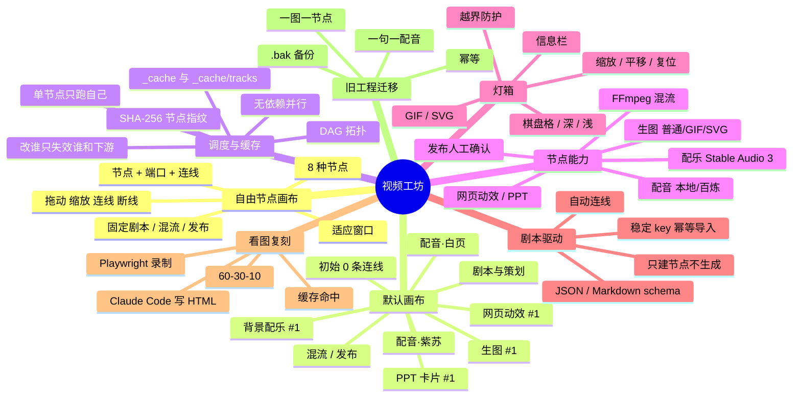

# 架构 · 视频工坊（v3.9）

> 最后核对：v3.9.0（2026-11-18）。

## 结构图

界面「说明」页会把下面这段画成可以点开、收起的树状图，GitHub 上也能直接看图。



## 做什么

v3.9 把视频工坊从「8 张固定卡片 + 子工作流」改成**自由节点画布**：

- **工程文件存真图：** `project.json` 里是 `graph.nodes` + `graph.edges`，不再是前端假节点 + `shots[]` 子列表。
- **8 种节点：** `script`（剧本与策划）、`image`（生图）、`voice`（配音）、`bgm`（背景配乐）、`web`（网页动效）、`ppt`（PPT/OnlyOffice 卡片）、`mux`（FFmpeg 混流压制）、`publish`（发布与排期）。
- **固定节点：** `script`、`mux`、`publish` 各只有 1 个，不能删；其余五类可任意增删。
- **端口有类型：** `text / image / audio / video / timeline`。连线时校验类型兼容、做环检测，不兼容直接拒绝并说明原因。
- **默认画布：** 剧本、生图 #1、配音·白页（Serena 女声）、配音·紫苏（Dylan 男声）、背景配乐 #1、网页动效 #1、PPT 卡片 #1、混流、发布；**初始 0 条连线**，每个节点都能单独运行测试。
- **旧工程自动迁移：** 第一次打开旧项目时拆成独立节点，保留已有产出和缓存指纹；迁移前留 `.bak`，失败原工程不动。

## 数据模型（`app/studio_graph.py`）

```json
{
  "graph": {
    "nodes": [
      {
        "id": "image-1",
        "type": "image",
        "title": "生图 #1",
        "x": 420, "y": 40, "w": 360, "h": 580,
        "params": { "prompt": "……", "model": "gpt-image-2.6-sunburst", "ratio": "9:16", "order": 1 },
        "outputs": [
          { "key": "images/image-1.png", "rel": "images/image-1.png", "kind": "image",
            "sha256": "……", "size": 123456, "index": 0 }
        ],
        "status": "ok", "error": "", "cache_key": "……", "cache_hit": false,
        "started": 0, "finished": 0
      }
    ],
    "edges": [
      { "id": "e-image-1-mux-1", "from": "image-1.image", "to": "mux.image" }
    ]
  }
}
```

- 节点位置/宽高写在节点上，拖动和缩放直接改 `x/y/w/h` 并保存。
- 产出带相对路径和内容 SHA-256；下游缓存键用这些哈希。
- `params.order` 决定同类型节点在混流里的拼接顺序（默认画布按 1、2、3；剧本导入按分镜顺序；旧工程按原分镜顺序）。

### 端口定义

| 节点 | 输入 | 输出 |
| --- | --- | --- |
| script | — | text |
| image | prompt(text)、ref(image) | image |
| voice | text(text) | audio、timeline |
| bgm | text(text) | audio |
| web | image、text、audio | video |
| ppt | text、image | image |
| mux | image、audio、video、text | video |
| publish | video、image、text | — |

`image.ref / mux.image / mux.audio / mux.video / ppt.image / web.image` 可以接多条；其余输入口只接一条。

## 画布交互（`ui/js/studio.js`）

- 顶部：项目切换、新建、「+ 添加节点」、「适应窗口」、「▶ 从头跑通全流程」、「■ 停下」。
- 节点：拖标题移动、拖右下角缩放、右上角删除（固定节点置灰）；节点内部滚动，不撑破画布。
- 端口：左边输入口、右边输出口；从输出口拖到兼容输入口成立；点连线（加宽的透明命中区）断开；SVG 贝塞尔曲线随拖动/缩放实时重算。
- 画布：空白拖动平移、滚轮缩放（以鼠标为中心）、空格或中键也可平移。
- 性能：每个节点算 HTML 签名，签名没变不动 DOM；只有被拖的节点和连线在 pointermove 时更新，不做整张画布每帧重渲染。
- 一屏：画布外框占满主区域，页面级不滚；只有节点内部滚。

## 调度与缓存

### DAG

- `topo_order()` 用 Kahn 拓扑排序；运行时每个节点一个 `asyncio.Task`，先 `await` 所有上游任务，再跑自己。无依赖节点同时开跑。
- 单节点运行：先检查每条入边的上游节点是否有可用产出（文件存在）；缺就报「缺上游产出：节点 X 还没跑出东西」，**绝不自动跑上游**。
- `publish` 在全流程里跳过，只做状态检查；真正入队由「送去发布」按钮调用。
- 停下：`Studio.stop()` 置停止位；生图/配音/配乐/FFmpeg 各自检查并安全收尾；看图复刻会按进程号结束 Claude Code。

### 缓存

- 节点键：`studio_cache.fingerprint("node", {type, params, upstream: [[kind, sha256]...], v: "studio-graph-3.9.0"})`。
- 上游哈希取所有祖先节点的产出；参数或任一上游产出变了，键就变。
- 命中条件：节点有产出、文件都在、`cache_key` 等于当前键；命中直接把节点标成完成，不再调 API/模型。
- 改参数：`graph_update()` 只调 `invalidate_downstream()`，清本节点和下游的 `cache_key`；上游和平行分支不动。
- 沿用 `工作区/视频工坊/_cache/` 和 `_cache/tracks/`；网页/PPT 轨道仍有自己的 `track_web` / PPT 内容哈希缓存。

## 节点执行器（复用现有后端）

| 节点 | 复用 |
| --- | --- |
| script | 把主题/完整口播写成 `script/<id>.md`；DeepSeek 拆解走 `_ask_plan` |
| image | `_gen_images/_image_one` + `imagegen.call_images`；节点 id 作产出文件名，参数映射成原 `shots[]` 字段 |
| voice | `_gen_tts` 的本地/百炼分支 + `_build_voice`；按节点前缀生成 `tts/<id>_voice.wav/.srt/.timeline.json`，逐句音频 `tts/<id>_<line>.wav` |
| bgm | `_gen_bgm`，产出 `bgm/<id>.wav` |
| web | `render_web.render_all()`；看图复刻用 `render_web.render_html_file()` |
| ppt | `render_ppt.render_all()`；多个 PPT 节点用锁串行，避免抢同一个 `.pptx` |
| mux | 把上游节点投影成 `shots/files/settings`，`_build_voice()` 拼全局配音和字幕，再 `video_maker.compose_video(..., project=投影)` |
| publish | `publish.check_item()` / `publish.ask()` / `to_publish()`；人工确认锁不变 |

临时投影工程带 `_transient`，`_save()` 不写盘，不会污染原 `project.json`。

## 旧工程自动迁移

- `Studio._load()` 发现没有合法 `graph`：先把 `project.json` 复制成 `project.json.bak`（已存在不覆盖），再迁移；失败把 `.bak` 复制回来并报错。
- 旧 `shots[]` 的每张分镜图 → 独立 `image` 节点；每句配音 → 独立 `voice` 节点（role/speaker/tone/text 保留）；`render=web/ppt` 的分镜 → 独立 `web/ppt` 节点；配乐、混流、发布各 1 个。
- 产出路径、`img_fps`、`tts_fp` 和 `_cache` 指纹原样保留；重跑应直接命中。
- 连线：所有图/音/网页/PPT 节点 → `mux`，`mux` → `publish`；剧本节点单独放。
- 迁移是幂等的：已有合法 `graph` 就不再迁移。

## 高清灯箱（`ui/js/lightbox.js` + `app/studio_assets.py`）

- 画布上节点的图、GIF、SVG、PPT 幻灯片、封面点一下打开通用灯箱；多张产出左右切换。
- 缩放（滚轮、双击复位、拖动平移）、Esc / 点遮罩关闭；棋盘格/深色/浅色三档底衬。
- GIF 用 `` 原速循环；SVG 用 `` 内嵌，不执行脚本。
- 信息栏：真实 W×H、文件大小、GIF 帧数/时长、缓存命中、打开所在文件夹、SHA-256 前 12 位。
- 后端只读取图：根只认项目目录和 `_cache`；拒绝绝对路径、盘符、`..`、解析后越界（含符号链接）、非图片扩展名、文件头对不上的假图片。SVG 响应带 `sandbox; default-src 'none'` CSP。

## 剧本驱动（阶段 C）

- 格式文档：`docs/视频工坊剧本格式.md`（JSON / Markdown）。
- `parse_script_doc()` 校验：JSON 语法错给行列；缺字段/类型不对给分镜 id、字段名和原因；Markdown 给行号。
- `_apply_script_doc()`：按 `script_key` 建/改 `image/voice/web/ppt/bgm` 节点，自动接 `mux` 和 `publish`；同 key 更新参数保留产出；剧本里没有的节点只标 `script_removed` 并断开到混流的线，不删除。
- 导入不触发生成，只返回节点数、预估生图张数/费用、配音字数/费用。

## 看图复刻（阶段 D）

- 生图节点的 `image` 输出接到网页动效节点的 `image` 输入。
- 点「交给 Claude Code 看图复刻并录制」：确认提示「会消耗 Claude Code 额度」→ `ccode.run()`（`claude -p`，cwd=工作区，事情从 stdin）→ 写 `styleframe/<节点>/index.html`。
- 提示词包含参考图路径、画布 W×H、FPS、时长、60-30-10 配色、禁止外部资源、不放 logo/商标。
- `render_web.render_html_file()` 用 Playwright 逐帧截图 → ffmpeg 生成 H.264 视频轨，存 `_cache/tracks/`。
- 缓存键含参考图 SHA-256、提示词、W/H/FPS/时长；参数没变直接命中，不再调用 Claude Code。
- 失败不自动重试，节点标出错并显示原因；停下按进程号结束。

## 发布与排期

- `publish` 节点保留标题（≤30）、简介、话题、封面、定时、合集、自主声明、单条送审 / 批量清单。
- 全流程不自动发布；「送去发布」只放进待确认队列/批量清单，「发布」窗口仍要人工点两下。
- AI 合规声明默认「内容由AI生成」。

## 接口

| 方法 | 地址 | 做什么 |
| --- | --- | --- |
| GET | `/api/studio/state` | 项目、自由节点图、音色、模型、发布计数 |
| POST | `/api/studio/new` | 新建项目（带默认 9 节点、0 连线） |
| POST | `/api/studio/select` | 切换项目（旧工程自动迁移） |
| POST | `/api/studio/plan` | 旧版 DeepSeek 拆解（保留兼容） |
| POST | `/api/studio/import_script` | 旧版 Gemini 剧本导入（保留兼容） |
| POST | `/api/studio/graph/add` | 加节点 |
| POST | `/api/studio/graph/update` | 改位置/宽高/标题/参数 |
| POST | `/api/studio/graph/delete` | 删节点（固定节点拒绝） |
| POST | `/api/studio/graph/connect` | 连线（类型 + 环校验） |
| POST | `/api/studio/graph/disconnect` | 断线 |
| POST | `/api/studio/graph/layout` | 批量保存位置大小 |
| GET | `/api/studio/graph/node` | 读一个节点 |
| POST | `/api/studio/graph/run` | 只跑一个节点 / 全流程 |
| POST | `/api/studio/graph/import` | 按剧本建/改节点和连线 |
| POST | `/api/studio/graph/plan` | DeepSeek 拆解后落到自由画布 |
| POST | `/api/studio/graph/styleframe` | 看图复刻并录视频轨 |
| POST | `/api/studio/graph/publish` | 发布节点入队 |
| GET | `/api/studio/asset` | 灯箱只读取图 |
| GET | `/api/studio/asset/info` | 图片信息 |
| POST | `/api/studio/reveal` | 打开所在文件夹 |
| GET | `/api/studio/media` | 项目文件 |
| POST | `/api/studio/open` | 打开项目/output |
| POST | `/api/studio/stop` | 停下 |

## 测试

`dev/test_studio.py`（不连后端、不用显卡、不花钱）：

- 旧功能：工程目录、拆解解析、三合一风格、生图全参数、双视角配音、双轨渲染、发布矩阵、FFmpeg 合成、停下。
- v3.9 新增：灯箱越界/符号链接/假图片/GIF 帧时长；默认 9 节点与固定节点；端口类型；环检测；断线；拓扑并行；缓存失效范围；单节点缺上游；旧工程迁移（节点数/参数/产出/缓存/幂等/失败回滚）；剧本 schema（JSON/Markdown/行号）；导入幂等/增量/移除标记；看图复刻（假 claude，提示词、录轨、缓存命中）。

界面：

- `dev/ui/lightbox.py`：开关、缩放、双击复位、棋盘格三档、GIF、多张切换、信息栏数字。
- `dev/ui/canvas.py`：加删节点、拖动、缩放、连线断线、适应窗口、页面不滚。
- `dev/ui/styleframe.py`：确认额度、假 Claude Code 写 HTML、录轨、第二次不调用。
- `dev/ui/fit.py`：横屏 1440×880、竖屏 1080×1860 一屏放下。

## 只在 Windows 真机上验证

- 真实 DeepSeek 拆解和 Gemini 策划包输出；
- 真实 API易 各模型出图/GIF/SVG、参考图字段；
- 真实 Qwen3-TTS / 百炼逐句音色语气、Stable Audio 3 显存串行；
- Playwright 用作者电脑上的 Edge/Chrome 录网页动效和 PPT 卡片的速度、字体；
- 真的 Claude Code 看图复刻：`claude.cmd` 能不能起来、流式输出编码、长活耗时、额度消耗；
- 抖音里字幕遮挡、真实发布待确认/批量清单。
