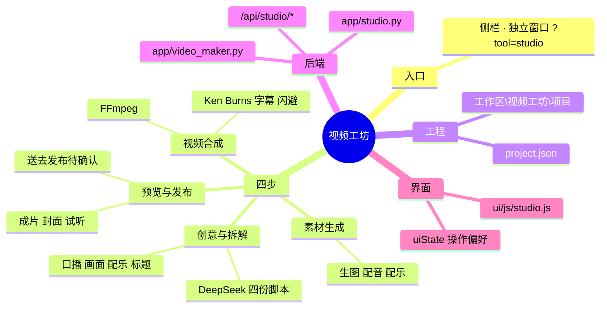

# 架构 · 视频工坊（v3.6）

> 最后核对：v3.6.0（2026-11-18）。

## 结构图

界面「说明」页会把下面这段画成可以点开、收起的树状图，GitHub 上也能直接看图。

## 做什么

作者 2026-11-18 的 R06：把「文案拆解 → 生图 → 配音 → 配乐 → 视频合成 → 送去发布」串成一个工作台。以前的生图、配音、配乐、发布各自是独立工具，做一条视频要在几个窗口之间来回搬文件；视频工坊把它们当能力调用，项目文件夹里一次存齐，单步能重跑。

## 工程结构

每个项目在 `工作区\视频工坊\<项目名_时间戳>\`：

| 位置 | 内容 |
| --- | --- |
| `project.json` | 状态、画幅、风格、目标时长、四步状态、分镜（台词 / 语气 / 画面提示词 / 图 / 配音 / 时长 / 时间轴）、成本 |
| `images\` | 分镜图 `shot01.png`…… |
| `tts\` | 每镜配音 `shot01.wav`……、拼好的 `voice.wav`、`subtitles.srt`、`timeline.json` |
| `bgm\bgm.wav` | 配乐 |
| `output\成片.mp4` | 成片；`output\封面.png` 封面 |

`工作区` 可以被作者换到别的盘；视频工坊跟着 `workspace.folder()` 走。整个 `工作区/` 在 `.gitignore` 里，`dev/pack.py` 的禁止清单也挡着，不进仓库、不进压缩包。

## 第一步：AI 拆解（`POST /api/studio/plan`）

- 输入主题，或者完整口播文案；画幅 9:16 / 16:9、风格、目标时长、音色。
- 复用 `app/smartlist.py` 同类思路：DeepSeek `json_mode` 一次给出四份联动脚本——分镜口播与语气、逐镜画面提示词、配乐英文提示词、标题与话题。
- 给了完整口播就只分段、原文不改；只给主题就由它写口播。`parse_plan()` 兼容常见的键名和 Markdown 代码块，空分镜、少于 2 镜会拦下并说清楚。
- 拆解会新建一个项目，旧项目留着；`project.json` 的 `steps.plan` 记好状态和花费。

## 第二步：素材生成

### 生图

- 不碰「生图」页的清单（`data/img/board.json`）：直接调 `app/imagegen.py` 的 `card()`、`build_prompt()`、`CALL` 四种线路，把图存进项目的 `images\`。
- 仍用「生图」页选的模型、画质、尺寸档；默认加「不要文字」。
- 一张一张出；某一镜失败只标这一镜，其他镜继续。只要至少有一张图，合成时按顺序循环铺满；一张都没有才整步失败。
- 花费记进 `project.json` 的 `cost.images_usd`，同时写遥测。

### 配音

- 本地 Qwen3-TTS：复用「配音」页同一个服务（`T.ensure()` + `/generate`），但每镜单独存一个 WAV，不覆盖「配音」页的试听稿。
- 百炼云端：用 `tts_cloud.synth_once_more()`，按音色计费，花费记 `cost.tts_cny`。
- 音色可以选预设、我的音色（描述 + 种子）、百炼音色；`voice_config()` 只认本机已有的音色。
- 出完把每镜 WAV 拼成 `voice.wav`：分镜之间留 0.25 秒；每镜的 `start/end` 按真实音频时长写进 `project.json`；字幕按台词在逗号处再切，按字数分配时间，写 `subtitles.srt`。
- **显存串行：** 起本地配音前先 `bgm.B.stop()`，把配乐服务关掉；配音出完在配乐前再 `tts.T.stop()`，把配音服务关掉。16GB 上不同时装两个模型。

### 配乐

- 复用 `app/bgm.py` 的 Stable Audio 3 Medium；提示词用拆解给的英文描述，或界面选的风格。
- 时长按成片总时长（10~380 秒）；服务没装、让路、失败都可以降级：标 `warn`，继续合成没有配乐的版本。
- 配乐文件存 `bgm\bgm.wav`；`settings.use_bgm` 控制合成时用不用。

## 第三步：视频合成（`app/video_maker.py`）

- **时间轴：** 每个分镜用这张图展示 `end - start` 秒；有配音时总长以 `voice.wav` 为准，画面不够长就用最后一帧 `tpad` 补到配音长度。图片比配音段少就循环使用。
- **防呆板：** `zoompan` 三种镜头轮换：推近、拉远、横向微移；输入先放大到 2 倍目标分辨率再裁切，慢移更稳。默认 9:16 1080×1920，横屏 16:9 1920×1080，帧率 30。
- **字幕：** 读 `subtitles.srt` 用 libass 烧进画面；白字黑边、底部居中；竖屏 `MarginV=76`、字号 18，避开抖音底部文案区；横屏 `MarginV=42`、字号 22。开关在界面上，默认开。
- **配乐闪避：** 配音 `asplit` 一路做 `sidechaincompress` 的侧链，配乐先按 `volume` 压低，再和人声 `amix`；结尾 2 秒淡出；配乐循环或裁剪到总长。
- **进程和进度：** `ffmpeg -progress pipe:1` 实时解析 `out_time_us` 回百分比；所有子进程 `CREATE_NO_WINDOW`；停下时 `terminate`，4 秒不退再 `kill`，半截 `.part.mp4` 删掉，`成片.mp4` 不出现。
- **FFmpeg 探测：** PATH → `imageio_ffmpeg` → 工作区 `ws-env` 里 pip 装的那份（`toolbox/合成.py` 的顺序再加一个兜底）。
- 合成完抽 `output\封面.png`，写 `project.json` 的 `files.video / cover / duration / resolution`。

## 第四步：预览与发布

- 界面直接 `<video>` 预览成片；配音、配乐各有 `<audio>` 试听；显示分辨率、时长、文件大小、这一轮花费。
- 「送去抖音发布」调用 `POST /api/studio/to_publish`：整理成 `publish.check_item()` 的一条，放进 `pub_pending` 待确认队列。它**不会**直接发抖音；作者到「发布」窗口看一眼、点两下才发。重复点同一条不会重复入队。

## 接口

| 方法 | 地址 | 做什么 |
| --- | --- | --- |
| GET | `/api/studio/projects` | 历史项目列表 |
| GET | `/api/studio/state` | 当前项目、分镜、四步状态、文件 URL、音色清单 |
| POST | `/api/studio/select` | 切换当前项目 |
| POST | `/api/studio/plan` | AI 拆解并新建项目 |
| PUT | `/api/studio/project` | 改标题 / 简介 / 话题 / 画幅 / 音色 / 字幕 / 配乐音量 / 每镜台词和画面 |
| POST | `/api/studio/run` | 一键全自动，或单步 `images/tts/bgm/video`（可带 ids） |
| POST | `/api/studio/stop` | 停下（结束当前 FFmpeg / 生成） |
| POST | `/api/studio/to_publish` | 成片、封面、标题、话题放进发布待确认队列 |
| GET | `/api/studio/media` | 项目里的图片、音频、视频、字幕 |
| POST | `/api/studio/open` | 打开项目或 output 文件夹 |

## 界面（`ui/js/studio.js`）

- 独立工具窗口 `?tool=studio`，侧栏和 Ctrl K 都能打开；`app/window.py` 的 `TOOLS` 登记。
- 顶部四步流程条：每步的状态、当前进度、「停下」「一键全自动生产」。
- 左：项目选择、主题或完整口播、发布标题 / 简介 / 话题、画幅、目标时长、风格、音色、配乐、字幕、配乐音量、「AI 拆解分镜」。
- 中：分镜列表（自己滚）；每镜缩略图、台词、画面提示词、语气、时长、图和音的状态；「重出这张图」「重配这段」。
- 右：成片播放器、配音 / 配乐试听、封面、花费、打开输出文件夹、送去发布。
- 操作偏好存 `uiState`（`U.studio`）：画幅、风格、时长、音色、配乐、字幕、配乐音量；深浅色全用 CSS 主题变量。
- 一屏放下：`dev/ui/fit.py` 横屏 1440×880、竖屏 1080×1860 都 0 滚动违规；只有分镜列表自己滚。

## 测试

`dev/test_studio.py`（不连后端、不用显卡、不花钱）：

- 工程目录和 `project.json`；
- DeepSeek 拆解的结构化解析（代码块、`#` 话题、空分镜）；
- AI 拆解落到新项目（标题、分镜、音色、配乐描述）；
- 真实 FFmpeg 合成：竖屏 1080×1920、横屏 1920×1080、有音轨、有视频流、封面、图片比配音段少也能铺满；
- 单步重跑：只重新合成视频，不动图、不动配音；改台词 / 画面只让对应步骤过期；
- 停下：安全结束 FFmpeg，不留半截成片。

另跑 `dev/ui_smoke.py`、`dev/ui/fit.py`、`python -m compileall app scripts dev`、`node --check ui/js/studio.js`。

## 只在 Windows 真机上验证

- 真实 DeepSeek 拆解的质量、口播字数和目标时长是否合适；
- 真实 API易 生图（画幅、人物一致性、出图时间）；
- 真实 Qwen3-TTS / Breeze 音色、显存占用、和 Stable Audio 3 的串行释放；
- FFmpeg 在作者显卡上的合成速度、zoompan 观感、libass 字体和字幕位置；
- 真实发布队列在「发布」窗口里的显示。
