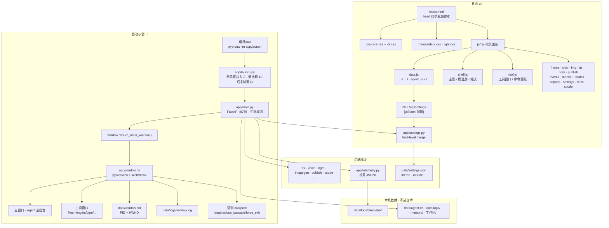

# R04 · v3.5.1 · 窗口启停生命周期、主题零闪烁与 UI 操作状态持久化

- 日期：2026-11-17
- 版本：v3.5.1
- 状态：代码与真机验证完成；Git 提交/推送信息见文末
- 基线：v3.5.0（R03，`origin/main` 已包含）

## 一、这一版解决什么

作者反馈三类问题：

1. **主窗口关了，工具窗口还在；再双击 `启动.bat` 看不到任何窗口。** 旧逻辑只看窗口互斥体，不看真实 HWND；主窗口没了但工具窗口占着互斥体时，新窗口进程直接退出。
2. **浅色模式偶发回弹深色、新窗口先闪一下深色、关掉再开有些筛选/音色要重选。** 主题首帧读的是旧 localStorage 键，异步 `/api/settings` 回来才改主题；前端可能在 GET 回来前把本地默认值写回后端。
3. **部分页面打开后先空白，后台繁忙时尤其明显。** `img`、`tts`、`docs`、`reports`、`brains` 的加载态太短；后台上次停在「行为监控」时重新打开是一块空白；配音 `/api/tts` 每次扫几 GB 模型目录要 6 秒。

## 二、项目 / UI 结构

## 三、改动文件清单

### 模块一：窗口启停生命周期

| 文件 | 说明 |
|---|---|
| `app/window.py` | `probe_main_window()`：`FindWindowW` + `IsWindowVisible` + `IsIconic` + `SendMessageTimeoutW(WM_NULL, 2s)`；`ensure_main_window()`：有窗口还原、隐藏还原、卡死按 PID 结束重开、两次重试；`Local\AgentWindowLaunch` 启动互斥体；`data/window.pid`；主窗口 `closing` 事件级联关闭工具窗口；0.9 秒 `os._exit(0)` 兜底；所有动作写 `window.log` + `cat=proc` 遥测 |
| `app/main.py` | `open_ui()` 改用 `window.ensure_main_window()`；端口忙但 `/api/ping` 不通时等待旧后端退出再启动（修「刚点退出又双击启动.bat，被当成已运行」竞态）；`/` 注入当前主题到 `<html data-theme>` |
| `app/launch.py` | 退出码 10 后再复检一次窗口；记录启动/复检/结果到 `window.log` 和遥测 |
| `启动.bat` | 无需改逻辑；仍用 `AGENT_OPEN_UI=1` + `pythonw -m app.launch`，不留黑窗口 |

### 模块二：主题零闪烁与 UI 状态

| 文件 | 说明 |
|---|---|
| `app/settings.py` | 新增 `uiState` 默认值；`_clean_ui_state()`（单值 500 字 / 总量 32KB / 一层子对象）；`_merge_ui_state()` 字段级递归合并；显式 `null` 才删除；`uiState` 落盘时记 `cat=ui` 遥测 |
| `ui/index.html` | `<head>` 最前面同步脚本：先读服务端注入的 `data-theme`，再读 `agent_theme`，默认 `dark`；在 CSS/body 前写 `document.documentElement.dataset.theme` |
| `ui/js/data.js` | `agent_ui.v1` + `U`；`uiMerge` / `saveUI`（300ms 防抖 + `pagehide` flush）/ `hydrateUI` |
| `ui/js/main.js` | 首次 GET 成功后 `hydrateUI` + `applyUIState` + `markHydrated`；本地主题优先于可能慢半拍的后端 |
| `ui/js/settings.js` | `HYDRATED` 前的 `pushSet` 只排队；`markHydrated` 应用排队字段并用 30ms 发送；`uiState` 子对象逐键合并 |
| `ui/js/shell.js` | `setTheme` 立刻写 `agent_theme` + 后端 + broadcast；比较 `S.set.theme` 和真实 DOM 主题，避免本地缓存与首帧不一致时点击无效 |
| `ui/js/tool.js` | 跨窗口 `winCmd` 同步主题时也写 `agent_theme`，不再回弹 |
| `ui/js/chat.js` `monitor.js` `tts.js` `img.js` `bgm.js` `docs.js` `ccode.js` | 把对话交给谁/引擎/拉高、后台日志/行为筛选、配音引擎/音色/语速、配乐模式/时长/风格、生图标签/比例/张数/透明、说明页文档/模式、Claude Code 开关写进 `U` 并随 `uiState` 增量同步 |

### 模块三：UI 视觉对齐与加载时序

| 文件 | 说明 |
|---|---|
| `ui/css/core.css` | 非生图页仅剩的硬编码 `color:#fff` 改用 `var(--text)`；生图渲染舱仍保持自己的深色 |
| `ui/css/v3.css` | 侧栏 Badge 文字改用 `var(--bg)`，深浅色都跟主题走 |
| `ui/js/img.js` `tts.js` `docs.js` `reports.js` `brains.js` | 打开即渲染带标题/说明的加载骨架；不再等接口回来才显示内容 |
| `ui/js/monitor.js` | 上次停在「行为监控」时先画筛选条 + 空状态，不再是一块空白；筛选/搜索/自动滚动持久化 |
| `ui/js/shell.js` | 主窗口小屏（副屏/竖屏）允许缩到 0.8，不再把右侧切掉 |
| `app/tts.py` | `model_size()` 缓存 30 秒；启动时守护线程预热四个模型目录，避免每次打开配音页扫几 GB |

### 模块四：回归与文档

- 新增 `dev/test_window.py`：窗口状态判定、默认深色、主题脚本在 CSS 前、后端注入 `data-theme`、`uiState` 增量合并/超限保护。
- 新增 `dev/ui/state.py`：主题三写、刷新首帧、hydration lock（GET 前 0 次 PUT、GET 后排队写回）。
- `dev/check.sh` 加入两项；`dev/README.md` 补说明；`dev/ui/fit.py` 等首页真实状态加载完再量「不来回闪」。
- `app/main.py` `VERSION="3.5.1"`；`docs/更新记录.md`；架构 `00/10/12/13/14` 同步；`docs/AI文档/当前结构.md` 启动时自动重写。

## 四、核心架构决策

1. **窗口健康以真实 HWND 为准。** 互斥体只能说明「有个窗口进程」，不能说明「用户看得到窗口」。现在用可见性、最小化、`WM_NULL` 响应三项一起判断。
2. **主窗口关闭是级联关闭，不是只关一个窗口。** 主窗口的 `closing` 事件统一处理 ×、Alt+F4、任务栏关闭、`WM_CLOSE`；先关工具窗口，再关主窗口，0.9 秒兜底退出窗口进程。
3. **启动.bat 的状态判断要能穿透「端口占着但后端正在退出」。** 端口 connect 成功不等于 `/api/ping` 能回；现在以 ping 为准，等旧进程退完再启动。
4. **主题第一帧由同步脚本 + 服务端注入共同保证。** 新键 `agent_theme` 所有窗口共用；服务端把 `settings.theme` 写进 HTML，清缓存也不先闪深色；本地主题优先，避免慢半拍的后端把刚切的浅色打回深色。
5. **UI 状态是「操作偏好」，不是业务设置。** 不存聊天、文案、提醒原文、Claude Code 任务正文；单值 500 字/总量 32KB，超限整包丢弃；显式 `null` 才删除。
6. **hydration lock 写在后端接口之前。** 前端首次 GET 成功前只排队，不会把默认值发出去；GET 成功后再合并发送。
7. **加载态也是界面内容。** 所有会等接口的页面先画标题/说明/骨架，避免空白；后台行为监控上次停在哪个标签就先画那个标签的框架。
8. **性能问题在源头修。** 配音页慢的根因是每次 `/api/tts` 都扫模型目录，改为 30 秒缓存 + 启动预热；不靠前端假 loading。

## 五、真机验证

### 窗口生命周期（Windows，副屏 DISPLAY2 / 24B168）

- **主窗口 + 2 个工具窗口 → 关主窗口：** 打开「生图」「配音」两个工具窗口，向主窗口发 `WM_CLOSE`，**0.54 秒**内两个工具窗口消失、窗口进程退出；`window.log` 记录级联关闭 2 个工具窗口和事件循环退出。
- **后端在线连续启动两次：** 两次都返回退出码 10，复用**同一个主窗口 HWND 和同一个 PID**，没有新增 `pythonw app.window`，日志分别记录「主窗口已在，拿到前面」和「启动.bat 复检成功」。
- **主窗口缺失、工具窗口占着互斥体：** 新逻辑识别到没有主窗口，结束旧工具窗口进程后重新拉起主窗口（约 1.1 秒），不再静默退出。
- **退出后立即再启动：** `app/main.py` 在端口仍被旧进程占着但 `/api/ping` 不通时等待旧进程退出再启动，避免把正在退出的旧后端当成「已运行」。
- **崩溃兜底：** 主窗口关闭后 0.9 秒仍未退出，`os._exit(0)` 结束窗口助手进程；后端、提醒、QQ 不受影响。

### 主题 / UI 状态

- `dev/ui/state.py`：切主题后 `<html data-theme>`、`localStorage.agent_theme`、`S.set.theme` 三处一致；后端 `settings.json` 同步；刷新首帧不回弹。
- hydration lock：GET `/api/settings` 被测试挂起时，切主题 **0 次 PUT**；放行后 HYDRATED=true，排队的改动 **1 次 PUT** 写回。
- `dev/test_window.py`：`uiState` 改 `tts.rate` 不丢 `monitorTab`/`tts.speaker`；再改 speaker 保留 rate；只改 uiState 不会把主题打回默认；超大包整包丢弃。
- 手工验证：主窗口、设置窗口、工具窗口同时打开，切浅色/深色所有窗口同步；关掉再开保持上次主题。

### 视觉与一屏

- `dev/ui_smoke.py`：横屏 1680×1000 + 竖屏 1080×1860，主窗口主页/对话抽屉 + **11 个工具窗口 × 深色/浅色**，**0 JS 报错、0 内容缺失、0 横向溢出**。
- `dev/ui/fit.py`：主页、每个工具窗口、每个设置分区在 1440×880 / 1080×1860，**0 个要滚的地方、0 JS 报错**；主页「不来回闪」通过（等待真实状态加载后测量）。
- 深色/浅色逐页看过：主页、对话、生图、配音、配乐、发布、事件、后台、大脑、报告、设置、说明、Claude Code；生图渲染舱在两套主题下都保持深色设计；浅色模式正文对比度正常。
- 修复：后台上次停在「行为监控」时空白；`img/tts/docs/reports/brains` 加载骨架；模型目录扫描导致配音页慢。

### 配音页

- `/api/tts` 冷启动首次仍会扫一次模型目录（页面有骨架），之后 30 秒缓存命中；实测第二次从约 6.9 秒降到约 0.9 秒。启动时守护线程预热，正常打开工具窗口时通常已命中缓存。

## 六、隐私安检

- `uiState` 只存操作偏好：主题、页面/筛选、引擎/音色/语速/时长/比例、开关状态；**不存**聊天、配音文案、提醒原文、Claude Code 任务正文。
- 单值 500 字、总量 32KB；递归只接受字符串/数字/布尔/一层子对象；超限整包丢弃。
- `data/window.pid`、`data/settings.json`、`data/logs/` 都在 `.gitignore`/打包禁止清单里，不进仓库。
- 交接文档不写 API Key、账号、聊天/提醒原文、真实个人目录。

## 七、Git Commit SHA / 推送

- v3.5.1 主提交：`待回填`
- 本报告回填提交：`待回填`
- 推送：见完成后回填（`git ls-remote --heads origin` 为准）

## 八、长期挂起（Backlog）

- **Breeze TTS 2 生成慢（RTF 约 14）导致朗读两字一卡**：v3.5.0 已确认主因是生成速度远慢于播放（TTFA 32~58 秒、最大分块间隔约 4.3 秒），180ms 预缓冲无法掩盖。作者决定暂时挂起；后续可选：开播前先攒 2~3 秒音频、flash-attn / 量化、或换更快的本地 TTS。**没有明确重新开工前，不在这上面耗时。**

## 九、待办 / 只在 Windows 上验证

- `启动.bat` 的 Win32 窗口检查、`WM_CLOSE` 级联、按 PID 结束旧窗口、`data/window.pid` 只在 Windows 上验证；沙箱只测了纯函数和静态脚本。
- 副屏为 1080×1920 / 125% 缩放（逻辑 864×1536）；主窗口现在允许缩放 0.8，实际观感请在作者电脑上再看一眼。
- Breeze 朗读仍按作者决定挂起。
